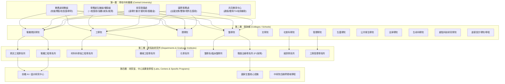

# OpenGSA 全國獎助來源藍圖、院校階層擴展與跨界補助檢索規劃

> 本文件是擴展搜尋種子與歷史規劃；未逐項查證的連結、金額、資格及免費額度不當作當期可用資源。執行設定以SCANNER.md及API-AUDIT.md為準。


> 文件性質：全域檢索規劃與架構藍圖（2026-10-30 規劃版）。
> 本文件以國立臺灣大學（NTU）作為示範藍本，規劃全校級、學院級、系所級之獎助資訊拓撲；確立未來向全臺大專院校（清大、交大、成大、政大等）擴展之標準階層模型；全面盤點政府計畫、民間基金會、企業獎助、創業補助、AI算力折抵、國際交流與青年百億海外圓夢基金之檢索範圍；並規劃 GitHub Actions 免費 tier LLM API 備援容錯架構。

---

## 1. 院校階層模型與拓撲架構（Institutional Hierarchy）

為了避免資訊扁平化導致「校內截止日與系所收件日混淆」、「非本系生誤認適用特定捐贈獎學金」，OpenGSA 建立四層階層化實體拓撲：



### 1.1 資訊流動與公文傳遞時間壓縮（Notice Compression Chain）

獎助學金在真實院校行政體系中的流動具有顯著的「前置期遞減」與「分層初審」特徵：

| 節點階段 | 典型行為 | 對期限的影響 | OpenGSA 處理原則 |
|---|---|---|---|
| **機關發布 (Originator)** | 國科會/教育部/民間基金會公告作業要點與彙送截止日 | 原始公告窗口（例如：9月30日 17:00 機關截止） | 標記為 `institution_deadline`，**嚴禁**顯示為學生截止 |
| **校級收文與轉知 (Aggregator)** | 校教務處/學務處收文，發布校內公告並分配各學院推薦配額 | 通常較機關截止提早 7–10 天（如：9月20日 17:00 校內截止） | 標記為 `university_deadline`，屬全校彙整總窗口 |
| **學院轉知與彙整 (Relayer - Tier 1)** | 學院轉發公文至各系所，要求各系提報推薦名單 | 通常較校級截止提早 3–5 天（如：9月15日 17:00 學院收件） | 標記為 `college_deadline` |
| **系所公告與初審 (Relayer - Tier 2)** | 系所公告學生收件日，預留系務會議/獎學金審查委員會評選時間 | 通常較學院截止提早 3–7 天（如：9月8日 17:00 系所截止） | 標記為 `student_deadline`（該系學生唯一真實截止日） |
| **學生實際可準備時間** | 學生自系所公告或轉發郵件獲悉至送件截止 | 窗口可能已被壓縮至 5–10 天 | 甘特圖以 `student_deadline` 為倒數基準，標記轉知壓縮天數 |

---

## 2. 臺大（NTU）全域來源拓撲盤點

### 2.1 全校級一級行政處室入口 (Central Administration)

| 序號 | 單位代碼 | 權責處室與組別 | 官方入口 URL | 核心維護方案與資訊特性 | 存取與技術特性 |
|---|---|---|---|---|---|
| 1 | `NTU-ACA-GAAD` | 教務處研究生教務組 | `https://www.aca.ntu.edu.tw/` | 國科會核配/教育部博士生獎學金、研究生校長獎、出席國際會議補助學生校內程序 | 靜態 HTML (`.article-center`)，**受轉載條款約束採 `evidence_mode: hash_only`** |
| 2 | `NTU-OSA-ADVISORY` | 學務處生活輔導組 | `https://advisory.ntu.edu.tw/` | 勵學獎學金、清寒/不利處境助學金、民間企業校友捐贈獎學金、急難救助、學雜費減免、就學貸款 | CMS 系統 (`/CMS/Scholarship?pageId=232`)，多為附件 Word/PDF 轉知 |
| 3 | `NTU-OSA-DOS` | 學務處僑生及陸生輔導組 | `https://osa_dos.ntu.edu.tw/` | 僑生清寒獎學金、優秀僑生獎助學金、僑陸生緊急醫療與就學補助 | 獨立網站公告，限定具僑生或陸生學籍 |
| 4 | `NTU-OIA` | 國際事務處 (OIA) | `https://oia.ntu.edu.tw/`<br/>`https://studyabroad.ntu.edu.tw/` | 校級海外交換學生獎學金、希望出航出國研修、境外學位生獎學金 (Governing / Outstanding)、雙聯學位補助 | 雙語動態站，含海外實習與出國獎助子網 |
| 5 | `NTU-ORD` | 研究發展處 (ORD) | `https://ord.ntu.edu.tw/` | 遠學計畫（博士生赴國外移地研究）、計畫研究助理約用標準、尖端研究補助 | 具備附件下載專區，**robots.txt 禁止 `/WebUPD/` 附件自動下載** |
| 6 | `NTU-CGE` | 共同教育中心 | `https://cge.ntu.edu.tw/` | 通識課程教學助理 (TA) 補助、兼任助理培訓與研習支持 | 動態公告索引，多與個別開課教師掛鉤 |
| 7 | `NTU-FAO` | 學生獎助學金查詢系統 (FAO) | `https://my.ntu.edu.tw/fao/` | 全校各單位與捐贈獎助歷史總庫 | **限定校內計中帳號登入**，僅作為人工比對驗證種子，不排自動爬取 |

---

### 2.2 全校所有學院級資訊入口 (11 傳統學院 + 3 跨域重點學院)

臺大共計 11 個傳統學院及近年配合國家重點政策新設之跨域學院，每個學院均具備獨立之學生規章、院級獎學金、院級出國會議補助或初審窗口：

| 學院代碼 | 學院名稱 | 官方網址 | 獎學金 / 學生事務網頁路徑 | 系統類型 | 院級專屬方案與檢索重點 |
|---|---|---|---|---|---|
| `COL-LIB` | 文學院 | `https://liberal.ntu.edu.tw/` | `/web/student/student.jsp?dm_id=DM1656910432608` | JSP 動態 CMS | 人文研習、論文著作獎、文學院院長獎、系友獎學金 |
| `COL-SCI` | 理學院 | `https://www.science.ntu.edu.tw/` | `/student-affairs/` | WordPress / PHP | 理學院院長獎、優秀學生獎學金、理學院研究生出國發表補助 |
| `COL-SOC` | 社會科學院 | `https://coss.ntu.edu.tw/` | `/News_n_10821_sms_19598.html` | 政府標準 RWD CMS | 頤賢獎學金、人社博士培育專案、社會科學研究生田野調查補助 |
| `COL-MED` | 醫學院 | `https://www.mc.ntu.edu.tw/` | 國際事務：`/oia/`<br/>研發分處：`rd.mc.ntu.edu.tw/bomrd/` | Action / ASP 混合 | 醫學院國際會議補助（會前4週）、李鎮源院長紀念獎、生醫論文獎 |
| `COL-ENG` | 工學院 | `https://www.eng.ntu.edu.tw/` | `/tc/news.aspx?pn=2&mid=9&cid=80` | ASP.NET CMS | 工學院利他獎、宗倬章先生教育基金會獎學金、工學院國際交流補助 |
| `COL-BIO` | 生物資源暨農學院 | `https://www.bioagri.ntu.edu.tw/` | `/bulletin.php` | PHP 自架系統 | 農業試驗研究獎助、生農院院長獎、農糧與生物科技捐贈獎學金 |
| `COL-MGT` | 管理學院 | `https://management.ntu.edu.tw/` | `/AboutCoM/LawsCoM#student` | RWD 企業風格 CMS | 冠德管理學術獎、管院交換學生獎助、商業個案與卓越論文競賽 |
| `COL-PH` | 公共衛生學院 | `https://coph.ntu.edu.tw/` | `/web/admissions/admissions_affairs.jsp?cp_id=CP1653651195215` | JSP 動態系統 | 陳拱北教授紀念獎學金、公衛流病田野研究獎、國際公衛年會補助 |
| `COL-EECS` | 電機資訊學院 | `https://eecs.ntu.edu.tw/` | `/zh_tw/Studentinformation/stu1` | Drupal / RWD | 電資學院頂尖博士培育專案、科技大廠聯名獎學金、電資會議 travel grant |
| `COL-LAW` | 法律學院 | `https://www.law.ntu.edu.tw/` | `/index.php/獎學金-徵才公告` | Joomla / PHP | 萬國法律獎學金、理律文教論文獎、各法學基金會專題論文獎助 |
| `COL-LS` | 生命科學院 | `https://cols.ntu.edu.tw/` | `/regulations-student.html` | 靜態/動態混合 | 生科院院長獎、分子生科出國補助、生科系所捐贈培育基金 |
| `COL-GSAT` | 重點科技研究學院 (半導體) | `https://gsat.ntu.edu.tw/` | 官方公告 / 學生專區 | 新設 RWD 網站 | 國家重點領域博士生高額獎學金（配合半導體、AI、前瞻製造產業） |
| `COL-DSCH` | 創新設計學院 (D-School) | `https://dschool.ntu.edu.tw/` | 專題孵化 / 創新學程公告 | 新創風格 SPA | 跨領域創新專案補助、學生創業實踐基金、原型打樣支持 |
| `COL-EXTENSION`| 進修推廣學院 | `https://extension.ntu.edu.tw/` | 終身學習 / 專案公告 | 商業推廣系統 | 多屬在職專班（**通常標記為一般獎學金排除對象**） |

---

### 2.3 代表性系所拓撲範例（Department / Institute Level）

各系所擁有獨立之系辦收件系統、系友捐贈專戶與特定企業指名合作，其收件期限往往早於學院與校級：

```
電資學院 (COL-EECS)
  ├── 電機工程學系 (DEP-EE, ee.ntu.edu.tw)
  │     ├── 特色方案：學士班專題研究培育獎學金、程欲明獎學金、何宜慈博士紀念獎助金
  │     └── 傳遞機制：系辦統一初審並提送電資學院，提早校級截止日 5 個工作天
  └── 資訊工程學系所 (DEP-CSIE, csie.ntu.edu.tw)
        ├── 特色方案：電資學院頂尖博士培育專案、台達電工業獎學金、玉山傑出人才、科林研發論文獎
        └── 資訊系統：建有內部獨立之「研究生獎勵金/課程助教申請系統」，要求線上登記與紙本繳交

工學院 (COL-ENG)
  ├── 化學工程學系 (DEP-CHE, che.ntu.edu.tw)：錢思亮先生紀念獎學金、台聚教育基金會獎學金
  └── 材料科學與工程學系 (DEP-MSE, mse.ntu.edu.tw)：中鋼獎學金、應用材料培訓獎助

理學院 (COL-SCI)
  └── 化學系所 (DEP-CHEM, chem.ntu.edu.tw)：周大紓教授紀念獎、台橡獎學金、國際會議發表差旅補助

醫學院 (COL-MED)
  └── 職能治療學系所 (DEP-OT, ot.ntu.edu.tw，P1驗收案例對象)：
        ├── 特色方案：生醫及復健醫學專案論文獎、國際復健學會參會補助
        └── 行政路徑：經醫學院研發分處初審彙整送校研發處/研教組
```

---

### 2.4 可擴展至全國大專院校之階層化資料規範 (Institutional Hierarchy Schema)

未來將收錄範圍擴充至國立清華大學 (NTHU)、國立陽明交通大學 (NYCU)、國立成功大學 (NCKU)、國立政治大學 (NCCU) 等校時，統一代碼與結構格式定義如下：

```json
{
  "$schema": "https://json-schema.org/draft/2020-12/schema",
  "title": "InstitutionalHierarchyNode",
  "type": "object",
  "required": ["institution_id", "tier", "name_zh", "url", "announcer_role"],
  "properties": {
    "institution_id": {
      "type": "string",
      "description": "階層唯一識別碼，格式為 [學校]-[單位]-[系所]，例：NTU-COL-EECS-CSIE、NTHU-ACA-GAAD"
    },
    "tier": {
      "type": "string",
      "enum": ["central_university", "college", "department_institute", "research_center_lab"]
    },
    "parent_id": {
      "type": ["string", "null"],
      "description": "上一層節點識別碼，根節點為 null"
    },
    "name_zh": { "type": "string" },
    "name_en": { "type": ["string", "null"] },
    "url": { "type": "string", "format": "uri" },
    "announcer_role": {
      "type": "string",
      "enum": [
        "originator",          // 原始出資/法規制定單位
        "aggregator",          // 校級彙整與函報機關單位
        "relayer_college",     // 學院層級轉知與名額篩選單位
        "relayer_department"   // 系所層級收件與初審初判單位
      ]
    },
    "default_lead_time_days": {
      "type": "integer",
      "description": "相對於上級截止日，該節點通常提前要求收件的工作日天數 (通常為 3-7 天)"
    },
    "system_architecture": {
      "type": "string",
      "enum": ["static_html", "standard_cms", "dynamic_spa_requires_render", "login_restricted"]
    }
  }
}
```

---

## 3. 政府機關國家級計畫獎助來源全面盤點

中央部會及附屬法人研究機構提供碩博士生最重要的基礎研究支持與高額公費：

### 3.1 國家科學及技術委員會 (NSTC)

| 計畫代碼 | 正式法規 / 計畫名稱 | 官方入口 / 法規資料庫 | 適用學籍與身分 | 補助額度與期限 | 關鍵申請時程與程序分流 |
|---|---|---|---|---|---|
| `NSTC-PHD-COMPETITIVE` | 國家科學及技術委員會博士生研究獎學金（國科會甄選類） | `https://www.nstc.gov.tw/`<br/>學術研發服務網 | 博士班一年級新生（具中華民國國籍，排除在職全時） | 每月 **40,000 元**，獎勵期間 **3 年**（最高 144 萬） | 每年 9–10 月開放個人線上直接向國科會申請；全國統一競爭評選 |
| `NSTC-PHD-ALLOCATED` | 國家科學及技術委員會博士生研究獎學金（大專校院核配類） | 各校教務處/研教組（依國科會核配名額） | 博士班在學生（新生或舊生，依各校規定；排除在職與陸生） | 每月 **40,000 元**，至多 **3 年** | 國科會核配名額給各大學，由各校/系所自行訂定要點與校內申請時程 |
| `NSTC-CHILIMA` | 補助博士生赴國外研究作業要點（千里馬計畫） | `https://law.nstc.gov.tw/LawContent.aspx?id=FL004652` | 國內大學博士班在學 1 年以上，中華民國國民 | 以年計約 **90 萬元**（按出國月數 7–12 個月比例核發） | 每年 6 月 1 日至 7 月 31 日中午 12:00 線上申請，學校造冊函送 |
| `NSTC-CONFERENCE` | 補助國內研究生出席國際學術會議作業要點 | `https://law.nstc.gov.tw/LawContent.aspx?id=FL038260` | 國內在學博/碩士生，具口頭或壁報發表論文 | 往返機票、會議註冊費、生活費（按地域上限核銷） | 會議舉行首日所屬月份之**前一個月首日**機構彙送；臺大校內為前一日 17:00 |
| `NSTC-RESEARCH-PERSONNEL`| 補助專題研究計畫研究人力約用注意事項（含博士生費用增核） | `https://law.nstc.gov.tw/LawContent.aspx?id=FL028686` | 專題計畫約用之兼任助理（在學碩博士生） | 學生兼任最低 6,000 元；**博士生獲增核者總額至少 16,000 元/月**（增核 1 萬元） | 隨專題研究計畫申請書提出或由計畫主持人依校內程序申請變更 |

---

### 3.2 中央研究院 (Academia Sinica)

| 計畫代碼 | 正式法規 / 計畫名稱 | 官方入口 / 主辦單位 | 適用學籍與身分 | 補助額度與期限 | 關鍵申請時程與程序 |
|---|---|---|---|---|---|
| `SINICA-HUMANITIES-PHD` | 中央研究院人文社會科學博士候選人培育計畫要點 | 學術及儀器事務處 (DAAIS)<br/>`https://daais.sinica.edu.tw/` | 國內外大學人社學系已修畢課程、取得**博士候選人資格**且未兼職者 | 每月獎勵金 **50,000 元**，為期 **1 年**（期滿可依規申請展延） | 每年約 1 月至 3 月初受理；由中研院各人社所中心初審後報院核定 |
| `SINICA-TIGP` | 臺灣國際研究生學程 (TIGP Fellowship) | `https://tigp.sinica.edu.tw/` | 與臺、清、交、成等合辦之 13 個跨領域學程在學博士生（本外籍皆可） | 每月約 **34,000–40,000 元**，提供 2–3 年 | 隨秋季/春季班招生甄審入學核定，每年定期考核學業與研究表現 |
| `SINICA-INSTITUTE-GRANTS`| 各研究所/研究中心研究生培育與專題獎助（如資訊所、分生所） | 各所官方網站公告（如 `iis.sinica.edu.tw`, `imb.sinica.edu.tw`） | 碩博士生在各所研究人員實驗室從事論文研究者 | 依各所標準，碩士約 10,000–25,000 元/月，博士約 25,000–50,000 元/月 | 由各所實驗室指導老師推薦，依各所內部徵選期程辦理 |

---

### 3.3 教育部 (MOE) 及青年發展署 (YDA)

| 計畫代碼 | 正式法規 / 計畫名稱 | 官方入口 / 專區 | 適用學籍與身分 | 補助額度與期限 | 關鍵申請時程與排斥性限制 |
|---|---|---|---|---|---|
| `MOE-PHD-SUBSIDY` | 教育部博士生獎學金補助計畫作業要點 | 教育部高等教育司<br/>`https://www.moe.gov.tw/` | 博士班 1 至 3 年級非在職學生，具中華民國國籍 | 每月原則 **40,000 元**（教育部 3 萬＋產學配合款 1 萬） | 由大學提報計畫後校內甄選；**嚴格禁止重複請領國科會博士生研究獎學金** |
| `MOE-GOV-STUDY-ABROAD` | 公費留學考試與留學獎學金甄試 | `https://www.scholarship.moe.gov.tw/` | 具中華民國國籍之學士/碩士畢業生攻讀境外碩博士 | 公費留學依地區每年約 3.5–4.5 萬美元；留獎每年約 1.6 萬美元 | 留學獎學金每年 1–2 月報名；公費留學每年 7–8 月報名 |
| `MOE-STUDY-ABROAD-SERIES`| 教育部學海系列（學海惜珠、學海飛颺、學海築夢、新南向學海築夢） | 國內大學國際處統籌<br/>`studyabroad.moe.gov.tw` | 在學碩博士生（惜珠限弱勢戶；築夢限實習專案） | 機票款＋生活費，每人約 10 萬至 30 萬元不等 | 學校每年 3 月中旬向教育部提出申請；學生依校內甄選期程提早 1–2 個月送件 |

---

### 3.4 經濟部、國發會、衛福部等中央專門計畫

| 部會單位 | 計畫名稱 | 官方網址 | 補助性質與學生受益機制 | 檢索與維護備註 |
|---|---|---|---|---|
| **經濟部 (MOEA)** | 產業高階人才培訓計畫 / 產學合作推動方案 | `https://www.moea.gov.tw/` | 博士後及高年級博士生赴企業從事專題實習，提供實習津貼 | 屬單位申請學生受益，需確認學生聘僱與津貼契約 |
| **國家發展委員會 (NDC)**| 國家發展基金創業天使投資計畫 | `https://www.angelfund.org.tw/` | 青年創業種子資金投資（最高匹配 2,000 萬） | 屬創業投資而非生活獎助，適合學生衍生新創公司 |
| **衛生福利部 / 國衛院** | 國家衛生研究院生醫研究生整合型培訓獎助 | `https://www.nhri.edu.tw/` | 生醫領域博士生在國衛院合作實驗室受訓津貼 | 限生醫、衛政、流病相關領域研究生 |
| **外交部 (MOFA)** | 國際青年大使交流計畫 / NGO 海外實習補助 | `https://www.mofa.gov.tw/` | 補助在學生短期赴海外參訪或國際非政府組織實習 | 每年春季徵選，涵蓋機票、食宿與培訓費用 |

---

## 4. 民間非營利組織與企業獎學金全面盤點

### 4.1 知名指標性財團法人基金會

| 基金會代碼 | 基金會名稱 | 指標性獎項名稱 | 官方入口 URL | 適用對象與金額 | 申請時程與特色 |
|---|---|---|---|---|---|
| `FAOS` | 財團法人傑出人才發展基金會 | 優秀學生出國開會補助 | `https://www.faos.org.tw/` | 國內在學碩博士生赴國外學術會議發表論文；補助機票與生活費 | **會前 2 個月由學校提出**；學生校內期限另查，接受函為必備附件 |
| `CTCI` | 財團法人中技社 | 科技獎學金（研究/創意/境外生） | `https://www.ctci.org.tw/` | 理工博士生（研究獎學金 15 萬）；碩士生團隊（創意獎學金 15 萬）；境外生（15 萬） | 每年 7 月 1 日至 9 月 10 日線上受理；**具民間獎學金排斥條款** |
| `HTK` | 財團法人台北行天宮 | 行天宮資優學生長期培育獎助學金 / 急難濟助 | `https://www.ht.org.tw/` | 學業優異或具特殊專長（科學、體育、藝能）之碩博士生（每學期數萬元） | 每年 2–3 月與 8–9 月分期受理；宗教慈善組織但**無信仰限制** |
| `WCS` | 財團法人吳健雄學術基金會 | 孟粹珠獎學金 / 女性科學人才培育 | `https://www.wcs.org.tw/` | 國內大學女性博士生（理工生醫領域），優秀研究表現 | 每年上半年公告，表彰女性傑出科學研究人才 |
| `PAN` | 財團法人潘文淵文教基金會 | 考察研究獎助金 / 論文獎 / 獎學金 | `https://pan.itri.org.tw/` | 電子、資通訊、半導體領域博士生與青年學者（最高 30 萬元） | 每年 2 月 15 日左右截止收件；著重前瞻半導體與 AI 架構考察 |
| `YZHSU` | 財團法人徐有庠先生紀念基金會 | 有庠科技論文獎 / 有庠科技講座 | `https://yzhsu.feg.com.tw/` | 奈米科技、資通訊、光電、生技醫藥、綠色科技領域（論文獎 20 萬元） | 每年 11 月至次年 1 月受理；須查明作者序與研究生受獎代表身分 |
| `SOONG` | 財團法人宋作楠先生紀念教育基金會 | 碩士論文獎 / 獎助學金 | `https://www.soongsan.org.tw/` | 會計、審計、財務、管理相關領域碩博士論文 | 每年 8–9 月收件，國內商管領域最具公信力之論文獎之一 |
| `TIER` | 財團法人台灣經濟研究院 / 台灣綜合研究院 | 產經政策研究獎學金 / 論文獎 | `https://www.tier.org.tw/`<br/>`https://www.tri.org.tw/` | 經濟、產業政策、綠能轉型相關領域研究生論文獎助 | 不定期徵件或年度論文獎，金額約 3 萬至 10 萬元 |

---

### 4.2 科技龍頭與產業企業獎學金

| 企業名稱 | 獎學金計畫全稱 | 官方入口 | 適用領域與對象 | 金額與給付方式 | 權益義務與限制 |
|---|---|---|---|---|---|
| **台積公司 (TSMC)** | 台積電博士獎學金 (TSMC PhD Fellowship) | `https://www.tsmc.com/` | 半導體、物理、化學、電機、材料等領域博一新生或準博士生 | **每年 50 萬元**，至多補助 **5 年**（最高 250 萬元） | 需指導教授推薦；安排主管擔任業師；畢業後審核優先任用 |
| **聯發科技 (MediaTek)**| 聯發科技博士生研究獎學金 | 聯發科技創新研究中心<br/>及各校電資學院公告 | 電機、資工、晶片設計、通訊通訊領域專職博士生 | **每月 35,000 至 50,000 元**，為期 3 至 4 年 | 須為專職學生，切結未受其他營利公司全額獎學金 |
| **鴻海教育基金會** | 鴻海獎學鯨 (Foxconn Educational Scholarship) | `https://www.foxconnfoundation.org/` | 大專院校及碩博士在學學生（修業年限內） | 碩博士生一學年統一給付 **50,000 元** | 限家境清寒/邊緣戶/突遭變故，碩博士需繳交研究論文計畫書 |
| **台達電子 (Delta)** | 台達科技與環境研發獎學金 | 台達電子文教基金會<br/>`https://www.delta-foundation.org.tw/` | 電力電子、智慧製造、綠能減碳相關碩博士生 | 每年 10 萬至 30 萬元不等，提供研發實習對接 | 鼓勵綠能技術創新，常與各校產學合作中心共同辦理 |
| **Google** | Google PhD Fellowship | `https://research.google/outreach/phd-fellowship/` | 電腦科學、機器學習、語音處理等領域全職博士生 | 學費補助＋生活津貼（依地區約 1–3 萬美元）＋業師指導 | 須由大學系所官方提名，不接受學生個人無推薦直接申請 |
| **微軟 (Microsoft)** | Microsoft Research PhD Fellowship | `https://www.microsoft.com/en-us/research/academic-program/` | 亞太區電腦科學與前瞻計算領域博士生 | 提供為期 2 年獎助金（約 1 萬美元/年）＋雷德蒙/北京實習機會 | 競爭極激烈，需經學校系所評選推薦 |
| **輝達 (NVIDIA)** | NVIDIA Graduate Fellowship Program | `https://www.nvidia.com/en-us/research/graduate-fellowships/` | GPU 計算、生成式 AI、圖學、晶片設計相關博士生（完成博一者） | 高達 **50,000 美元** 獎助金＋搶先體驗 GPU 硬體技術 | 需已完成博士第一年研究，提交論文題目與成果證明 |

---

### 4.3 金融金控與文教基金會

| 金控集團 | 獎學金 / 論文獎名稱 | 官方網址 | 適用對象與金額 | 檢索備註 |
|---|---|---|---|---|
| **富邦金控** | 富邦文教基金會 / 富邦人壽管理碩士論文獎 | `https://www.fubon.org/` | 全國商管碩博士優秀畢業論文（首獎 10 萬元） | 與中華民國管理科學學會合辦，每年 5–7 月徵件 |
| **國泰金控** | 國泰卓越獎助計畫 | `https://www.cathay-charity.org.tw/` | 青年領袖探索、社會創新、特殊專長大專及碩士生 | 包含特色創新與社會實踐補助（每案數萬至 20 萬元） |
| **玉山金控** | 玉山培育傑出人才獎學金 / 玉山學術獎 | `https://www.esunfhc.com/` | 管理、科技、AI生醫優秀碩博士生（每年最高 10 萬至 20 萬元） | 部分專案限指定合作院校（如臺大、政大、清大、交大） |
| **中國信託** | 中信文教基金會 / 優秀學生獎助 | `https://www.ctbcfoundation.org/` | 經濟不利優秀學子、法律與金融專案研究補助 | 結合偏鄉扶助與專業領域產學合作 |
| **元大金控** | 元大文教基金會優秀人才獎助學金 | `https://www.yuanta.com/` | 全國大專及研究所清寒且成績優異學生（每人 20 萬元） | 獎助金額名列金控前茅，每年 8–9 月由學校推薦提報 |

---

## 5. 跨界多元補助檢索範圍（非純學術獎學金）

### 5.1 創業補助與學生新創育成 (Entrepreneurship Grants)

| 計畫代碼 | 計畫名稱 | 主管機關 / 執行單位 | 官方網站 | 補助額度與機制 | 學生參與條件與檢索特性 |
|---|---|---|---|---|---|
| `GR-FITI` | 創新創業激勵計畫 (FITI) | 國科會指導<br/>國研院科政中心 (STPI) | `https://fiti.stpi.narl.org.tw/` | 最高 **100 萬元** 創業種子金；為期 6 個月營隊與業師輔導 | 團隊成員公私立大專院校在校生/專任研究人員比例**須達 50% 以上**；須專任教師推薦 |
| `GR-USTART` | U-start 創新創業計畫 | 教育部青年發展署 | `https://ustart.yda.gov.tw/` | 第一階段 50 萬（創業款 35 萬＋學校育成費 15 萬）；第二階段績優團隊 **35 至 100 萬元** | 結合大專院校育成中心共同提案；青年與學生新創主流首選 |
| `GR-TEC` | 臺大創創加速器 / 校園孵化器 | 臺大創創中心 (TEC) | `https://tec.ntu.edu.tw/` | 空間進駐、企業對接、校友天使網絡、Prototype 開發支持金 | 限校內學生與青年團隊，分為個人孵化組與加速器組 |
| `GR-NDF-ANGEL` | 國發基金創業天使投資方案 | 國家發展委員會 | `https://www.angelfund.org.tw/` | 早期新創企業股權投資（最高 2,000 萬元投資搭配） | 須已辦妥公司登記，適合從學生實驗室技術衍生之新創法人 |
| `GR-LOCAL-YOUTH`| 地方政府青年創業補助（北市SITI、新北、桃園等） | 各縣市青年局/產發局 | 如北市產發局 `siti.gov.taipei` | 創新研發補助款（50 萬至 100 萬元不等，需檢附會計核銷） | 戶籍或公司登記設於該縣市之在學青年或畢業生 |

---

### 5.2 AI 工具與雲端算力補助 (AI Compute & Cloud Credits)

碩博士從事 AI、計算生物學、材料模擬與物理運算需要龐大算力支撐，目前國內外均有針對學研提供之免費或高額折抵點數：

| 資源代碼 | 平台 / 計畫名稱 | 提供主體 | 申請入口網址 | 額度與資源規格 | 申請路徑與注意事項 |
|---|---|---|---|---|---|
| `COMP-TWCC` | TWCC 臺灣 AI 雲 / 台灣杉系列超級電腦 | 國家高速網路與計算中心 (NCHC) | `https://iservice.nchc.org.tw/`<br/>`https://twcc.ai/` | 台灣杉二號/晶創26 GPU (V100/H200/GB200) 容器運算、CPU 虛擬機與高速儲存 | 透過 **iService 計算資源服務網**，由指導教授國科會專案或學術優惠方案開通帳號 |
| `COMP-GCP` | Google Cloud Research Credits | Google Cloud for Education | `https://edu.google.com/programs/credits/research/` | 學生個人專案 1,000–5,000 美元；教研專案高達 **10,000–50,000 美元** GCP 額度 | 需提出 1–2 頁研究計畫書與架構估算；審核通過後發放 GCP Coupon 點數 |
| `COMP-AWS` | AWS Cloud Credit for Research | Amazon Web Services | `https://aws.amazon.com/research-credits/` | 單一學術專題 5,000 至 20,000 美元抵用券 | 限學術研究使用，每年多梯次審查，審核重點在於雲端架構合理性 |
| `COMP-AZURE` | Microsoft Azure Research Grants | Microsoft for Startups & Research | `https://www.microsoft.com/en-us/research/` | 專題研究抵用額度（數千至數萬美元），包含 Azure OpenAI Service 額度 | 需透過大學校方網域信箱申請，支持大型開源模型微調與推理 |
| `COMP-OPENAI` | OpenAI Researcher Access Program | OpenAI Academic Outreach | `https://openai.com/form/researcher-access-program/` | 免費 API 額度（通常 500 至 5,000 美元），存取 GPT-4o 等先進模型 | 針對 AI 安全、倫理、跨學門創新研究之研究生與學者 |

---

### 5.3 國外交流與國際研究交流機構 (Overseas Mobility)

| 機構代碼 | 機構名稱 | 官方入口 URL | 代表性獎助方案 | 適用學制與特點 |
|---|---|---|---|---|
| `MOB-FULBRIGHT`| 學術交流基金會 (Fulbright Taiwan) | `https://www.fulbright.org.tw/` | 博士論文研究獎助金 (Fulbright Doctoral Dissertation Research) | 國內大學博士候選人赴美進行 6–10 個月論文研究，全額生活費與保險支持 |
| `MOB-DAAD` | 德國學術交流總署 (DAAD) | `https://www.daad.de/`<br/>資訊中心：`daad.org.tw` | 博士生短期研究獎學金、台德三明治計畫 (Sandwich Program) | 赴德從事 1 至 6 個月研究，每月生活津貼約 1,300 歐元＋機票與保險 |
| `MOB-FRANCE` | 法國在台協會 / 法國教育中心 (Campus France)| `https://www.taiwan.campusfrance.org/` | 幽蘭計畫 (Orchid Program)、台法博士雙聯獎學金 | 針對台法雙邊實驗室共同指導之博士生提供移動差旅補助 |
| `MOB-CHEVENING`| 英國文化協會 (British Council) / Chevening | `https://www.chevening.org/` | 英國政府獎學金 (Chevening Scholarships) | 全額資助赴英修讀 1 年制碩士學位（學費、生活費、機票全包） |
| `MOB-JAPAN` | 公益財團法人日本台灣交流協會 | `https://www.koryu.or.jp/` | 訪日研究獎學金（碩博士生短期訪日研習） | 赴日進行 1 至 3 個月短期研究，提供往返機票與日支生活費 |
| `MOB-HORIZON` | 歐盟執委會 Horizon Europe / MSCA | `https://ec.europa.eu/` | 瑪麗居禮計畫 (Marie Skłodowska-Curie Actions Doctoral Networks) | 歐洲頂尖跨國跨機構研究學程，外加國際差旅津貼 |

---

### 5.4 青年百億海外圓夢基金計畫 (MOE Pathfinder Flagship)

由行政院跨部會策劃、教育部青年發展署主責之 100 億元旗艦專案，全面支援青年自主提案開拓國際視野：

| 項目維度 | 官方規格與規範 |
|---|---|
| **專案名稱** | 青年百億海外圓夢基金計畫 |
| **官方入口** | `https://twpathfinder.org/`（教育部青年署官方平台） |
| **預算規模** | 4 年編列新臺幣 100 億元 |
| **適用年齡** | 具中華民國國籍之 **15 歲至 30 歲** 青年（碩博士在學學生年齡相符者皆可申請） |
| **主要組別 1：築夢工場組** | **青年自主提案**：由青年個人或團隊自行提出赴海外交流、研習、考察或多元創意行動之企劃書（期程 2 週至 1 年），通過後獲得創業及孵化補助金與專業業師指導 |
| **主要組別 2：海外翱翔組** | **部會媒合旗艦提案**：由政府部會對接國際組織、國際智庫、全球非政府組織 (NGO)、海外科研院所與跨國企業，提供青年專案見習、蹲點研究與高階實習職缺 |
| **弱勢助力機制** | 特別保留「圓夢助力方案」名額，針對低收入戶、中低收入戶及特殊境遇青年提供全額旅費與加額生活津貼 |
| **OpenGSA 收錄策略** | 追蹤 `twpathfinder.org` 之各梯次公告；由於其提案涵蓋科研、永續、文創與社會公益，標記為 `cross_disciplinary_mobility`，並分列「自主企劃」與「機構媒合」雙管道 |

---

## 6. 核心檢索關鍵字庫與 Taxonomy 映射

依據現有儲存庫台帳（`N01`–`N15`、`N02`/`N03`/`N04` 三份原始彙整 PDF、`CONFERENCE-SOURCES.md` 等）提煉之關鍵字矩陣，做為爬蟲與搜尋引擎 Dorks 之標準化詞庫：

### 6.1 七大主題關鍵字庫 (Taxonomy Keyword Matrix)

```
[A1] 就學與生活支持 (Living & Financial Aid)
  中文：獎學金、獎助學金、助學金、清寒助學金、不利處境、弱勢助學、生活津貼、生活助學金、勵學獎學金、就學貸款、學雜費減免、校友捐贈、急難救助
  英文：scholarship, fellowship, financial aid, bursary, stipend, living allowance, tuition waiver, student loan, hardship fund

[A2] 研究與人才培育 (Research & Doctoral Fellowship)
  中文：博士生研究獎學金、博士候選人培育、撰寫博士論文獎助、逕行修讀博士提升計畫、優秀研究生獎勵金、研究津貼、尖端科技人才、專題研究計畫約用
  英文：doctoral fellowship, PhD studentship, dissertation grant, graduate research fellowship, research assistant stipend

[A3] 成果與榮譽獎勵 (Awards & Recognition)
  中文：研究生校長獎、優秀著作獎、博士論文獎、碩士論文獎、期刊論文發表獎勵、壁報論文獎、學術競賽、國家新創獎、有庠科技論文獎
  英文：best paper award, thesis award, dissertation prize, presidential award, research excellence award, poster prize

[A4] 國際會議與學術交流 (Conference Travel Grants)
  中文：出席國際學術會議補助、國際會議差旅費、口頭發表補助、壁報發表補助、機票款補助、註冊費減免、會前四週、前月首日、四週前補送
  英文：travel grant, conference grant, conference attendance support, registration fee waiver, mobility support

[A5] 境外研究與移動學習 (Overseas Mobility & Visiting)
  中文：千里馬計畫、遠學計畫、出國移地研究、交換學生獎學金、雙聯學位獎助、希望出航、學海惜珠、學海飛颺、學海築夢、新南向築夢、青年百億海外圓夢基金、築夢工場、海外翱翔
  英文：overseas research stay, visiting PhD student, sandwich program, exchange scholarship, dual degree fellowship, study abroad grant

[A6] 創業與專案孵化 (Entrepreneurship & Incubation)
  中文：創新創業激勵計畫、FITI、U-start、創業天使、種子資金、校園加速器、專案研發補助、原型打樣金
  英文：startup grant, seed fund, entrepreneurship incentive, incubator grant, prototype funding

[A7] AI 工具與算力補貼 (AI Tools & Compute Grants)
  中文：國網中心、TWCC、臺灣AI雲、台灣杉、晶創、GPU算力補助、算力點數、雲端研發折抵、Cloud Credits、Azure Research、GCP Research
  英文：cloud credits, GPU compute grant, compute allocation, research credits, HPC access
```

### 6.2 否定條件與資格排除詞庫 (Negation Keywords)

抓取與萃取器在解析資格文本時，若命中下列詞彙，強制進入否定邏輯檢核：

* **身分排除**：`在職專班`、`在職生`、`帶職借調`、`具有全職工作者`、`休學期間`、`延修生`、`公費生`、`國防生`。
* **兼領排除**：`不得重複領取`、`同性質政府獎助不得兼領`、`擇一受領`、`已獲其他全額獎學金者除外`、`需切結未在其他公私立機構受領工資`。
* **學制年級排除**：`限大一至大四`、`限碩士班`、`限修業年限第一至三年`、`博四以上不得申請`。

---

## 7. API與成本限制（2026-10-30更新）

舊版的固定免費額度、Llama 3.3跨平台預設與三把金鑰瀑布備援提案已撤換。正式對照由[data/model-providers.json](../data/model-providers.json)維護，官方依據、8組Secret對應及本次Actions結果見[API查核](API-AUDIT.md)。

每次手動選一個Provider；額度不足、401／402／403或429時停止外部推論並保留規則結果，不自動改用付費模型。目錄可讀、帳戶通過驗證、模型能輸出JSON、帳戶免費額度及key效期分別記錄，未知不填零或永久有效。hash_only永不外送；排程模型關閉。

## 8. 驗收與後續實作路徑 (Roadmap & Next Steps)

- [x] **全域來源拓撲規格確立**：建立全校級、11 院＋3 跨領域學院、代表性系所架構與階層化 Schema。
- [x] **全方位資助管道盤點**：涵蓋國科會、中研院、教育部、民間基金會、科技企業、創業補助 (FITI/U-start)、AI算力 (TWCC/公有雲)、國際交流 (Fulbright/DAAD) 與青年百億海外圓夢基金平台 (`twpathfinder.org`)。
- [x] **學術生涯進階與校園助教工讀深度盤點**：研討會出國五層補助網絡、千里馬/雙聯學位、碩博候選人博士後身分專屬獎助、斐陶斐榮譽學會、優秀青年、助教（TA）多軌聘任（EMITA）與 4k–50k 薪資級距已完整獨立建檔於 [學術生涯與助教工讀深度盤點](ACADEMIC-CAREER-AND-ASSISTANTSHIPS.md)。
- [x] **核心詞庫與否定語法收錄**：提煉 7 大主題關鍵字、排斥條款過濾詞與檢索語法。
- [x] **GitHub Actions 免費 API 備援容錯設計**：完成 Gemini（Primary）+ Groq（Secondary）+ Mistral（Tertiary）三級瀑布斷路器機制規劃。
- [ ] **下一階段待辦**：
  1. 待非原編輯者覆核本規劃文檔，確認各學院系所拓撲命名規範。
  2. 依階層模型評估在 `data/scan-sources.json` 漸進增加第二批 3–5 個具備高價值且允許抓取的公開學院來源（如電資學院頂尖博士培育公告）。
  3. 維持每週二、五既有低頻無模型掃描，待人工資料 PR 完善正式資料集。
