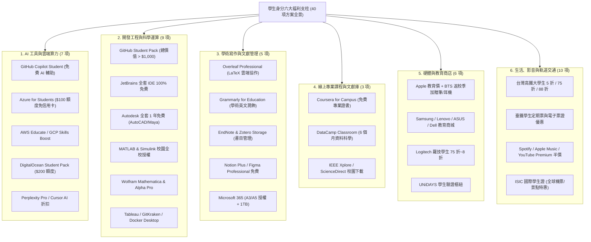
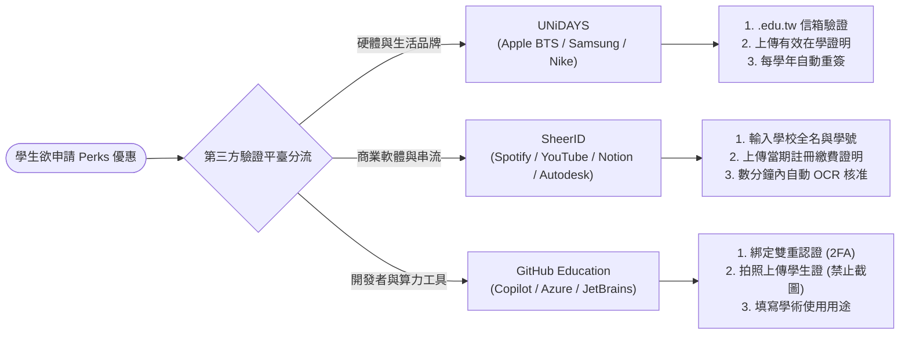

# 全球與臺灣學生身分（Student Perks）軟硬體、雲端與生活福利第二梯次擴展調研報告

> **版本**：2.0.0-student-perks-expansion  
> **更新時間**：2026-11-06  
> **關聯資料**：
> - 學生身分福利基準台帳：[`data/student-perks-baseline.json`](../data/student-perks-baseline.json)（收錄 **40 項** 代表性方案）
> - 學生福利候選清冊：[`data/candidates/student-perks.json`](../data/candidates/student-perks.json)（28 方案第一梯次）
> - 學生 Perks 資訊鏈批次：[`data/source-chain-batches/batch-perks.json`](../data/source-chain-batches/batch-perks.json)
> - 第一梯次深度報告：[`docs/STUDENT-SOFTWARE-HARDWARE-AND-AI-PERKS.md`](docs/STUDENT-SOFTWARE-HARDWARE-AND-AI-PERKS.md)

---

## 1. 執行摘要：學生身分百寶箱價值再評估

在求學與學術研究歷程中，除了直接的獎助學金與研究計畫薪資之外，「**學生身分（Student Identity）**」本身就是極具經濟價值的資產。善用合法正規的學生教育授權與折扣福利，每位在校學生（從國高中職、大專院校到博碩士研究生）每年可為自己與實驗室省下 **NT$60,000 至 NT$150,000 以上** 的高昂開銷。

本輪在第一梯次 28 項福利的基礎上，深入盤查學術寫作、科學運算、雲端部署與大專生軌道交通生活，正式將基準台帳擴展至 **40 項全方位福利**：

---

## 2. 第二梯次 12 項新增核心福利深度剖析

---

### 2.1 學術寫作與科研文獻管理 (Academic Writing & Reference)

#### 1. Overleaf Professional for Students（雲端 LaTeX 協作平台）
- **官方連結**：[https://www.overleaf.com/edu](https://www.overleaf.com/edu)
- **福利類型**：**100% 免費或大專校院全校授權**（一般專業版訂價 $15/月，年省約 NT$5,800）
- **核心亮點**：
  - 支援無限制協作者即時共同編輯（Real-time Collaboration），實驗室研究生與指導教授可同屏編修論文。
  - 完整版本歷史回溯與對比（Full History & Track Changes），可精確找回任一時間點之修訂版本。
  - 內建 Git 雙向同步整合與 Dropbox 備份。
  - 收錄數千套 IEEE、ACM、Springer、Elsevier、Nature 期刊與碩博士論文官方 LaTeX 範本。
- **認證方式**：以具備全校授權之大學教育信箱（.edu.tw）直接註冊升級；或透過加入 IEEE 學生會員取得專屬優惠代碼。

#### 2. Grammarly for Education & QuillBot Student（學術英文寫作潤飾）
- **官方連結**：[https://www.grammarly.com/edu](https://www.grammarly.com/edu)
- **福利類型**：**全校授權免費或學生個人約 50% 折扣**（年省約 NT$4,500）
- **核心亮點**：
  - 專為非英語母語學者設計，即時偵測冠詞誤用、時態矛盾與懸空修飾語。
  - 提供「學術語調（Academic Tone）」重寫建議，使論文遣詞更符合國際審稿人口味。
  - 內建學術防剽竊（Plagiarism Checker）檢測功能，避免引用不當爭議。
- **認證方式**：透過學校單一簽入 (SSO) 入口直接啟用，或以校園郵箱取得專案教育折價。

#### 3. EndNote & Zotero Storage（學術書目管理與文獻庫）
- **官方連結**：[https://endnote.com/](https://endnote.com/)
- **福利類型**：**全台主要大學圖書館全校授權免費下載安裝**（商業版單機買斷約 NT$8,000）
- **核心亮點**：
  - 碩博士論文開題與文獻回顧必備，一鍵從 Web of Science、Google Scholar 匯入書目與 PDF 全文。
  - 與 Microsoft Word「Cite While You Write (CWYW)」深度整合，切換期刊格式（APA 7th, IEEE, Nature, MLA）秒級重新排版。
  - Zotero 則可透過學校教育郵箱取得無上限雲端附件儲存空間。
- **認證方式**：登入各大學圖書館電子資源查詢系統或校園授權軟體專區下載合法金鑰安裝。

---

### 2.2 科學運算與工程分析 (Scientific Computing)

#### 4. Wolfram Mathematica & Wolfram|Alpha Pro（符號運算旗艦）
- **官方連結**：[https://www.wolfram.com/mathematica/](https://www.wolfram.com/mathematica/)
- **福利類型**：**全校校園授權免費安裝**（單機商業授權年費逾數萬元）
- **核心亮點**：
  - 全球最頂尖之符號代數系統（CAS），精確解各類非線性微分方程、向量微積分與張量分析。
  - 內建 Wolfram|Alpha Pro 引擎，提供逐步推導解析（Step-by-step solutions）。
  - 提供跨平台 Windows / macOS / Linux 本機安裝版與 Wolfram Cloud 雲端筆記本。
- **認證方式**：各大專校院計算機中心授權軟體專區線上登記領取 Activation Key。

---

### 2.3 雲端開發與基礎建設 (Cloud & Developer Tools)

#### 5. DigitalOcean Student Cloud Credits（$200 雲端主機額度）
- **官方連結**：[https://www.digitalocean.com/](https://www.digitalocean.com/)
- **福利類型**：**$200 美元免費雲端額度（效期 1 年）**（價值約 NT$6,500）
- **核心亮點**：
  - 專門適合資工、資料科學學生部署開源專案、研究模型演示 (Demo Web App) 或微服務。
  - 可開立 Linux 虛擬主機 (Droplets)、託管 PostgreSQL/MySQL、Redis 資料庫或 Kubernetes (DOKS)。
  - 搭配 GitHub Student Developer Pack 領取，無需擔心雲端高額計費陷阱。
- **認證方式**：透過 GitHub Education 學生身分審核後於 Partner Offers 領取專屬 Promo Code。

#### 6. Namecheap / Name.com Student Bundle（免費頂級域名與 SSL 憑證）
- **官方連結**：[https://nc.me/](https://nc.me/)
- **福利類型**：**1 年免費頂級域名（.me / .live）+ 1 年免費 SSL 安全憑證**（價值約 NT$1,200/年）
- **核心亮點**：
  - 建立個人學術形象首頁、研究作品集（Portfolio）與技術部落格之最佳基石。
  - 搭配 GitHub Pages、Vercel 或 Cloudflare Pages 即可免費建立高可用 HTTPS 網站。
- **認證方式**：以 .edu 或 .edu.tw 教育信箱登入 nc.me 即可一鍵兌換註冊。

#### 7. GitKraken Client Pro & Postman Student Program（開發與除錯利器）
- **官方連結**：[https://www.gitkraken.com/student-resources](https://www.gitkraken.com/student-resources)
- **福利類型**：**100% 完全免費 Pro 專業版授權**（價值約 NT$4,000/年）
- **核心亮點**：
  - GitKraken：全球最精美的 Git 視覺化客戶端，直觀查看 Commit 樹狀圖、解決 Merge 衝突、支援 Git Worktrees 與大型 Repo 效能優化。
  - Postman：提供 API 測試自動化、Mock Server 與 Team Workspace 學生免費方案。
- **認證方式**：綁定 GitHub Education 帳號或通過 Postman Student Expert 認證。

#### 8. Docker Desktop for Education（容器化開發環境教育授權）
- **官方連結**：[https://www.docker.com/community/education/](https://www.docker.com/community/education/)
- **福利類型**：**學生、學術研究與開源使用 100% 免費商業豁免**（省下 $5/月）
- **核心亮點**：
  - 解決「在我的機器上可以跑、在你的機器上報錯」的研究復現性痛點。
  - 構建包含 CUDA、PyTorch、JupyterLab 的獨立容器映像檔，隨時分享給同儕或論文審稿人復現實驗。
- **認證方式**：直接於官網下載安裝，學術研究與個人使用自動適用免付費條款。

---

### 2.4 生活交通與硬體特惠 (Transportation & Hardware)

#### 9. 台灣高鐵大學生 5 折 / 75 折 / 88 折優惠乘車專案
- **官方連結**：[https://www.thsrc.com.tw/](https://www.thsrc.com.tw/)
- **福利類型**：**指定車次享票價 5 折、75 折或 88 折高額優惠**
- **核心亮點**：
  - 大專校院學生跨縣市求學通勤、寒暑假返鄉與赴台北/新竹/台中/高雄參加學術研討會最實惠之交通工具。
  - 以臺北至左營標準車廂單程票價 NT$1,490 為例，5 折票僅需 **NT$745**，單趟現省 NT$745。
- **使用要件與查驗規則**：
  - 適用對象：具中華民國公私立大專院校有效學籍之在學生（含學士班、碩士班、博士班）。
  - 乘車必須攜帶「蓋有當學期註冊章之實體學生證正本」；若為免蓋註冊章之學校，必須出示手機查驗之「在學證明書（電子版/紙本）」以備列車長查驗。
  - 罰則提醒：若未攜帶合格有效學生證件，將依規定補收票價差額並加收 50% 違約金。

#### 10. Apple BTS (Back to School) 返校專案加贈活動
- **官方連結**：[https://www.apple.com/tw-edu/shop](https://www.apple.com/tw-edu/shop)
- **福利類型**：**教育優惠折扣價外，額外免費獲贈 Apple Pencil 或 AirPods 耳機**（價值 NT$3,500–$6,500）
- **核心亮點**：
  - 每年約 7 月中旬至 9 月底暑假開學前限定舉辦。
  - 購買指定 Mac（MacBook Air, MacBook Pro, iMac, Mac mini）額外贈送 AirPods（亦可加價升級 AirPods Pro）。
  - 購買指定 iPad（iPad Air, iPad Pro）額外贈送 Apple Pencil（USB-C 或 Pro）。
  - 同步享有 AppleCare+ 服務專案 8 折教育優惠。
- **認證方式**：透過 UNiDAYS 平台認證學生教育身分；或親赴 Apple 直營門市（台北 101、A13 信義）出示有效學生證或錄取通知書現場購買。

#### 11. ASUS / Dell 學生教育商城與筆電專案折扣
- **官方連結**：[https://www.asus.com/tw/store/events/education/](https://www.asus.com/tw/store/events/education/)
- **福利類型**：**學生專屬 75 折至 85 折，額外贈送筆電包、滑鼠與保固延長**（省下 NT$3,000–$8,000）
- **核心亮點**：
  - 針對資訊工程、機械設計、多媒體剪輯等高算力需求科系學生，提供 ROG 電競/工作站筆電、Zenbook 輕薄筆電與 Dell XPS 學生特惠價。
- **認證方式**：以學校 .edu.tw 電子郵件信箱註冊會員，或上傳學生證正面照片由人工客服 24 小時內審核。

#### 12. 臺鐵學生定期票與電子票證通學優惠
- **官方連結**：[https://www.railway.gov.tw/](https://www.railway.gov.tw/)
- **福利類型**：**學生通用定期票享約 5 折至 68 折優惠**（每月節省 NT$1,000–$2,500）
- **核心亮點**：
  - 適合跨鄉鎮市每日搭乘臺鐵通勤通學之國高中職與大專院校學生。
  - 可於 30 天或 60 天期限內於指定起訖站間不限次數搭乘區間車與復興號。
- **認證方式**：持實體學生證正本至臺鐵各車站售票窗口申辦學生定期票卡。

---

## 3. 學生身分第三方驗證平臺避坑與操作指南

### 3.1 GitHub Education 認證三大避坑秘笈
1. **必須開啟設備 GPS 定位**：GitHub 審查系統會檢查上傳請求的 IP/GPS 是否位於就讀學校所在國家/地區。若在境外使用 VPN 申請，容易被系統直接判定為詐欺而秒拒。
2. **禁止使用螢幕截圖（Screenshot）**：上傳學生證或在學證明時，必須使用手機相機「真實拍攝」紙本文件或實體學生證卡片，四角需完整入鏡，反光或裁切均會觸發拒絕。
3. **個人資料姓名必須對齊**：GitHub 帳號的「Public Name」建議修改為與學生證相符的中文姓名或護照英文拼音。

### 3.2 UNiDAYS 與 Apple BTS 認證秘訣
1. **優先使用校園 Webmail 驗證**：如果學校教育信箱（如 `b11901000@ntu.edu.tw`）能夠順利收取外信，在 UNiDAYS 點擊信件中的驗證連結可在 10 秒內秒速過審。
2. **新生（無學生證者）如何過審**：剛考上大專校院或研究所之準新生，只要備妥「正式錄取通知書（包含姓名、身分證字號、錄取系所）」之 PDF 檔案，上傳至人工審查通道即可核准享有 Apple BTS 返校優惠。
