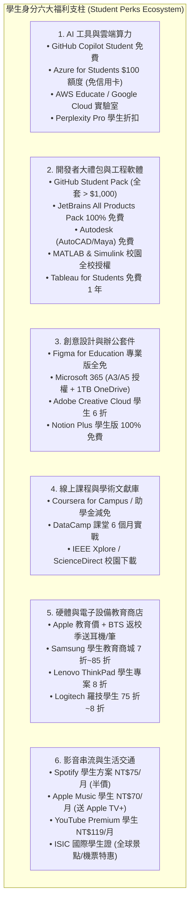
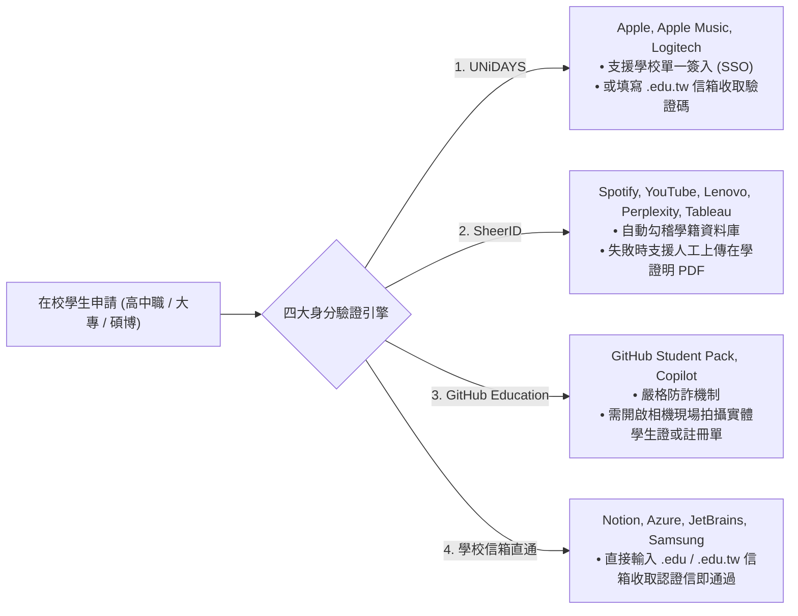

# 臺灣與全球學生身分（Student Perks）軟體、硬體、AI 與學習資源優惠深度調研報告

> **本文件定位**：針對學生身分（包含高中職、大專院校、碩士班與博士班在學研究人員）所能申請的「**軟體免費授權、硬體教育折扣、AI 註冊帳戶與算力額度、線上專業課程、電子文獻庫與生活串流特惠**」進行全方位擴大檢索與深度架構盤點。
>
> 本研究收錄 **28 項全球與臺灣代表性核心方案**，並提供機器可讀之基準台帳 [`data/student-perks-baseline.json`](../data/student-perks-baseline.json)。同時，本報告詳解 **UNiDAYS、SheerID、GitHub Education** 等主流學生身分驗證平臺的操作與避坑攻略，為在校學生與青年研究人員節省每年逾數萬至十萬元之求學與研究成本。
>
> **本輪約束與邊界**：本輪不修改現行正式資料（`data/pilot.json`）、不修改生產環境業務程式碼；排程模型維持關閉（`model_mode=off`），本研究成果作為獨立擴展資源台帳儲存。

---

## 1. 執行摘要與價值評估（Executive Summary & Value Proposition）

在高等教育與學術研究過程中，研究軟體、生產力工具、雲端運算與硬體設備往往構成龐大的經濟門檻。善用合法正規的「學生身分福利（Student Perks / Student Discounts）」，每位學生每年可合法省下 **NT$50,000 至 NT$120,000 以上** 的高昂開銷。

本調研將學生專屬資源歸納為六大核心支柱：

---

## 2. 六大核心支柱方案深度評析

---

### 2.1 支柱一：AI 工具、雲端算力與模型 API 學生特惠（AI & Cloud Compute）

#### 1. GitHub Copilot Student（學生免費 AI 程式輔助）
- **提供者**：GitHub / OpenAI
- **官方連結**：[https://education.github.com/](https://education.github.com/)
- **福利類型**：**100% 完全免費**（一般使用者定價 $10/月，價值約 NT$3,800/年）
- **2026 最新機制**：
  - 獨立為專屬 **`GitHub Copilot Student`** 方案。
  - **代碼自動補全（Code Completions）**：維持無限制次數使用。
  - **Copilot Chat 與 Agent 對話**：提供每月 200 AI credits 額度。
  - **模型配置**：由 GitHub 系統自動選擇最佳模型，支援 VS Code、JetBrains 等主流 IDE。
- **驗證方式**：通過 GitHub Education 學生身分審查（每年更新）。

#### 2. Microsoft Azure for Students（學生雲端服務與 OpenAI 額度）
- **提供者**：Microsoft Azure
- **官方連結**：[https://azure.microsoft.com/free/students/](https://azure.microsoft.com/free/students/)
- **福利類型**：**每年 $100 美元免費額度 + 12 個月免費熱門服務（免信用卡）**
- **核心亮點**：
  - 專門為學生設計，**完全不需輸入信用卡號**，絕無非預期扣款風險。
  - 獲得 $100 美元抵扣額度，可直接部署 Linux/Windows 雲端虛擬機、Azure App Service、Azure SQL。
  - 支援存取 **Azure OpenAI Service（GPT-4o、GPT-4o-mini）** 與 Cognitive Services 語音／視覺 AI 模型。
- **驗證方式**：以學校配發的 `.edu` 或 `.edu.tw` 組織電子郵件信箱直接認證（在學期間每年可重新申請獲得 $100 額度）。

#### 3. Amazon AWS Educate & AWS Academy
- **提供者**：Amazon Web Services (AWS)
- **官方連結**：[https://aws.amazon.com/education/awseducate/](https://aws.amazon.com/education/awseducate/)
- **福利類型**：**免費雲端沙盒實驗室與訓練課程（免信用卡）**
- **核心亮點**：
  - 提供免信用卡綁定的 Hands-on 沙盒練習環境，可實作 EC2、S3、Lambda 等核心服務。
  - 支援 Amazon Bedrock 生成式 AI 實驗環境，完成指定學習路徑可獲得官方數位技能徽章（Digital Badges）。
- **驗證方式**：學生教育信箱註冊或修習具備 AWS Academy 授權學校之專案課程。

#### 4. Google Cloud Skills Boost for Students
- **提供者**：Google Cloud
- **官方連結**：[https://www.cloudskillsboost.google/](https://www.cloudskillsboost.google/)
- **福利類型**：**免費 30~90 天實作通行證（Credits & Quest Access）**
- **核心亮點**：
  - 提供無風險 GCP 實作實驗室，直接在雲端操作 Vertex AI、Gemini API、BigQuery 與 TensorFlow。
  - 完成認證路徑可獲得 Google 官方技能認證徽章，適合資工與資料科學領域學生。
- **驗證方式**：透過校園 Google Developer Student Clubs (GDSC) 活動、黑客松或特定學術專案領取。

#### 5. Perplexity Pro 學生優惠方案
- **提供者**：Perplexity AI
- **官方連結**：[https://www.perplexity.ai/](https://www.perplexity.ai/)
- **福利類型**：**教育版專屬約 75% 訂閱折扣（約 $10/月）**
- **核心亮點**：
  - 新世代學術搜尋必備，基礎版即內建免費 Academic Search Mode（精準鎖定 arXiv、PubMed 等學術文獻來源）。
  - Pro 版支援 Claude 3.5 Sonnet、GPT-4o、o1 等多模型切換，並提供每日數百次深度研究分析與文件解析。
- **驗證方式**：透過 **SheerID** 平臺線上驗證在學身分。

---

### 2.2 支柱二：開發者大禮包與專業工程軟體（Developer & Engineering Software）

#### 6. GitHub Student Developer Pack（全球最強開發者大禮包）
- **提供者**：GitHub 及其 80+ 家全球技術合作夥伴
- **官方連結**：[https://education.github.com/pack](https://education.github.com/pack)
- **福利類型**：**100% 免費（全套總市值超過 $1,000 美元，約合新臺幣 3 萬至 4 萬元）**
- **包含之頂級核心福利**：
  1. **JetBrains 全產品教育授權**（價值數百美元）
  2. **Namecheap / Name.com**：免費贈送 1 年頂級域名（如 `.me`、`.live`）及免費 SSL 憑證
  3. **DigitalOcean**：新用戶贈送 $200 美元雲端點數（1 年期）
  4. **GitHub Pro**：個人帳號升級 Pro（無限私有倉庫協作者、進階代碼分析）
  5. **GitHub Codespaces**：每月免費 180 核心小時雲端開發環境
  6. **Termius Premium**：終端 SSH/SFTP 客戶端跨裝置多端同步
  7. **Bootstrap Studio**：視覺化響應式前端網頁設計工具終生授權
  8. **Datadog & Sentry**：專業伺服器與前端崩潰日誌監控額度
- **驗證方式**：於 GitHub Education 上傳清晰學生證、在學證明或成績單，並綁定校園 `.edu` 信箱審核。

#### 7. JetBrains All Products Pack（全套專業級 IDE 旗艦授權）
- **提供者**：JetBrains
- **官方連結**：[https://www.jetbrains.com/community/education/#students](https://www.jetbrains.com/community/education/#students)
- **福利類型**：**100% 免費（原商業定價第一年 $289 美元，後續每年 $689 美元）**
- **涵蓋軟體**：
  - IntelliJ IDEA Ultimate（Java/Kotlin 頂級旗艦）
  - PyCharm Professional（Python 與 Django/Flask 全端開發）
  - WebStorm（JavaScript/TypeScript/React/Vue 前端神級神器）
  - CLion（C/C++ 跨平臺系統開發）
  - DataGrip（多種關聯式與 NoSQL 資料庫管理工具）
  - GoLand, Rider, PhpStorm, RubyMine 等十餘款專業軟體
- **驗證方式**：直接以學校信箱或 GitHub Student Pack 授權認證，每年可重新續期，畢業時享有續訂 25% 優惠。

#### 8. Autodesk Education Community（工程與建築設計軟體全家桶）
- **提供者**：Autodesk
- **官方連結**：[https://www.autodesk.com/education/edu-software/overview](https://www.autodesk.com/education/edu-software/overview)
- **福利類型**：**100% 免費 1 年教育授權（可每年持續續約）**（商業版年費數萬至十萬元）
- **涵蓋軟體**：AutoCAD、Revit、Inventor、3ds Max、Maya、Fusion 360。
- **驗證方式**：透過 SheerID 上傳載有學生姓名、學校名稱與當前年度日期之在學證明。

#### 9. MathWorks MATLAB & Simulink 校園全校授權（Campus-Wide License）
- **提供者**：MathWorks / 各大專院校計算機與資訊中心
- **官方門戶**：[https://www.mathworks.com/academia/tah-portal.html](https://www.mathworks.com/academia/tah-portal.html)
- **福利類型**：**100% 免費正版下載與雲端運算**（全套工具箱市值逾十萬）
- **核心特色**：
  - 臺灣包含國立臺灣大學、清華大學、陽明交通大學、成功大學、臺灣科技大學、臺北科技大學、政治大學、中央大學等幾乎所有主流大學均採購全校授權。
  - 學生可直接以學校帳號登入 MathWorks 官網，免費下載單機版與線上版 MATLAB、Simulink，並包含 Image Processing、Signal Processing、Deep Learning、Control System 等 100+ 個完整官方專業工具箱。
- **驗證方式**：使用學校電子郵件帳號直接登入開通。

#### 10. Tableau for Students（資料視覺化與商業智慧軟體）
- **提供者**：Salesforce / Tableau
- **官方連結**：[https://www.tableau.com/academic/students](https://www.tableau.com/academic/students)
- **福利類型**：**100% 免費 1 年 Desktop 與 Prep 軟體序號（原價 $75/月）**
- **驗證方式**：SheerID 驗證，需上傳本學期有效在學證明。

---

### 2.3 支柱三：創意設計、UI/UX 與文書辦公套件（Design, Office & Creative Suites）

#### 11. Notion for Education（個人工作區免費升級 Plus）
- **提供者**：Notion Labs
- **官方連結**：[https://www.notion.com/product/notion-for-education](https://www.notion.com/product/notion-for-education)
- **福利類型**：**100% 免費升級 Plus 方案（原價 $10/月，年省 NT$3,800）**
- **核心亮點**：
  - 個人工作區解除 1,000 區塊限制，享有無上限頁面與 Blocks。
  - 單一檔案上傳容量無上限（一般免費版限 5MB）。
  - 提供 90 天完整的版本歷史記錄（Version History），誤刪筆記可一鍵還原。
- **驗證方式**：將 Notion 登入電子郵件更換為學校 `.edu` / `.edu.tw` 信箱，至設定中點選「Get free education plan」即刻開通。

#### 12. Figma for Education（Figma Professional 專業版免費）
- **提供者**：Figma
- **官方連結**：[https://www.figma.com/education/](https://www.figma.com/education/)
- **福利類型**：**100% 免費使用 Professional 方案（原價 $12~15/人/月，年省 NT$5,700）**
- **核心亮點**：
  - 學生可免費建立專屬「Student」團隊，享受無限制專案數量與無限制版本歷史。
  - 支援完整全團隊共用設計元件庫（Design System Libraries）與 Dev Mode 開發者檢視功能。
- **驗證方式**：於官方教育申請頁面透過 SheerID 或填寫學校資料審核。

#### 13. Microsoft 365 Education（全套正版 Office 桌面版 + 1TB OneDrive）
- **提供者**：Microsoft / 各大學計中
- **官方連結**：[https://www.microsoft.com/education/products/office](https://www.microsoft.com/education/products/office)
- **福利類型**：**100% 免費（A3/A5 全校授權，年省約 NT$2,190 ~ 3,190）**
- **核心亮點**：
  - 包含 Word, Excel, PowerPoint, OneNote, Teams 桌面客戶端正版安裝（可同時安裝於 5 台 PC/Mac 及 5 台平板/手機）。
  - 配發專屬 **1TB 大容量個人 OneDrive 雲端硬碟**，論文寫作與大檔案備份首選。
- **驗證方式**：使用學校配發之 Office 365 教育信箱直接登入啟用。

#### 14. Adobe Creative Cloud 學生與教師優惠方案
- **提供者**：Adobe
- **官方連結**：[https://www.adobe.com/tw/creativecloud/buy/students.html](https://www.adobe.com/tw/creativecloud/buy/students.html)
- **福利類型**：**享原價約 6 折至 6.5 折優惠（每月省下約 NT$800 ~ 1,200）**
- **核心特色**：全套 20 多款專業創作工具（Photoshop, Illustrator, Premiere Pro, After Effects, InDesign 等），包含 100GB 雲端空間與 Adobe Fonts。部分大專院校之設計、傳播、藝術學院更提供校內電腦全額免費安裝授權。
- **驗證方式**：購買時驗證學校教育信箱或上傳學生證。

#### 15. Canva for Education / Canva 學生方案
- **提供者**：Canva
- **官方連結**：[https://www.canva.com/education/](https://www.canva.com/education/)
- **福利類型**：**K-12 師生 100% 免費；大專院校學生特惠**
- **核心特色**：線上平面設計與簡報神兵利器，海量商用精美範本、一鍵智慧去背、AI 圖像生成與 Magic Studio。
- **驗證方式**：教育帳號登入或 SheerID 認證。

---

### 2.4 支柱四：線上學習課程、技能培訓與學術文獻庫（Online MOOCs & Academic Databases）

#### 16. Coursera for Campus & 助學金計畫（Financial Aid）
- **提供者**：Coursera
- **官方連結**：[https://www.coursera.org/](https://www.coursera.org/)
- **福利類型**：**校園合作全額免費 / 助學金 75%~100% 費用減免**
- **核心特色**：
  - 提供 Stanford、Yale、Google、IBM、Meta 開設之頂尖專業認證課程。
  - **助學金避坑技巧**：若學校未購買全校授權，學生只要在任何付費課程頁面點擊「Financial Aid Available」，填寫兩段各 150 字的經濟現況與學習計畫說明，通常在 15 天內即可獲准，**免費解鎖作業批改並取得正式官方認證證書**。
- **驗證方式**：學校專案信箱或線上表單自述審核。

#### 17. DataCamp for Classrooms & Students
- **提供者**：DataCamp
- **官方連結**：[https://www.datacamp.com/universities](https://www.datacamp.com/universities)
- **福利類型**：**課堂教師申請 100% 免費 6 個月 / 學生大禮包免費體驗**
- **核心特色**：以即時瀏覽器互動方式學習 Python、R、SQL 資料分析與機器學習。授課教師可直接免費為全班學生建立班級專案。

#### 18. 全國學術電子資訊資源共享聯盟（CONCERT）與大學電子資料庫
- **提供者**：國家科學及技術委員會 / 國家實驗研究院科技政策研究與資訊中心 (STPI) / 各大學圖書館
- **官方門戶**：[https://concert.stpi.narl.org.tw/](https://concert.stpi.narl.org.tw/)
- **福利類型**：**全額免費檢索與下載全球學術文獻（研究期間無價）**
- **核心寶庫**：
  - **IEEE Xplore Digital Library**（電機、資工、通訊領域論文聖殿）
  - **ScienceDirect (Elsevier)**（自然科學、生醫與工程頂級期刊）
  - **SpringerLink & ACM Digital Library**
  - **Web of Science (WOS) & Scopus**（文獻引用與影響因子追蹤）
  - **Airiti Library 華藝線上圖書館**（全臺灣碩博士論文與中文核心期刊）
- **使用方式**：在校內連線校園網路，或在校外設定學校提供的 **SSL VPN / 網頁 Proxy** 登入，即可享用政府與大學每年斥資數億元購買的電子期刊資源。

---

### 2.5 支柱五：電腦硬體與電子產品教育商店（Hardware Education Stores & Discounts）

#### 19. Apple 臺灣教育優惠與 Back to School（BTS 返校季）
- **提供者**：Apple Taiwan
- **官方連結**：[https://www.apple.com/tw-edu/store](https://www.apple.com/tw-edu/store)
- **福利類型**：**硬體全年教育價（約 9 折至 9.5 折）+ BTS 檔期加贈耳機/觸控筆 + AppleCare+ 8 折**
- **優惠重點**：
  - MacBook Air / Pro、iMac、Mac mini 及 iPad 系列全年享有教育折扣價（每部省 NT$1,500 ~ 6,000）。
  - 每年 7 月至 9 月推出「Back to School」返校專案，購買指定 Mac 加贈 AirPods，購買指定 iPad 加贈 Apple Pencil，價值約 NT$4,000 ~ 5,500。
  - 購買 AppleCare+ 享有專屬 8 折保固加購價。
- **驗證方式**：**臺灣 Apple 教育商店全面採用 UNiDAYS 平台線上驗證**（需大專院校信箱或有效在學文件；亦可至 Apple 直營店如信義 A13、台北 101 現場出示實體學生證或入學許可證購買）。

#### 20. Samsung 臺灣三星學生教育商城
- **提供者**：Samsung Taiwan
- **官方連結**：[https://www.samsung.com/tw/multistore/tw_student/](https://www.samsung.com/tw/multistore/tw_student/)
- **福利類型**：**官方定價 7 折至 8.5 折教育價**
- **優惠重點**：Galaxy S 旗艦手機、Galaxy Tab 系列平板、Galaxy Watch 智慧手錶與智慧螢幕享有高額折扣，支援專屬舊換新加碼折抵與分期零利率。
- **驗證方式**：直接以國內公私立大專院校 `.edu.tw` 信箱註冊登入即可解鎖全館教育價。

#### 21. Lenovo 臺灣聯想學生與教師教育商城
- **提供者**：Lenovo Taiwan
- **官方連結**：[https://www.lenovo.com/tw/zh/education/student/](https://www.lenovo.com/tw/zh/education/student/)
- **福利類型**：**最高享 8 折至 8.5 折教育價**
- **優惠重點**：經典工程師神機 ThinkPad（X1 Carbon, T 系列）、電競 Legion 及 Yoga 筆電教育價，加購原廠延長保固（Premier Support）享專屬折扣。
- **驗證方式**：**SheerID** 平台線上驗證在學資格。

#### 22. Logitech 羅技學生教育優惠折扣
- **提供者**：Logitech Taiwan
- **官方連結**：[https://www.logitech.com/zh-tw](https://www.logitech.com/zh-tw)
- **福利類型**：**指定商品享 75 折至 8 折專屬折扣碼**
- **優惠重點**：MX Master 頂級辦公滑鼠、MX Keys 鍵盤、G 系列電競周邊及高畫質視訊鏡頭。
- **驗證方式**：透過 UNiDAYS 或 Student Beans 領取專屬單次優惠碼。

---

### 2.6 支柱六：影音串流、生活娛樂與學生交通（Streaming, Lifestyle & Travel）

#### 23. Spotify Premium 學生方案
- **提供者**：Spotify
- **官方連結**：[https://www.spotify.com/tw/student/](https://www.spotify.com/tw/student/)
- **福利類型**：**每月半價特惠（NT$75/月，原價 NT$149/月，年省 NT$888）**
- **核心特色**：享受無廣告、高音質串流、離線歌曲下載，至多可享 4 年學生優惠。
- **驗證方式**：**SheerID** 平臺線上身分審查（每 12 個月需重新驗證一次）。

#### 24. Apple Music 學生方案（神級加贈：隨附 Apple TV+ 免費看）
- **提供者**：Apple Taiwan
- **官方連結**：[https://www.apple.com/tw/apple-music/](https://www.apple.com/tw/apple-music/)
- **福利類型**：**每月特價 NT$70/月（原價 NT$150/月）+ 免費隨附 Apple TV+（原價 NT$250/月）**
- **價值評估**：**每年省下高達 NT$3,960 元！** 學生只要花 70 元，不僅享有 Apple Music 無損音樂與空間音訊，還能直接免費觀看 Apple TV+ 全館原創影集與電影。
- **驗證方式**：**UNiDAYS** 平台驗證大專院校在學身分（最長可連續享受 48 個月）。

#### 25. YouTube Premium 學生方案
- **提供者**：Google / YouTube
- **官方連結**：[https://www.youtube.com/premium/student](https://www.youtube.com/premium/student)
- **福利類型**：**每月特價 NT$119/月（原價 NT$199/月，年省 NT$960）**
- **核心特色**：YouTube 影片全站免除所有廣告干擾、支援手機背景鎖屏播放、影片離線下載，並附贈 YouTube Music Premium。
- **驗證方式**：**SheerID** 平台線上驗證。

#### 26. 國際學生證（ISIC, International Student Identity Card）
- **提供者**：聯合國教科文組織 (UNESCO) / 財團法人康文文教基金會（臺灣總代理）
- **官方連結**：[https://www.travel934.org.tw/isic/isic.aspx](https://www.travel934.org.tw/isic/isic.aspx)
- **福利類型**：**全球 130+ 國超過 15 萬家特約商戶專屬門票與交通優惠**
- **核心亮點**：
  - 全球唯一聯合國教科文組織背書之學生身分證件。
  - 在臺灣享國家兩廳院、故宮博物院、各大公立美術館門票優惠。
  - 出國留學、交換或出國發表論文時，享有**學生青年專屬機票折扣與額外行李托運額（如長榮、華航、阿聯酋等學生票）**、歐洲火車通行證特惠、青年旅館折扣。
- **申辦方式**：年滿 12 歲在學學生憑學生證與工本費（約 NT$400）向康文基金會或特約旅行社申辦，效期為 1 年。

#### 27. Cursor AI Code Editor（學生與教育支持）
- **提供者**：Anysphere
- **官方連結**：[https://www.cursor.com/](https://www.cursor.com/)
- **福利類型**：**教育版專屬額度與試用優惠**
- **核心亮點**：當前全球工程師最推崇之 AI 原生程式編輯器，具備極強的代碼庫上下文索引（Codebase Indexing）與一鍵修復終端錯誤能力。
- **申請方式**：使用 `.edu` 郵箱註冊並於官網提出教育支持申請。

#### 28. UNiDAYS 學生認證平台專屬折扣整合網
- **提供者**：UNiDAYS
- **官方連結**：[https://www.myunidays.com/TW/zh-TW](https://www.myunidays.com/TW/zh-TW)
- **福利類型**：**全球學生品牌特約折扣中樞**
- **涵蓋品牌**：Apple、Samsung、Logitech、Nike、Ray-Ban、ASOS 等，定期更新 10%~30% 折扣碼。

---

## 3. 主流身分驗證平臺機制與「避坑實戰指南」

在申請各類學生優惠時，最常遭遇的挫折是「驗證失敗」或「找不到有效文件」。以下剖析四大認證引擎的運作原理與破解方式：

### 3.1 學生最常遭遇的 4 大卡點與解法（Troubleshooting）

1. **卡點一：大一新生或研一新生，尚未發放實體學生證**
   - **痛點**：暑假想趁 Apple BTS 或開學前購買筆電，但還沒拿到學生證。
   - **破解法**：至各大學教務處招生網站下載**「正式錄取通知書（PDF）」**，或至學雜費系統列印**「已繳費收據／在學證明」**，上傳至 UNiDAYS 或 SheerID，人工審核通常在 24~48 小時內通過。
2. **卡點二：臺灣許多大學學生證背面已取消蓋印「每學期註冊章」**
   - **痛點**：SheerID 或 GitHub 系統退件，理由是「學生證未標註當前學期年份」。
   - **破解法**：切勿僅上傳悠遊卡學生證正面！請登入各校教務資訊系統（如臺大 myNTU、清大校務資訊系統），下載**「含當學期註冊戳記之在學證明書（電子簽章版 PDF）」**，一併上傳即可 100% 過關。
3. **卡點三：國際平臺對中文版文件辨識不良**
   - **痛點**：部分海外平臺 OCR 無法正確讀取繁體中文學生證上的姓名與系所。
   - **破解法**：申請並上傳學校教務處發行之**「英文在學證明書（English Certificate of Enrollment）」**，並確保申請平臺填寫的姓名拼音與護照/英文證明完全一致。
4. **卡點四：在職專班（EMBA）、進修部或交換學生能否申請？**
   - **分析**：
     - **Apple 教育優惠 / UNiDAYS**：只要具備教育部立案之大專院校有效正式學籍（含在職專班與夜間部），原則上均符合資格。
     - **Spotify / YouTube (SheerID)**：要求必須為「立案高等教育機構之正式學生」，部分終身學習或推廣部學分班可能無法通過。

---

## 4. 與 OpenGSA 專案之整合價值與後續打底指引

本調研與 OpenGSA 核心使命「**讓研究生活安心、消滅資訊不對稱**」高度契合：

1. **機器可讀基準支援**：
   - 本研究產出之 [`data/student-perks-baseline.json`](../data/student-perks-baseline.json) 包含 28 項完整優惠資料，可作為未來 OpenGSA 擴充第五分頁「生活與工具島」或整合進既有四分頁之種子資料。
2. **Obsidian Vault 知識庫聯動（PR #34 介接）**：
   - 後續 Agent 執行 `scripts/export_obsidian_vault.py` 時，可直接讀取此 JSON，在 `vault/Generated/` 生成對應的學生福利筆記，並在 Canvas 圖譜中將開發工具與 AI 算力關聯至研究生生涯支援。
3. **安全邊界與資料純淨度**：
   - 保持純靜態原則，所有鏈結皆為公開正規官方網址，無引流商業合作碼，維持 MIT 與 CC BY 4.0 乾淨開源邊界。

---

## 5. 官方來源與專屬入口 URL 清單

1. **GitHub Education**：[https://education.github.com/](https://education.github.com/)
2. **Microsoft Azure for Students**：[https://azure.microsoft.com/free/students/](https://azure.microsoft.com/free/students/)
3. **AWS Educate**：[https://aws.amazon.com/education/awseducate/](https://aws.amazon.com/education/awseducate/)
4. **Google Cloud Skills Boost**：[https://www.cloudskillsboost.google/](https://www.cloudskillsboost.google/)
5. **Notion for Education**：[https://www.notion.com/product/notion-for-education](https://www.notion.com/product/notion-for-education)
6. **Figma for Education**：[https://www.figma.com/education/](https://www.figma.com/education/)
7. **JetBrains Free Student Pack**：[https://www.jetbrains.com/community/education/#students](https://www.jetbrains.com/community/education/#students)
8. **Autodesk Education**：[https://www.autodesk.com/education/edu-software/overview](https://www.autodesk.com/education/edu-software/overview)
9. **MathWorks MATLAB 校園入口**：[https://www.mathworks.com/academia/tah-portal.html](https://www.mathworks.com/academia/tah-portal.html)
10. **Tableau for Students**：[https://www.tableau.com/academic/students](https://www.tableau.com/academic/students)
11. **Microsoft 365 Education**：[https://www.microsoft.com/education/products/office](https://www.microsoft.com/education/products/office)
12. **Adobe 學生特惠商城**：[https://www.adobe.com/tw/creativecloud/buy/students.html](https://www.adobe.com/tw/creativecloud/buy/students.html)
13. **Apple 臺灣教育商店**：[https://www.apple.com/tw-edu/store](https://www.apple.com/tw-edu/store)
14. **Samsung 臺灣學生教育商城**：[https://www.samsung.com/tw/multistore/tw_student/](https://www.samsung.com/tw/multistore/tw_student/)
15. **Lenovo 臺灣教育商城**：[https://www.lenovo.com/tw/zh/education/student/](https://www.lenovo.com/tw/zh/education/student/)
16. **Spotify 學生方案**：[https://www.spotify.com/tw/student/](https://www.spotify.com/tw/student/)
17. **Apple Music 學生方案**：[https://www.apple.com/tw/apple-music/](https://www.apple.com/tw/apple-music/)
18. **YouTube Premium 學生方案**：[https://www.youtube.com/premium/student](https://www.youtube.com/premium/student)
19. **ISIC 國際學生證（臺灣總代理）**：[https://www.travel934.org.tw/isic/isic.aspx](https://www.travel934.org.tw/isic/isic.aspx)
20. **UNiDAYS 臺灣官網**：[https://www.myunidays.com/TW/zh-TW](https://www.myunidays.com/TW/zh-TW)
