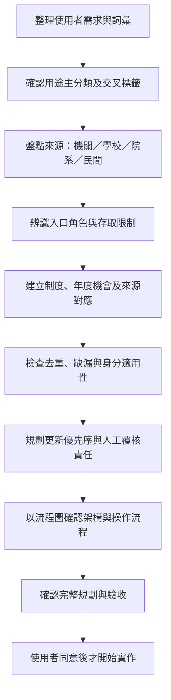
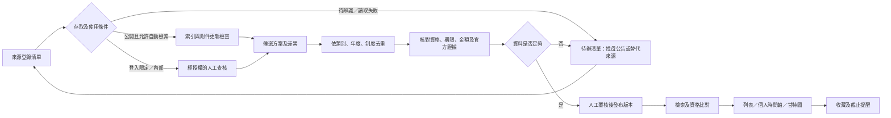
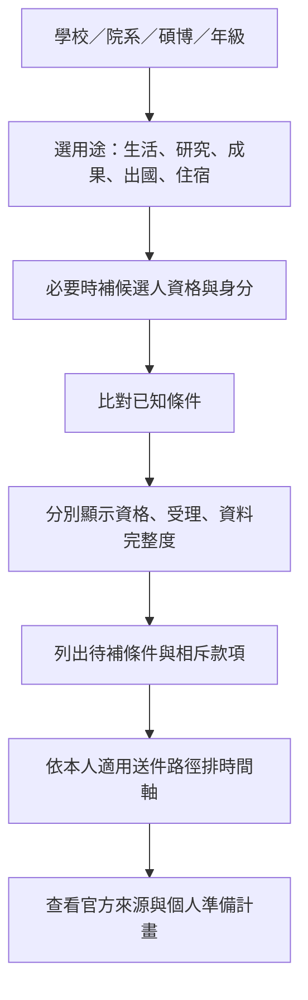
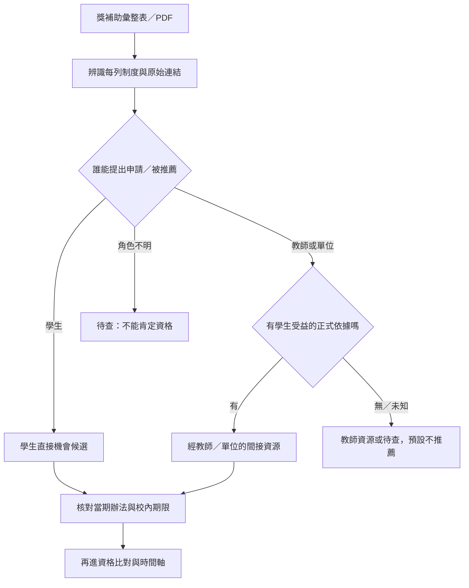

> 文件性質：規劃參考／研究日快照。repo 初始化已核可；目前分期及授權邊界以 [目前計畫](PLAN.md) 為準。文內「本次／本輪／尚未建 repo」描述的是原規劃階段，不代表目前 repo 尚不存在；來源條件仍須逐案重查。

# OpenGSA：關鍵字、資源分類與檢索規劃

Grant Scholarships Award｜規劃補充 v1.2｜2026-10-28

本文件補充原 handoff；只做資料與流程規劃，不寫產品程式、不建立 repo、不啟用排程。後續先確認分類及來源清單，再設計詳細架構與排程，規劃完成並經使用者確認後才開始實作。以下時間頻率均是提案。

## 1. 從討論提取的核心關鍵字

| 主題 | 關鍵字 | 對產品的意義 |
|---|---|---|
| 財務支持 | 獎學金、獎助學金、生活津貼、研究獎勵金、急難救助、學費減免、貸款、租補、住宿 | 除競爭型獎學金，也涵蓋基本生活與就學支持；貸款另標須償還 |
| 研究與成果 | 博士培育、候選人、資格考、論文撰寫、優秀著作、期刊發表、論文獎、研究成果、學術競賽 | 區分持續研究支持與成果獎項 |
| 國際移動 | travel grant、會議、交通、機票、註冊費、移地研究、短訪、交換、見習、實習、雙聯、出國研修 | 不能只設一個「出國專用」類別，須分用途與活動 |
| 資格篩選 | 學校、院、系所、學制、年級、修業年限、候選人資格、國籍、入學身分、戶籍、在職、全職、兼領 | 多維篩選；年級與修業年限、國籍與入學身分分開 |
| 外籍生與居住 | international graduate student、stipend、tuition waiver、housing、accommodation、living allowance、房租、宿舍 | 生活需求可共用；各項資格不可假設本外籍生相同 |
| 資訊分散 | 校級、學院、系所、研究室、承辦窗口、公告、函文、附件、內部信件 | 建來源層級與轉知鏈，不只抓單一獎學金入口 |
| 時間視覺化 | 申請窗口、最早校內截止、準備期、甘特圖、時間軸、補件、推薦、核銷 | 申請時程與個人準備計畫應可疊圖比較 |
| 資訊傳遞研究 | 公文延遲、收文、轉發、通知、送達、資訊落差、可準備天數 | 另立研究題目；公開發布時間不能冒充收文或學生收到時間 |
| 權益 | RA、TA、研究助理、教學助理、勞僱、學習型、最低工資、保險、勞退、申訴 | 獨立權益入口，不把助理職缺或薪資當成獎學金 |

「專任研究員」「專任帶學生飛」等聊天內容缺乏完整上下文，只保留為職稱／聘僱關係待釐清線索，不據此新增資格限制或認定教授義務。

## 2. 分類原則：用途、形式、來源、資格分開

**一個方案可有多個用途與標籤，但必須只有一個穩定制度 ID。** 同一獎學金的中英文名、多處轉貼、國際處與校級入口，不應變成多個機會；不同年度、梯次與校內程序則分開記錄。

### A. 用途主分類

| 代碼 | 類別 | 子類別／典型種子 |
|---|---|---|
| A1 | 就學與生活支持 | 成績優秀、清寒／不利處境、身分別、國際生、校友／捐贈獎學金、生活津貼 |
| A2 | 研究與人才培育 | 博士生研究獎學金、候選人培育、論文撰寫、逕博研究提升、專題研究支持 |
| A3 | 成果與榮譽獎勵 | 優秀著作、學位論文、期刊發表、研究生校長獎、競賽、學會論文／壁報獎 |
| A4 | 國際會議與學術交流 | 口頭／壁報發表、參會、交通、註冊費、短訪、學術工作坊；各院系 travel grant |
| A5 | 境外研究與學習 | 千里馬、遠學、交換、見習／實習、雙聯、海外學位；海外學位類先保留少數占位 |
| A6 | 學費與就學融資 | 學雜費減免、學費補助、就學貸款、利息補貼；明示還款義務 |
| A7 | 急難與居住支持 | 校內急難、社福／宗教急難、租金補貼、校外住宿補貼、宿舍／住宿支持 |
| R1 | 勞動與法規資源 | RA／TA、聘僱、最低工資、工時、保險、勞退；屬資訊資源而非獎助機會 |
| R2 | 程序與救濟資源 | 申請指南、證明、表單、FAQ、承辦、申訴、調解；支援其他類別 |

獎學金 Scholarship、補助 Grant／Subsidy、獎項 Award、津貼 Stipend、費用減免 Waiver、貸款 Loan、非金錢支持 In-kind，是**給付形式**，另設欄位；「獎項」未必有現金，「補助」也未必核銷。

### B. 可交叉篩選的維度

- 提供單位：國科會／教育部／中研院／其他中央部會／地方政府／學校／學院／系所／研究室／基金會／企業／校友與個人／宮廟／教會／其他宗教慈善組織／國際機構。
- 地理：提供方所在地、申請人就讀地、活動目的地三欄分開；臺灣機關補助出國研究仍屬優先國內來源。
- 學籍：碩／博／候選人、年級、正常修業／延修、一般／在職、逕博、在學／休學。
- 身分：國籍、入學身分、戶籍、地緣、弱勢或特殊資格；敏感資訊只在使用者需要時本機輸入。
- 活動：研究、發表、交換、雙聯、實習／見習；目的地及活動日期。
- 程序：自行申請、系所推薦、學院排序、主辦機關審查、錄取後自動列候選、另案補件；自動列候選不等於自動獲獎。
- 財務：金額、頻率、名額、全額／部分、是否核銷、是否須償還、兼領、同費用不得重複補助。
- 資料狀態：當期已核對、待查、歷史資料、登入限定、無法存取、來源衝突、海外占位。

## 3. 可用來建立檢索清單的詞彙庫

| 檢索群 | 中文詞 | 英文詞／別名 |
|---|---|---|
| 就學與生活 | 獎學金、獎助學金、助學金、清寒、經濟不利、不利處境、弱勢、生活津貼 | scholarship, financial aid, bursary, stipend, living allowance |
| 研究支持 | 博士生、研究生、博士候選人、培育、研究獎勵、撰寫博士論文、逕博 | graduate funding, doctoral fellowship, PhD studentship, dissertation fellowship |
| 成果獎 | 優秀著作、優秀論文、學位論文、期刊、發表、校長獎、壁報、競賽 | award, prize, best paper, thesis award, dissertation award, poster award |
| 會議補助 | 國際學術會議、出席、發表、交通費、機票、註冊費 | travel grant, conference grant, conference bursary, registration waiver |
| 境外研究 | 千里馬、遠學、移地研究、短期研究、訪問、三明治 | research stay, visiting student, mobility grant, sandwich programme |
| 境外學習 | 學海惜珠、學海飛颺、學海築夢、新南向、交換、希望出航、雙聯、見習、實習 | exchange scholarship, internship funding, traineeship, dual degree |
| 學費與融資 | 學雜費減免、學費補助、就學貸款、利息補貼 | tuition waiver, tuition assistance, student loan |
| 急難住宿 | 急難救助、急難慰問、急難濟助、租補、租金補貼、住宿補貼、校外住宿、宿舍 | emergency aid, hardship fund, rent subsidy, housing assistance, accommodation |
| 身分 | 外籍、國際生、僑生、港澳、陸生、本國、原住民、身障、特殊境遇 | international student, overseas Chinese student, domestic student |
| 徵件與程序 | 公告、申請、徵件、甄選、推薦、候補、續領、申復、補件、函、作業要點 | call, application, nomination, renewal, guideline, deadline |
| 法規權益 | 兼任助理、研究助理、教學助理、勞僱、學習型、最低工資、勞保、勞退、申訴 | research assistant, teaching assistant, RA, TA, employment, minimum wage |

標準化規則：臺／台、國科會／科技部／國科會舊稱、傅爾布萊特／Fulbright；保留原文與年代，不將舊機關名稱或「108 年」直接視為失效證據。`fullbright` 收作常見誤拼，正式名稱用 `Fulbright`。英文 `award`、`grant` 單獨太廣，搭配 graduate／student／doctoral 及來源範圍。

檢索模板（只列查詢方式，不執行排程）：

1. 官方機關：`site:nstc.gov.tw (博士生 OR 研究生 OR 博士候選人) (獎學金 OR 獎勵 OR 補助 OR 徵求)`。
2. 中研院：`site:sinica.edu.tw (博士候選人 OR 培育 OR 論文) (申請 OR 獎勵 OR 補助)`，再跟各所中心原始公告。
3. 學校：`site:學校網域 (碩士 OR 博士 OR 研究生) (獎助學金 OR 急難 OR 租金 OR 補助)`。
4. 院系：`site:院系網域 (國際會議 OR travel grant OR 論文發表 OR 優秀著作)`。
5. 民間：`機構名稱 (研究生 OR 碩士 OR 博士) (獎學金 OR 助學金 OR 急難)`；搜尋引擎找入口，最終仍回主辦方確認。
6. 年度詞用當期、下一期與不帶年度三組；加 `115／116／2026／2027` 是擴充，不用來排除未寫年度的常態方案。

## 4. 使用者提供的臺大公開來源種子

狀態定義：「已辨識」只確認頁面用途，不代表每項辦法、附件與資格已完整查核；「待查」只是檢索種子。「登入限定」依使用者提供的存取資訊標記，本次沒有登入。

| ID | 種子與來源角色 | 分類／查核狀態／下一步 |
|---|---|---|
| N01 | [生輔組獎學金公告一覽](https://advisory.ntu.edu.tw/CMS/Scholarship?pageId=232) | 已辨識，A1 及民間轉知入口；逐項追到申請詳情與主辦方；不涵蓋全校所有承辦單位 |
| N02 | [校外常見獎補助資源表（11509彙整）](https://ann.cc.ntu.edu.tw/nasattach/97000/45637_5195881007.pdf) | 已由使用者提供的本機同名 PDF 讀取，共 3 頁；混合學者獎、人才、成果及學生獎學金線索；見第 12 節。遠端 URL 本身尚未重新成功存取 |
| N03 | [校內獎補助資源表（11509臺大彙整）](https://ann.cc.ntu.edu.tw/nasattach/97000/45638_6230009973.pdf) | 已讀本機同名 PDF，共 2 頁；含遠學、TA、課程與教師獎勵等，需區分申請人與受益人；見第 12 節 |
| N04 | [校內研究計畫資源表（11509臺大彙整）](https://ann.cc.ntu.edu.tw/nasattach/97000/45639_8879372011.pdf) | 已讀本機同名 PDF，共 1 頁；以教師／教研團隊計畫為主，列間接受益或範圍外線索；見第 12 節 |
| N05 | [FAO 獎助學金查詢](https://my.ntu.edu.tw/fao/search.aspx) | 登入限定；跨單位發現入口；只作人工查詢來源，不排自動爬取 |
| N06 | [本校急難慰問救助金](https://advisory.ntu.edu.tw/CMS/HTML/118) | 已辨識，A7；後續核對辦法、事由、事件起算與申請程序 |
| N07 | [急難慰問救助總入口](https://advisory.ntu.edu.tw/CMS/Page/186) | 已辨識，A7 資源索引；連到校內、教育部、行天宮等，不是單一方案 |
| N08 | [行天宮社會急難扶助金](https://advisory.ntu.edu.tw/CMS/HTML/123) | 已辨識，A7／宗教慈善；追行天宮正式辦法；不能推定要求信仰身分 |
| N09 | [教育部學產基金急難慰問](https://advisory.ntu.edu.tw/CMS/HTML/122) | 已辨識，A7；臺大此頁寫大學部在學學生，研究生適用性須查主辦規範，暫不推薦研究生 |
| N10 | [學雜費減免](https://advisory.ntu.edu.tw/CMS/Page/174) | 已辨識，A6；有分階段與身分條件，不能只存單一日期 |
| N11 | [就學貸款](https://advisory.ntu.edu.tw/CMS/Page/176) | 已辨識，A6／Loan；借款、利息及還款與獎助金分開 |
| N12 | [不利處境助學金（原弱勢助學金）](https://advisory.ntu.edu.tw/CMS/Page/180) | 已辨識，A1／A6；保留新舊名稱別名與適用年度，正式資格待逐案核對 |
| N13 | [生輔組首頁](https://advisory.ntu.edu.tw/) | 使用者作為研究生獎勵金入口；目前只是寬泛種子，須另找明確辦法與系所承辦 |
| N14 | [獎助學金總說明](https://advisory.ntu.edu.tw/CMS/Page/21) | 已辨識，資源索引；不是勵學獎學金的專用詳情頁 |
| N15 | [勵學獎學金實際連結](https://advisory.ntu.edu.tw/CMS/HTML/184) | 由 N14 官方連結追得，A1；完整年度細則待覆核 |

使用者貼上的學期日期只記為「使用者提供的日期快照」，不直接覆寫現行公告。比如 N10 有分階段、N12 有新名稱，後續應以當期完整公告與適用身分確認。

### 院級來源清單：以下均為待逐頁盤點的使用者種子

| ID | 學院與連結 | 預計優先查找 |
|---|---|---|
| C01 | [文學院](https://liberal.ntu.edu.tw/web/student/student.jsp?dm_id=DM1656910432608) | 論文、研究、出國、人社、生活支持 |
| C02 | [理學院](https://www.science.ntu.edu.tw/student-affairs/) | 研究、成果、會議與院級獎助 |
| C03 | [社會科學院](https://coss.ntu.edu.tw/News_n_10821_sms_19598.html) | 人社培育、論文、會議、博士獎學金 |
| C04 | [醫學院](https://www.mc.ntu.edu.tw/ntucm/Index.action) | 優秀著作、研究、會議；再追研發分處及各系所 |
| C05 | [工學院](http://www.eng.ntu.edu.tw/tc/news.aspx?pn=2&mid=9&cid=80&key=) | 院級／企業獎助、競賽、會議；HTTP 種子需確認現行 HTTPS／轉址 |
| C06 | [生物資源暨農學院](https://www.bioagri.ntu.edu.tw/bulletin.php) | 研究、企業／基金會、會議 |
| C07 | [管理學院](https://management.ntu.edu.tw/AboutCoM/LawsCoM#student) | 學生規章、院級獎學金、交換／雙聯 |
| C08 | [公共衛生學院](https://coph.ntu.edu.tw/web/admissions/admissions_affairs.jsp?cp_id=CP1653651195215) | 論文獎、研究、國際會議 |
| C09 | [電機資訊學院](https://eecs.ntu.edu.tw/zh_tw/Studentinformation/stu1) | 企業、研究、競賽、會議 |
| C10 | [法律學院](http://www.law.ntu.edu.tw/index.php/獎學金-徵才公告) | 獎學金、基金會、論文／交流；HTTP 與網址有效性待查 |
| C11 | [生命科學院](https://cols.ntu.edu.tw/regulations-student.html) | 學生規章、研究獎助、會議 |

上述 11 個院級入口不是「已完整覆蓋臺大所有學院」聲明；後續先比對官方組織清單，再補新設學院、學位學程、系所及承辦單位。院首頁、規章頁與公告索引的角色不同，登錄後須找真正可追蹤的公告列表與正式附件。

## 5. 從 FAO 貼文整理的方案候選清單

本表全部視為使用者提供的線索，未因貼文而認定現行有效；登入頁的 `schOfDetail.aspx` 或 `schOfDetailUnitspx.aspx` 未帶項目 ID，不是各方案的唯一詳情連結，不能當穩定來源鍵。

| 候選方案 | 分類 | 後續查核／去重事項 |
|---|---|---|
| 學海惜珠 | A5；交換／弱勢支持 | 教育部及臺大國際處當期規範、國籍戶籍、錄取身分與目的地 |
| 希望出航海外見習實習學生獎學金 | A5；實習／見習 | 國際引水人計畫對應、是否自動列候選、是否另甄審 |
| NTU Governing Scholarships for International Degree Students | A1；國際生 | 正式中英文名稱、適用新舊生、GPA、續領與年級 |
| NTU Outstanding International Graduate Student Scholarship | A1／A2；國際研究生 | 當期年級、期限、續領與其他方案關係；不沿用貼文英文 under 的模糊界線 |
| NTU Voyage of Aspirations Scholarship for Exchange Students | A5；交換 | 與「希望出航交換學生獎學金」可能為同一制度中英文名稱，待比對辦法確認 |
| 國立臺灣大學希望出航交換學生獎學金 | A5；交換 | 確認校級／院系交換路徑及身分別；與前項先設 suspected_duplicate |
| 赴境外研修雙聯學位獎學金 | A5；雙聯 | 正式辦法、學制、目的地與在職排除條件 |
| 逕行修讀博士學位學生研究提升計畫 | A2；逕博 | 貼文含 108／109 年歷史時程，僅作歷史發現線索，找現行研發處公告 |
| 博士生赴國外移地研究試辦方案／遠學計畫 | A5；研究 | 正式名稱、是否仍辦、候選人及千里馬申請關係待查，不從「試辦」推定停辦 |
| 傅鐘獎學金 | A1；大學部新生線索 | 保留學制排除測試；依使用者貼文屬學士班新生，不能列研究生推薦 |
| 115 國科會核配博士生獎學金 | A2；博士 | 與原 handoff 同制度去重；年級不限與各院系程序分開核對 |
| 115 教育部博士生獎學金 | A2；博士 | 一至三年級及資格認定日期；不同梯次分開，與國科會方案分開 |

## 6. 全臺來源擴充與海外占位

### 國內優先檢索群

| 群組 | 已知入口／候選來源 | 登錄策略 |
|---|---|---|
| 中央研究與教育 | [國科會](https://www.nstc.gov.tw/)、[教育部獎助專區](https://www.moe.gov.tw/Content_List.aspx?n=DBDDB8DC17D0D8C4)、[中研院博士候選人培育公告](https://www.sinica.edu.tw/news_content/56/3434) | 機關索引→制度／徵件→所中心或校內程序；中研院此連結是特定年度公告，不當成永久唯一入口 |
| 居住與社會支持 | [政府住宅補助資訊索引](https://www.gov.tw/News_Content_26_586833)、內政部相關方案、教育部校外住宿支持、各地方政府 | 索引僅供發現，後續登錄真正主管機關及當期辦法；外籍生不可推定均適用租補 |
| 學校與單位 | 全臺各校學務／生輔、教務／研教、研發、國際處、僑陸生輔導、學院、系所、研究室 | 先用臺大來源分類做模板，再分批擴校；研究室內部來源需提供者同意及可公開範圍 |
| 基金會／企業 | 中技社、各教育／慈善基金會、企業基金會、企業人才培育／競賽 | 名稱先列候選，正式入口與研究生適用待逐一查；轉貼不能替代主辦方 |
| 宗教／社福 | 行天宮、宮廟基金會、教會與其他宗教慈善組織 | 統一作提供方類別；另查地緣、推薦與信仰條件，不能憑宗教名稱推定限制 |
| 地方／學會 | 縣市／鄉鎮公所、同鄉會、專業學會、學術年會、國際會議主辦方 | 地緣與戶籍另存；學會獎、會議 travel grant、註冊費減免都納入 |

### 海外只保留 4 個來源占位，暫不全面檢索

| 名稱 | 官方入口 | 記錄狀態 |
|---|---|---|
| Fulbright／傅爾布萊特 | [臺灣公民赴美獎助](https://www.fulbright.org.tw/zh-hant/awards-to-the-u-s/) | placeholder；與訪臺項目分開，不因官方頁存在就認定當期受理或個人適用 |
| DAAD | [Scholarships & Funding](https://www.daad.de/en/studying-in-germany/scholarships/) | placeholder；後續再依國籍、學位與研究活動選子方案 |
| Chevening | [Scholarships](https://www.chevening.org/scholarships/) | placeholder；海外學位類，不自動對應現有博士班研究補助 |
| Erasmus Mundus | [Joint Masters](https://erasmus-plus.ec.europa.eu/opportunities/individuals/students/erasmus-mundus-joint-masters) | placeholder；碩士學程類，不當通用博士獎學金 |

placeholder 只有名稱、入口、用途簡述、擴充待辦；不填假截止、假金額或肯定資格，也不排自動更新。境外來源暫緩不影響國內機關的出國補助與臺灣國際學生支持列入核心範圍。

## 7. 後續用視覺化方式規劃的流程

### 7.1 先分類再設計架構

### 7.2 資料檢索與發布架構草圖

### 7.3 使用者篩選流程

三張都是規劃圖，不表示資料抓取、資格引擎或提醒已實作。下一步再逐模組畫細節與資料流，不先定死程式框架。

## 8. 甘特圖與時間軸的呈現規格

每列一個年度／梯次機會；時間軸顯示五層：官方受理窗口、適用校內／院系期限、文件／推薦步驟、使用者自訂準備期、獲獎後執行／核銷期。準備期是使用者計畫，不是官方規定；未公告／時間未知以文字與虛線表示，不補假日期。

使用者可以用 A1–A7、院系、年級、候選人、身分、國內／境外活動等篩選；同一筆多用途方案只出現一列。另有純文字列表可讀屏，所有顏色附文字標籤，不要求拖曳才能設定。

示意結構：

| 一列機會 | 準備期 | 官方受理期 | 自己必須完成的步驟 | 後續 |
|---|---|---|---|---|
| 方案甲 | 使用者自訂 | 公告明載 | 系所送件→教授推薦→學校彙送 | 補件／核定 |
| 方案乙 | 尚未設定 | 尚未公告 | 期限未知 | 保留觀察 |

此處不用真實日期繪製示意，以免被誤讀成現行申請期。正式個人甘特圖等每筆日期確認後再規劃。

## 9. 檢索排程先以來源角色分級

| 群組 | 建議頻率 | 啟用前提 |
|---|---|---|
| 機關、校級、院系公告索引 | 每日；公告季或近截止可加密 | 網站允許、真正列表頁確認、有人負責覆核 |
| 已發現的當期公告與附件 | 每日；14 天內截止可每 12 小時 | 有變更偵測與去重，非無差別重抓全文 |
| 常態助學／急難／住宿規範 | 每週；公告索引每日 | 區分常態規範與各期窗口；急難另核對事件後期限 |
| 法規／工資公告 | 公告索引每日、全文每週 | 生效日與適用對象需人工覆核 |
| 基金會／企業／宗教組織 | 預設每週；已知徵件季每日 | 逐站確認使用條件與正式來源，不能一律高頻 |
| FAO／研究室內部資訊 | 不排自動爬取；約定人工查核 | 授權、保密及可公開範圍確認；不收集登入憑證 |
| 海外 placeholder | 暫停 | 待決定是否擴充，再規劃子方案與頻率 |

排程單位是「來源頁／附件」，不是每個關鍵字都跑一次。廣泛搜尋引擎查詢用於定期找新來源；已登錄來源以索引更新為主，避免反覆搜尋同一方案。

來源登錄表建議欄位：來源 ID、標題、URL、提供／發布／轉知角色、機構層級、主分類與標籤、涵蓋學制及身分（可未知）、是否登入、頁面角色、母公告、附件關係、當期／歷史、查核狀態、最後成功、最後人工核對、候選更新頻率、使用條件、負責人、下一項待辦。來源頻率與使用者提醒頻率分開。

## 10. 公文傳遞延遲：可獨立發展的研究題目

使用者分享「機關→醫學院延遲 3 天→系所延遲 4 天→剩 5 天」只作假設來源，尚非已驗證研究資料，也不能推論全校狀況或行政違失。

資料事件至少分開：機關發文、機關公開、學校收文、學校轉發、學院收文／轉發、系所收文／轉發、學生首次可取得、學生實際收到、適用學生截止。每個時間都附證據、精確度與是否僅為回憶；爬蟲 first_seen 不等於 posted_at 或 received_at。

可計算指標：

- 節點傳遞時間＝下游收文／通知時間－上游可比對事件時間；缺少任一時間就不算，不能以 0 填補。
- 學生可準備時間＝適用學生截止－學生首次可取得時間；負值保留，表示通知時期限已過。
- 公告前置時間＝適用截止－主辦公開時間；與實際學生可準備時間分開。
- 窗口損耗比例須採一致起點與同一截止基準；學校自行提早期限另列「內部期限壓縮」，不全部歸咎轉發延遲。

先做匿名可重現的描述統計：樣本數、缺失率、中位數、四分位距、分院系及類別比較；區分日曆日與工作日。通知延遲和申請／獲獎結果的相關不等於因果，研究還需控制原始窗口長短、文件負擔、身分與研究時程；不要預先宣稱延遲造成未申請。

如需讀私人郵件或調查學生，另外規劃明確同意、去識別化、資料保存與研究倫理／審查適用性。原始郵件、學生名單與個人指控不進公開 repo。這個研究模組先列後續項目，不阻塞資源分類與主要資訊服務。

## 11. 接下來的規劃順序與驗收

1. **分類定稿**：確認 A1–A7、R1–R2 與交叉維度；新增分類必須說明解決哪種找不到資源的情況。
2. **完成來源台帳**：每個使用者種子都有 ID、角色、存取狀態及下一步；三份 PDF 已由本機副本辨識，後續追查原始方案；FAO 不冒充可公開爬取。
3. **代表案例驗證**：臺大職能治療博士五年級候選人、碩士生、外籍博士生三種情境，查驗分類不會把學士專用方案、就貸、薪資或重複中英文名稱混在一起。
4. **設計排程矩陣**：按來源群決定頻率、負責人與失敗處理；來源失效不等於方案停辦。
5. **視覺化詳細架構**：另畫來源登錄、資料審查、資格比對、時間軸、提醒、法規版本與更正流程；檢視是否能解釋未知與衝突。
6. **完整規劃確認**：在本輪與原 handoff 的範圍、資料模型、MVP 及驗收整合一致後，交使用者確認；目前不寫程式或啟用排程。

首輪資料整理驗收：所有提供連結皆已收進台帳；讀不到者標未知、登入來源標限制；每項候選制度可對應用途／形式／提供方；舊年度與現行不混用；海外占位不進目前可申請清單；甘特圖不捏造申請日期。

## 12. 本機 PDF 補充查核：申請人與受益人必須分開

### 12.1 文件身分與查核界線

2026-10-28 依使用者提供的 Downloads 路徑讀取三份原始 PDF，已擷取六頁文字、檢查六頁表格影像及內嵌超連結。原檔未修改。標題中的「11509」記為 2026 年 9 月彙整版標籤，不把檔案建立時間、下載時間或本次讀取時間當成正式發布日。

| 來源 ID | 本機副本 | 文件標題 | 頁數／資訊性質 |
|---|---|---|---|
| N02 | `本機來源副本：45637_5195881007.pdf` | 校外常見獎補助資源表（11509彙整） | 3 頁；校方彙整的多主辦方資源索引，不是每項方案的完整現行辦法 |
| N03 | `本機來源副本：45638_6230009973.pdf` | 校內獎補助資源表（11509臺大彙整） | 2 頁；混有教師、學生、TA、社團、課程與研究人才補助 |
| N04 | `本機來源副本：45639_8879372011.pdf` | 校內研究計畫資源表（11509臺大彙整） | 1 頁；教師個人型、團隊型及國際合作計畫 |

「本機已讀取」不代表遠端 URL 已恢復，也不等於每個內嵌連結都有效。所有獎助條件、金額及當期截止仍須追正式方案查核。內文同時有歷年月份、2023 年舉例與 2027–2028 週期，不能因彙整版標籤為 11509 就全部當成 2026 年受理資訊。

### 12.2 對 OpenGSA 分類的修正

每個制度除用途外，再分四種與研究生的關係：

| 關係 | 含義 | 顯示方式 |
|---|---|---|
| 學生直接申請／被推薦 | 學生是申請或受獎主體，但可能須院系推薦 | 可進研究生機會清單，仍須完整資格與當期確認 |
| 教師／單位申請，學生可能受益 | 經費由教師、課程或計畫申請，可能支應學生活動或助理 | 顯示「須經教師／單位」，不能列成學生可直接領取 |
| 成果／團隊參與待確認 | 學生可能為成果團隊成員，但申請、獲獎與獎金歸屬不同 | 先列線索，不肯定學生資格或個人所得 |
| 非研究生核心範圍 | 如講座、教師加給、新進教師設備或院士遴選 | 搜尋發現時留排除理由，預設不進學生推薦與高頻維護 |

新增規劃欄位：`applicant_role`（申請者）、`beneficiary_role`（受益者）、`awardee_role`（受獎者）、`application_route`（自行／推薦／教師／單位）、`student_relevance`（上述四類）、`student_access_evidence`（學生可參與的證據）、`funding_recipient`（款項受領主體）。未知可保留，不從「補助含人事費」直接推導學生有權申請或可領固定款項。

### 12.3 優先追查的學生與間接受益線索

以下僅摘要 PDF 所載線索，不是個人資格結論。

| 優先 | 線索與 PDF 定位 | 用途／關係 | 應追查內容 |
|---|---|---|---|
| P1 | 遠學計畫；N03 第 1 頁 | A5 境外研究；有博士生與博士後分支 | 與先前遠學候選制度去重；查博士生一般補助、配合補助、博士後補助各自條件與本期徵件。不能拿博士後分支規則套博士生 |
| P1 | 共同基礎暨專業課程 TA 補助；N03 第 1 頁 | R1／教學支持；教師及教學單位申請，TA 可能受益 | 確認徵聘、補助到單位與發給 TA 的關係、實際工作與學習／勞動分流；表列月額不是最低工資，也不是所有 TA 通用薪資 |
| P1 | 通識課程 TA 補助；N03 第 1 頁 | 同上，不與前項自動合併 | 共同教育中心程序、課程範圍、助理名額與申請窗口 |
| P1 | 孟粹珠獎學金；N02 第 2 頁 | A1／A2；表載國內大學女性博士生 | 查吳健雄學術基金會當期徵件、研究領域、年級與資格；不推定使用者性別或符合資格 |
| P2 | 學海築夢／新南向學海築夢；N03 第 1 頁 | A5 海外實習；教師提案、學生可能受益 | 不能和學海惜珠、學海飛颺混成一項；查教師提案與學生甄選兩條路徑及碩博士適用性 |
| P2 | 有庠科技論文獎、科技發明獎；N02 第 2 頁 | A3 成果；學生／團隊資格待確認 | 回基金會核對作者序、身份、成果年份、提名與受獎歸屬，不因名稱有「論文」就當成學生論文獎 |
| P2 | 未來科技獎、國家新創獎、物聯網創新應用獎；N02 第 1–3 頁 | A3 成果／團隊 | 確認學生能否代表申請、團隊參與、計畫來源與獎勵對象 |
| P3 | 學生社團服務學習課程補助；N03 第 1 頁 | 活動型支持；社團／教師程序 | 先查研究生社團適用性與是否符合產品範圍；不是一般個人生活獎學金 |
| 暫緩 | 傅爾布萊特獎助計畫；N02 第 3 頁 | 海外來源占位 | 英文欄為 Senior Research Award；不能直接當成 Fulbright 學生獎學金。同樣主辦方下須分開子方案 |
| 暫緩 | 哈佛燕京學社獎助計畫；N02 第 3 頁 | 該表這一列要求全職教員等條件 | 此列不列研究生直接機會；不據此排除哈佛燕京旗下所有其他方案 |

### 12.4 教師與研究計畫來源的保留方式

N04 內含新進教師創始經費、專題研究配合補助、研究設備補助、深耕型、拾玉、教學實踐育成、跨領域種子、核心研究群、add-on 國際合作、國合第一至三類、共同種子與 TUKUC 研究計畫等。這些是教師／教研團隊計畫線索，預設不擴張成研究生可自行申請的清單。

可以保留為「找教師／單位詢問的資源」：研究生可能參與其中的研究、交流或助理活動，但須另有正式計畫與學生支用證據。計畫總補助額不能顯示成每位學生可領金額。

N03 第 2 頁的教師教學／導師／服務獎、學術研究績效、學術著作傑出獎、臺大講座、特聘與彈性加給等，主要列範圍外或教師資源。N02 的國家講座、院士及其他學者獎也不能因同在「獎補助」表中而進研究生直接推薦。

### 12.5 從內嵌超連結取得的新檢索種子

下列 URL 均從 PDF 連結標註擷取；本次沒有逐一重查其遠端現況，列 `embedded_link_unverified`。不得將連結存在當成當期徵件存在。

| 用途 | 擷取連結 | 維護優先 |
|---|---|---|
| 遠學計畫 | [研發處計畫頁](https://ord.ntu.edu.tw/w/ordntu/GW_20072012192817260) | P1：找到本期公告、正式辦法與申請分支 |
| TA 共同基礎／專業課程 | [教務處補助頁](https://www.aca.ntu.edu.tw/w/aca/SecretariatService_21070717324321514) | P1：學生受益與單位申請雙路徑 |
| 通識 TA | [共同教育中心公告索引](https://cge.ntu.edu.tw/News_n_68409_sms_66659.html) | P1：索引需找到相關 TA 公告，不是每則皆相關 |
| 孟粹珠及女性科學人才獎助 | [吳健雄學術基金會](https://www.wcs.org.tw/news-4.php) | P1：該頁含不同獎項，須逐項分流 |
| 海外實習 | [國際處學海築夢頁](https://studyabroad.ntu.edu.tw/internship/moe-overseas-internships/) | P2：教師提案與學生選送分開 |
| 有庠系列 | [基金會獎項頁](https://yzhsu.feg.com.tw/Programs.html?selectID=0591395e-8a94-433b-8e07-9732c431856d) | P2：PDF 部分子連結含 year=2021，須找當期版本 |
| 國家新創獎 | [主辦獎項網站](https://innoaward.taiwan-healthcare.org/) | P2：參與角色與分組待查 |
| 潘文淵系列 | [基金會獎項頁](https://pan.itri.org.tw/datadetailTab?SiteID=1&MmmID=1310654304506445452) | P2：各獎別分開；此 URL 不代表系列全數子項目 |
| 共同種子計畫 | [國際處 Joint Seed Funding](https://oia.ntu.edu.tw/cooperation-with-ntu/international-funding/joint-seed-funding) | P3：教師／團隊資源，學生支用待查 |
| TUKUC | [國際處研究計畫](https://oia.ntu.edu.tw/cooperation-with-ntu/international-funding/tukuc-research-grant) | P3：教師／團隊資源 |

### 12.6 抽取與翻譯衝突：必須納入資料品質測試

PDF 有中英文並列、跨列合併、紅字修訂與內嵌超連結；單純逐行抽字容易把提供方或申請月份配到錯誤獎項。分類時要保留原 PDF 頁碼與表格列名，再對回正式規範。

具體衝突線索：N02 第 2 頁「傑出技術移轉菁英獎」中文為每兩年申請一次，英文卻含一年兩次的表述；N03 第 1 頁「開授復振國家語言課程」中文月份為 4 月及 10 月，英文為 April and June。這些欄位應標記衝突並查正式來源，不能由抽取器自行擇一。

原 PDF 還有格式異常的內嵌 URI；只允許有效的 HTTP(S) 連結進候選清單，疑似亂碼或失效連結保留錯誤記錄，不能悄悄猜改後發布。紅字不直接當作「本次最新修正」，須有正式版本依據。

### 12.7 補入規劃的篩選流程

學生直接／間接的分類是機會呈現方式，不替代每項資格審查。臺大職能治療博士五年級案例可優先追遠學；TA 需先知道是否擔任相關課程助理；孟粹珠需使用者自行確認相關身分，不能直接推薦為已符合。整體仍停留規劃階段。

## 13. 獎助標籤（Tag）與篩選規格

依使用者需求，來源、身分、年級限制、兼領及清寒限定列為必要標籤維度，顯示在結果卡、詳情與篩選器。標籤由有證據的結構化條件產生，不另維護一份可能與資格引擎矛盾的自由文字；可人工補編搜尋別名，但不能靠自訂標籤覆寫正式限制。

| 維度 | 建議標籤與篩選值 | 必須保留的細節 |
|---|---|---|
| 來源 | 國科會、教育部、中研院、地方政府、校級、院級、系所、基金會、企業、宗教慈善、國際機構、待確認 | 分「資助／主辦來源」與「公告／轉知來源」；例如基金會出資、臺大生輔組轉知時兩者皆可查，不把轉知單位誤當出資方 |
| 身分 | 碩士生、博士生、博士候選人、本國生、外籍生、僑生、港澳生、陸生、逕博生、其他指定身分、身分不限、待確認 | 學制、國籍、入學身分及候選人條件分組；可有多種條件同時成立，不把所有 tag 當成任選其一 |
| 年級限制 | 年級不限、限新生、碩一至碩二、博一至博三、其他指定範圍、待確認 | 列出精確上下限、資格認定日及例外；正常修業年限／延修另列，不只看年級；候選人是額外條件，不等於特定年級 |
| 是否可兼領 | 可兼領、附條件兼領、不可兼領、待確認 | 「可兼領」必須有明確適用範圍；保存相斥方案／款項類型、期間、例外及是否同一費用重複核銷；不對所有其他方案作無條件保證 |
| 是否清寒限定 | 清寒／經濟資格限定、非清寒限定、待確認；另有清寒優先／加額等標籤 | 清寒證明、低收入戶、中低收入戶、所得／財產門檻分開；「優先」不等於「限定」，「非限定」也不保證完全不用所得資料 |

### 呈現方式

結果卡優先顯示五組摘要，數量多時可展開全部。示例僅為虛構介面文案：

> 示例獎學金｜資助：基金會｜公告：臺大生輔組
> 博士生｜年級不限｜附條件兼領｜非清寒限定
> 兼領條件：不得與指定政府博士獎學金於同一期間領取；詳見辦法。

「不限」與「待確認」使用不同文字與樣式；所有狀態均不能只靠顏色表示。點擊標籤可看規則、適用年度、原文定位與核對日期。標籤表示方案條件，不是學生已符合或已備妥證明。

### 篩選邏輯

- 同一單純維度可複選聯集，例如資助來源「國科會或基金會」；不同維度取交集，例如「博士生且年級符合且非清寒限定」。複合資格仍交由完整規則判斷。
- 提供「保留待確認機會」選項；開啟時未知資料獨立分組，不能混入已符合。使用者關閉時須明示因此隱藏多少筆未知機會。
- 「可兼領」篩選在未輸入現有受領方案時只表示來源規則的標記；輸入既有受領款項與期間後，才可進一步比對兩邊限制。不要求填寫才能瀏覽。
- 年級比對依方案的資格認定日；使用者只提供目前年級而缺歷史資訊時，不能自動推算過往年級並判定符合。
- 清寒標籤是客觀資格資訊，不表示學生價值、研究能力或受助優先性的評分；個人經濟身分預設不公開、不傳給教師，也不要求上傳證明。

### 新增驗收案例

1. 基金會出資、學校轉知的方案可由兩種來源角色找到，結果不重複。
2. 博五案例不被「年級不限」標籤排除，也不因博士候選人身分通過「限博一至博三」。
3. 來源沒有提到兼領規則時標「待確認」，不是「可兼領」；一方允許兼領不能覆蓋另一方的禁止。
4. 清寒優先但不限清寒的方案，標為「非清寒限定＋清寒優先」，不隱藏於一般學生結果；正式清寒認定辦法不明時仍保留待確認。
5. 舊年度 tag 不沿用至新年度；規則修改後，結果卡、詳情、篩選器與資格解釋須同時更新。

上述是規劃規格，尚未建立標籤程式或資料庫。
