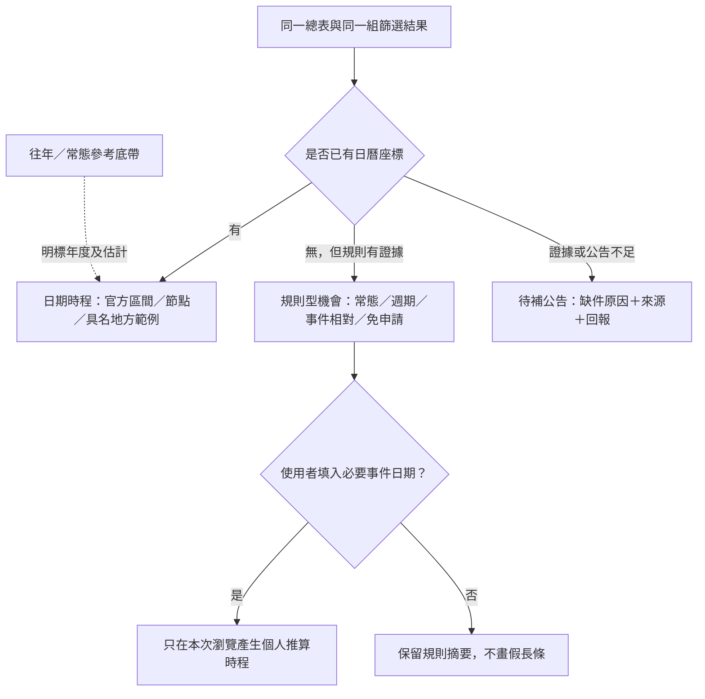
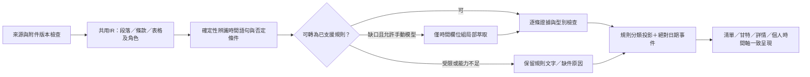

# 下一輪開發方向：時間語意、UI／UX、導覽與搜尋可見度

2026-11-03；基線為已合併並部署的PR40／41，main `6c34998d78ed774eedd93f214abbe26f7937a9ef`。本PR只做現況分析、離線盤點與規劃，沒有改網站程式、正式資料、候選核准、排程、模型、索引設定或部署；不自動合併本PR。所有時間標記、Schema及規則運算以下皆是**提案**，不是已實作功能。

## 1. 建議決策

下一步應改善UI／UX與導覽，但先處理時間語意，再教使用者理解它。SEO／AEO可同步準備內容與建置檢查，開放索引放在後面；不應為了畫滿甘特圖而補日期，也不應用導覽或漂亮文案遮住真正的萃取缺漏。

優先順序：**時間分類與來源證據 → 共用顯示及篩選 → 64筆時間重驗 → 短導覽 → 可索引內容頁**。延續原生HTML／CSS／JS、Python與Git資料快照，不因這輪新增資料庫、帳號、常駐Agent、向量服務或前端框架。

## 2. 現況與先前PR對照

| 參考 | 可沿用的能力／方向 | 本輪判斷 |
|---|---|---|
| [PR26](https://github.com/matt-ye/opengsa/pull/26)、[PR27](https://github.com/matt-ye/opengsa/pull/27)、[PR29](https://github.com/matt-ye/opengsa/pull/29) | IR準備、欄位局部重萃、規則＋模型、逐欄證據 | 重萃時間欄位組，不要求整筆所有欄位重跑；模型仍依原授權手動使用 |
| [PR28](https://github.com/matt-ye/opengsa/pull/28) | 雷達、未知分流、問題回報 | 維持不猜測，但把「有規則／缺使用者日期／未公告／未讀／解析失敗」分開 |
| [PR30：仍開啟](https://github.com/matt-ye/opengsa/pull/30) | 短導覽、Toutour、YAEO、滑動提示、無障礙 | 採納原則，不直接照舊稿落地；詳見§9 |
| [PR31](https://github.com/matt-ye/opengsa/pull/31)、[PR32](https://github.com/matt-ye/opengsa/pull/32) | 資訊鏈、事件、單位範例、歷史底帶、相對規則研究 | 保留事件／來源分層，補通用規則層；中央與地方期限不混用 |
| [PR37](https://github.com/matt-ye/opengsa/pull/37)、[PR38](https://github.com/matt-ye/opengsa/pull/38)、[PR39](https://github.com/matt-ye/opengsa/pull/39) | 原始來源處置、64筆摘要／58組、來源分類及日期補漏 | 不是64筆完整重萃，也不是全485原始URL已完成時間分類 |
| [PR40](https://github.com/matt-ye/opengsa/pull/40)、[PR41](https://github.com/matt-ye/opengsa/pull/41) | 回饋／來源推薦、權益四主題、跨區連結 | 已上架；導覽需對照這個介面，不再教舊的三主題權益頁 |

PR30查閱版本：`e0aeeb51476c28b2807c598a9913d71259dacfc4`；未合併其分支，也未更動PR33–36，尤其PR34維持棄用但保留。

### 2.1 64筆離線盤點

逐筆資料見[時間覆蓋盤點JSON](audits/temporal-coverage-2026-11-03.json)，64筆ID均有紀錄。沒有重抓獎助源站、沒有模型呼叫；只讀目前JSON並呼叫既有`candidate_preview_data`、`radar_metadata`、`timeline_metadata`及前端`makeDrafts`／`applyTimeline`。

| 觀察層 | 結果 | 正確解讀 |
|---|---:|---|
| 候選／暫定方案 | 64／58 | 全64筆pending，非64個已核定可申請方案 |
| 候選本身有絕對日期學生步驟 | 3 | 含年度最晚上限、舊年度，不代表3筆現在開放 |
| 候選本身有任一角色絕對日期步驟 | 9 | 機構、院、系所程序不能代填學生截止 |
| 候選本身有relative步驟 | 5 | 現有relative混放活動相對期限與常態月日；語意尚未統一 |
| 安全顯示層可辨識起日／學生期限或規則／結果 | 1／4／0 | 這是候選欄位證據閘門，尚未加資訊鏈範例；不是源站真的沒寫 |
| 安全顯示層有任一角色時間步驟 | 14 | 卡片可保留程序規則，甘特標籤卻仍主要看start／end |
| 加資訊鏈／系所範例後，有任一可畫日期或參考 | 20 | 以2026參考年、開啟底帶、全部文件且不限畫面日期範圍計；含歷史與行政節點 |
| 同上，有可連接起訖／有參考底帶 | 7／5 | 包含具條件的工具補助及地方範例；不是7個無條件當期窗口，兩數可重疊 |
| 日期投影前的文件狀態 | unknown 54、N/A 3、closed 7 | 不等於54筆萃取失敗，也不把N/A解讀成全年開放 |

這些集合可重疊，不相加成完整率。20筆以外的44筆，也不能直接判為「官方未公布」或「都是常態受理」。本輪未建立全64筆時間類型的人工標準答案。

### 2.2 已定位的原因

1. **資料模型**：`schedule.relative_rule`有`nstc_ntu／days_before／months_before`等類型，但缺少獨立的常態受理、審查節奏、額滿條件、來源未讀原因。`cycle.kind=academic_year`只代表週期標記，不足以證明每年固定收件。
2. **萃取**：`semantic_facts.recurring_time`主要辨識帶月日的每年／每學期規則；常態受理、無固定日期及複合條件仍缺通用入口。原始文字未持久保存，現有快照不足的欄位須日後受控重讀，不能憑標題填值。
3. **投影**：`radar_metadata.known.deadline`以學生步驟為核心；只有機構或補件規則時，不能推為學生期限，但仍應能顯示「機構規則已知」。`makeDrafts.timeRule`只取學生relative步驟，還可能因deadline證據閘門被清除，應改逐條規則呈現而非放寬證據。
4. **畫圖**：`drawGantt`左欄沒有start／end就放`UNKNOWN_LABEL`，即使`timeSteps`已有相對或常態規則；規則沒有日期座標時，目前沒有專屬圖形或區域。
5. **狀態與文案**：「不明，請見來源」同時用於日期、受理狀態、來源缺漏與其他欄位，掩蓋已知資訊。已知規則不等於已知今天受理；兩者應分列。

可直接重現的例子：國科會會議法源有機構彙送與補件規則；FAOS有會前兩個月的機構規則；千里馬辦法有常態月日。它們不一定有絕對日期，不能因此把整列時間判成空白。上述例子依本repo快照描述，本輪未重驗官方現行條文。

## 3. 時間分類：分清四個問題

不採一個巨大enum同時代表所有狀態；用四個小維度組合，前台再壓成少量標記。

| 維度 | 解答 | 建議類型 |
|---|---|---|
| 受理方式 `submission_mode` | 何時可以提出？ | 固定期、僅截止、常態受理、週期批次、事件相對、依單位公告、自動取得、不適用、未判定 |
| 審查節奏 `review_mode` | 何時審？ | 隨到隨審、定期批次、個案安排、未載明 |
| 可用條件 `availability_conditions` | 還有哪些界線？ | 年度最晚日、名額／預算、額滿或經費用罄、資格取得、購買／支出期間、暫停／恢復等 |
| 證據狀態 `evidence_state` | 我們知道到哪裡？ | 有直接證據、可依規則推導、僅歷史參考、官方明示待公告、來源鏈未齊、尚未解析、互相矛盾、存取受限 |

**「隨到隨審」主要是審查方式，不自動表示全年都可申請。**「常態受理」也可能只在某年度、資格成立後或經費用罄前有效。「依目的調整」建議改為較具體的「依活動日期計算」或「依事件日期計算」；購買、入學、論文接受及資格取得也可能是事件。

## 4. 對學生的標記、文案與甘特呈現

| 來源確定表達的情況 | 主標記／摘要示意 | 時程呈現 | 下一步 |
|---|---|---|---|
| 明確受理起訖 | 日曆「固定申請期」；起日–截止日 | 官方實心條，today線照常；公告與結果各用獨立標記 | 看申請文件 |
| 只知截止，不知開始 | 沙漏「截止已公告」 | 截止點；準備帶仍為建議，不畫虛構官方起日 | 提前準備，確認是否已受理 |
| 明示常態受理 | ∞「常態受理」；另列有效年度／條件 | 規則區的∞標記，不用全寬綠條假裝永久開放 | 核對目前條件與餘額 |
| 明示隨到隨審 | 「隨到隨審」次標記 | 附在任何相容受理模式旁；不是獨立無限時間條 | 閱讀辦理／審查時間 |
| 每年／每學期／每月固定批次 | 循環箭頭「定期受理」；已知常態月日 | 常態參考帶或批次符號；具體年度未確認前不上正式實心條 | 追當期公告 |
| 只公布月份、上中下旬或預估季節 | 「預計時段」；保留原文精度 | 月份／區間的淡色斜紋帶，不把月初月末畫成精確官方起訖 | 等待具體日程 |
| 會前、出國前、購買後等期限 | 錨點「依事件日期計算」；顯示原規則與角色 | 未填事件時留在規則區；填後畫個人推算線、事件點與送件點 | 「填日期，算送件基準」 |
| 活動期限＋年度上限＋預算條件 | 「複合期限」；年度上限只是其中一條 | 年度截止點＋條件標籤；有個人事件才算完整界線 | 逐條確認限制 |
| 各院系另訂收件日 | 校舍「依所屬單位公告」 | 已有範例則保留有署名範例列，個人期限不明示為套用 | 開承辦／院系來源 |
| 官方明示本期稍後公告 | 公告「本期時程待公告」 | 待補公告區；可疊明標的往年參考 | 看最新公告 |
| 本頁未列日期、鏈未齊或解析未完成 | 「本頁未列時程」／「需補當期附件」／「時間資訊待整理」 | 待補區，附原因與可操作連結 | 開具體缺件來源或回報 |
| 明示免另行申請／資格驗證即可啟用 | 勾選「免另行申請」／「資格驗證後啟用」 | 非日期資源區；若有啟用截止仍單列 | 看啟用條件 |
| 純法規／聘任制度參考 | 書本「制度參考」 | 不要求申請長條；有修正／生效日可另看制度版本 | 看辦法及當期招募 |
| 期限矛盾或版本衝突 | 警示「期限待核對」 | 不畫看似確定的申請條；並列衝突來源 | 看來源差異 |

圖示搭配文字及線型，不能只靠顏色或emoji。正式稿可用既有原生SVG／CSS圖示，暫不加圖示套件。黃色三角用在尚需核對的事實，常態／相對等已知規則用中性或藍綠標記；不要讓所有非固定期都像錯誤。

**避免文案誤導：**只有官方明示待公布，才寫「待公告」；未取得全文不得寫「官方未載明」。已辨識失敗就誠實寫待整理，不改名為常態受理。截止已過是狀態，不是萃取錯誤；N/A不是「不限」。

### 4.1 三種區域，仍在同一組篩選結果內



同一獎助可同時有絕對上限與相對條件；主列只呈現一次，兩種資訊組合顯示，不拆成兩個看似不同獎學金。不改變64筆文件／58組方案的定義或悄悄合併年度。

預設先看「日期時程」；緊接著是可展開的「無固定日期但有規則」與「時程待補」區，各顯示筆數及摘要，不能讓無日期資料被當成不符合篩選。手機預設顯示簡短摘要與「查看時程」動作，保留既有甘特／清單切換，不新增一個必學的主分頁。

### 4.2 相對計算與混合條件

- 先選已知事件種類，再要求最少必要輸入。會議首日、出國日、購買日、接受函日不可互代；不是所有來源都只用會議首日。
- 曆月與日曆天分開；「前一個月首日」不能當「前30天」，「兩個月」不能直接減60天。月底、閏年、跨年及非工作日有明確測試。
- 同一角色、同一分支、同一事件的多條必要期限才可取交集／較早者。學生截止與學校彙送分列，不能先取最小值再叫學生期限；擇一通路也不能誤算成交集。
- 例假日順延、工作日行事曆未驗證時保留限制與來源，不能顯示「已校正」。單純公曆推算可以顯示，但標「未含假日調整」。
- 沒有明確起日，就只畫截止點與個人準備建議，不把會前幾天至活動日整段塗成官方受理期。
- 「即日起」要有同公告的可信發布日及明確語句；更新日、爬取日或今天不可替代。
- 「建議提早」「原則上」「預計」保留建議／條件語氣，不升格為硬截止；「前一學期」缺所屬校曆時不近似成180天。「每年約六月」不補成6/1–6/30正式受理。
- 新竹／臺北AI補助是優先混合條件測試：起日或年度最晚日可以已知，仍須個人條件期限；不因有兩個日期就判今天可申請。
- 名額、經費及受理狀態需帶查核時間；「經費用罄即止」不是我們能從日期保證的狀態。
- 個人事件、推算值及填表進度只在本次瀏覽記憶體，不寫Git、Issue、分析事件或伺服器；公開條文與個人推算要有不同來源標記。

## 5. 資料契約與萃取規劃

最高層維持一筆方案／文件的表格存取，內部增加可組合的時間規則。候選是規則真相的儲存位置；資訊鏈共用文件與事件，前端只讀投影，不另維護一套前端公式。現有`conference-programs.json`未來由同一規則轉接，不再增加來源ID專用分支。

建議在下一版候選契約擴充` schedule.rules`及受理／審查分類，保留現有start、steps、result與relative_rule相容轉接。實作時訂明Schema版本、轉接器及快取失效條件；本PR不改Schema，也不要求舊64筆立刻填滿新必填欄。

每條規則至少保留：`rule_id`、適用年度／梯次／單位、申請或補件等階段、`actor`、事件錨點、計算操作及參數、包含端點與時間／時區、工作日政策、來源ID／revision／定位／hash、證據狀態與待補理由。另記`precision`（時刻／日／月／旬／學期等）與`rule_strength`（硬性界線／原則／建議／預計），避免以圖形精確度冒充來源精確度。條件與已算日期分開，缺事件時仍可展示有來源的文字規則。

時間的用途也要分：公告、申請、補件、審查、結果通知、活動、購買／支出、報支與啟用不可混成同一個deadline。「收齊文件後約30個工作日通知」若有來源，可展示為結果處理規則；沒有收齊日或已驗工作日曆就不產生確定結果日，亦不把這30日當申請期。

以下是**合成示意**，不是FAOS或任何真實方案的現行規定：

```json
{
  "submission_mode": "event_relative",
  "review_mode": "not_stated",
  "availability_conditions": [],
  "rules": [{
    "rule_id": "SYNTH-before-event",
    "stage": "application",
    "actor": "institution",
    "anchor": {"event": "conference_start"},
    "operation": {"type": "calendar_month_offset", "amount": -2},
    "boundary": "on_or_before",
    "timezone": "Asia/Taipei",
    "source_refs": [{"source_id": "SYNTH", "revision": "SYNTH", "locator": "合成條款"}],
    "evidence_state": "direct",
    "student_deadline": null
  }]
}
```

不讓模型輸出可執行程式或任意運算式。採有限、可驗證的操作種類：日期界線、曆日／曆月位移、指定月首／月末、週期批次、條件交集／擇一；超出能力先保留原規則與定位，不能任意套近似公式。

### 5.1 低成本流程



先用關鍵詞取得候選語句，再綜合角色、否定、年份、期間用途、上下條款與附件；不是看見「隨時」二字就標常態受理。規則常態化後也須保留「暫停／不得／僅限某年度／經費用罄／核定後」等限制。

相同文件只準備一次；重萃範圍只含時間規則、狀態理由及相關證據，其他已核對欄位不重跑。文件／IR／解析器／Schema／欄位範圍變更要失效舊結果；舊快照不能冒充新證據。hash_only不存原文／摘錄、不外送模型；登入、robots受阻維持原因。排程模型仍off，本規劃不新增API呼叫、配額或自動發布權限。

### 5.2 未知原因與資訊清晰度

前台不能只看日期非空比例。將「時間規則是否清楚」「是否已換算成日曆」「目前受理是否確認」拆開：規則很清楚、還沒填個人活動日，可以是「規則已明確／填日期試算」，不因無座標被判低品質；但也不因此變成受理中。

原因碼至少分：`explicit_pending_announcement`、`not_stated_on_read_page`、`missing_related_document`、`not_extracted`、`unsupported_format`、`restricted_source`、`conflicting_versions`、`needs_user_anchor`、`not_applicable`。沒有讀完允許的資訊鏈，不能用`not_stated_on_read_page`代表全部官方來源。紅綠燈表示資訊清晰度與衝突，不是資格或法律正確率；暫不顯示看似精準的「萃取完整百分比」。

## 6. 篩選、排序與後續輸出

- 新增與「受理狀態」獨立的「時間類型」篩選；前台先用固定期／常態／定期／依事件／依單位／免申請與參考／待補七組，細類放詳情。
- 預設保留時程待補與未填活動日期的項目；「已知符合」「可能相關」既有邏輯延續。沒有時間標記不代表不符合身分。
- 近期截止排序只比較同角色、同層級、可用日期；常態及未填事件日期另外分組，不能用12/31、今天或2099年當排序哨兵畫進圖裡。
- 第二、三頁使用相同時間投影，顯示哪些是官方事件、地方範例、歷史參考與個人推算；不從不同年份或文件各取一欄拼成確定申請期。
- RSS日後可公告「規則／當期公告有變」，不是把無日期當沒有更新；ICS只輸出已定日期或使用者主動產生的個人推算，不輸出假截止或持續每日事件。RSS／ICS本輪仍未啟用。

## 7. 分批處理範圍

| 批次 | 資源／驗證重點 | 產物與放行條件 |
|---|---|---|
| T0 | 現有64筆離線盤點、本文件與Schema草案 | 本PR；只記錄觀察，不替64筆新增未驗證時間類型 |
| T1 | 國科會會議法源、臺大路徑、FAOS、千里馬常態月日、學海要點；同時保留既有固定期對照 | 先把已保存且有證據的規則正確顯示，分清機構／學生／補件，無新源站抓取也能驗證投影 |
| T2 | 臺北／新竹AI工具補助及既有工具資源 | 混合年度上限、事件後期限、支出／啟用期；不憑年度最晚日宣稱目前可申請 |
| T3 | 剩餘64筆中未有可畫日期的44筆逐筆triage | 先分缺鏈／格式／未萃取／公告與純制度，不因為缺日期就整批判常態；需重讀者另受控分小批處理 |
| T4 | 從尚待納入的來源挑未參與規則設計的外部樣本 | 覆蓋固定、常態、事件相對、單位窗口、額滿、無日期等情境；先封存規則再盲測，失敗後修改必須換一組外部保留樣本 |

T1、T2、T3是處理面向，可重疊；44是目前投影沒有日期／參考的候選，不是另一個互斥資源批次。單批建議最多8個候選，先讀共用文件、再按來源限制申請下一輪抓取額度；不沿用已耗盡的舊HTTP預算，也不在此文件預先授權擴爬485個URL。

## 8. UI／UX先修內容與操作負擔

1. 第一屏只保留清楚的起點：「選用途 → 篩選 → 看時程／規則 → 勾選規劃」。維持四個主分頁與既有共用選取，不另造一組清單。
2. 每列左欄固定顯示時間類型與一句可讀規則，再以日期圖或規則區展開。缺結果日不必每列重複警示，放到詳情；結果未公布與根本不適用分開。
3. 圖例依畫面出現的類型顯示，白底網格維持收合；「怎麼看時間」旁有短說明，不強迫先看完整導覽。
4. 手機提示橫向捲動；沒有溢出就不顯示提示。保留文字時程及來源，不要求滑鼠hover才能看單位範例或規則。
5. 篩選後以簡短狀態區說明固定期、規則型、待補各幾筆；不把三種數量加進目前64文件／58方案之外造成假增長。
6. 選取成功用`aria-live`的短提示即可，維持焦點；不在權益自測完成時灑紙花，也不把判讀結果包裝成闖關通過。
7. 320px、390px、桌面矮視窗及放大200%均需檢查；固定導覽與甘特內捲動不能遮住焦點，`prefers-reduced-motion`停用非必要動畫。

## 9. 導覽：採PR30原則，修正過時部分

PR30目前仍開啟，不能把研究文件視為已裝好導覽。這輪比對既有HTML，`#gantt-chart`及`.btn-add`不存在；實際有`#persona-bar`、`#gantt-view`、`#gantt-grid`、`#select-filtered`、`#tab-rights`。情境快捷主要按用途，不應教成已完成個人資格判斷。

| 採納 | 調整／暫緩 |
|---|---|
| 常設「如何使用」、最多4步、可跳過與重開、上下文迷你說明 | 不採PR30後段「首次強制自動跳出」；它與其非侵入原則不一致 |
| Toutour的步驟撰寫／驗證方法、滑動提示理念 | 先原生說明＋可選短導覽；若需引擎，僅選Toutour或Driver.js其中一個，實作時再審檢版本／授權／大小，不同時裝多套 |
| 依實際可見UI定位；沒資料也能完成導覽 | 不使用過期selector；不能暗中改篩選、加入假獎學金、清空選取或輸入個人資料 |
| 可讀的視覺焦點、鍵盤、返回入口 | 暫緩模糊背景、全站快捷鍵及電影感轉場；資訊層次與時程語意優先 |
| 少量本機導覽偏好 | 預設本次記憶體；若另選「記住已讀」，只存版本化完成旗標，不存身分、活動或勾選，storage失敗仍可用 |

建議四步：①選用途（`#persona-bar`）→ ②看固定期／規則標記（可見圖表或空態容器）→ ③勾選並理解第二、三頁共用（穩定容器，非特定動態列）→ ④權益與求助（`#tab-rights`及新四主題）。導覽退出恢復原焦點及合理位置；切頁／捲動後重算定位，沒有目標就略過並給文字替代。

不收集追蹤事件作為本輪必要條件。先用人工任務觀察：能否找出「常態受理」、輸入會議日理解機構／學生期限差異、勾選後找到詳情與規劃、回到官方來源；記錄合成測試結果，不記使用者個資。

參考專案：Toutour [`cf7cb8b`](https://github.com/matt-ye/Toutour/tree/cf7cb8b50fff1204271488fed6dce8070e8ce648)、YAEO [`7b720f0`](https://github.com/matt-ye/yaeo/tree/7b720f0ced3a894f4051ec49283e836321f0873e)，本輪查閱其公開README與repo metadata，未安裝或執行外部Skill。導覽若使用modal才套相應焦點拘束；非modal不能假裝modal鎖住背景。[W3C modal pattern](https://www.w3.org/WAI/ARIA/apg/patterns/dialog-modal/)

## 10. SEO／AEO：先內容可引用，再談索引

目前`build_site.py`刻意輸出`noindex, nofollow`，canonical指向首頁；獎助卡片主要由JS從內嵌JSON生成，四頁使用hash。這是公開預覽的既有決策，**本PR不移除noindex**。公共上架不等於已開放搜尋收錄。

### 10.1 三階段

| 階段 | 工作 | 索引策略 |
|---|---|---|
| S0：準備／可與時間工作並行 | 用YAEO方法檢查實際build輸出：標題、語言、描述、可點連結、canonical、無JS時正文、來源與日期、授權與更正政策 | 雷達預覽與審查台維持noindex；報告把「刻意封鎖」列為發行設定，不當要偷偷修的錯誤 |
| S1：公開說明與指南 | 靜態產生`/opengsa/about/`、`/opengsa/guide/time-rules/`等實體HTML、唯一title／canonical、可見短答與官方連結 | 待核可後只讓明確允許的指南被索引；同一路徑no-JS可讀，不能把README當網站正文的唯一替代 |
| S2：穩定方案頁 | 以穩定方案ID產生實體頁，分年度／梯次／單位；提供摘要、時間規則、適用範圍、來源版本與更正入口 | 經證據檢查可讀投影允許後，再個別開放；候選可保持pending，不能冒充真人核准。不索引合成、私人規劃、錯誤頁或未讀來源內容 |

沿GitHub Pages build產生目錄／index.html，不為SEO先換框架或伺服器。`#search`等仍可作應用導覽，但不能把不同hash當獨立可索引的獎學金頁；不要只改成History API卻沒有可直達的實體檔案。[Google JavaScript SEO](https://developers.google.com/search/docs/crawling-indexing/javascript/javascript-seo-basics)

網站`robots.txt`、sitemap與canonical按發行路徑一致生成，保留`/opengsa/`子路徑；先允許爬蟲讀到noindex，不用robots阻擋後又期待它讀到排除標記。網址變動給明確對照；不把`lastmod`每天更新成掃描日，發布、內容異動、成功讀取與真人覆核日期分開。

### 10.2 可引用內容與結構化資料

- 每頁先給精簡答案：這是什麼資源、適用範圍、受理方式／規則、最後核對時間、官方來源。條件與年度緊貼答案，不藏到頁尾；不把地方範例寫成全國截止。
- 對「是否隨時可申請」「會前多久申請」「是否需要先拿接受函」等問題，只有來源支持才答；其餘明列缺口與承辦連結，不能用泛用AI文字補答案。
- JSON-LD只轉出頁面可見且有證據的內容。優先考慮WebSite、WebPage、BreadcrumbList；實際金錢補助可評估[MonetaryGrant](https://schema.org/MonetaryGrant)，工具優惠／法規／論文獎不一律套同型別。它不是Google保證提供的獎學金rich result。
- 申請期不是活動本身，不能為了日期顯示把每筆申請都標成Event。個人推算、歷史底帶、未知截止不得放成官方有效期間。[Google結構化資料規範](https://developers.google.com/search/docs/appearance/structured-data/sd-policies)
- Google明示AI搜尋功能沒有必需的特殊AI檔案或Schema；`llms.txt`可日後作其他服務的選配，不列第一階段必要成本，也不保證被引用。[Google AI features](https://developers.google.com/search/docs/appearance/ai-features)
- 2026-11-03核對Google更新紀錄：FAQ rich result已自2026-05-07起不再顯示，相關文件亦移除；可讀問答仍有用，但不能把「加FAQPage就能得到FAQ搜尋外觀」當驗收目標。[Google更新紀錄](https://developers.google.com/search/updates)

AEO的驗收是「機器與人能讀到有來源、帶條件的答案」，不是Google／AI平台必定收錄、排名或引用。YAEO的規則與CJK檢查可參考，但其README或PR30的工具宣稱仍須回官方來源；不採未驗證的提升百分比、舊star數或壓縮體積。

## 11. 建議拆PR與放行門檻

| 階段 | 範圍 | 完成門檻 |
|---|---|---|
| P1：時間契約與投影 | Schema遷移、規則證據、原因碼、相容轉接 | 每個已知標記可追到來源／版本；未知不變成不限；既有期限及角色不倒退 |
| P2：三種區域與個人計算 | 共用顯示、時間類型filter、相對輸入、圖例與文字替代 | 常態／相對無需假日期可見；混合條件不假判open；第二三頁與來源一致 |
| P3：64筆分批重驗＋外部盲測 | 按T1–T4，小批資料PR | 逐筆有時間類型或明確待辦；不要求每筆都有固定期；訓練／修改樣本與保留樣本分開 |
| P4：UI整理與可選導覽 | 快速起點、短說明、滑動提示、最多4步 | 鍵盤、手機、空清單、跨頁、焦點恢復、reduced motion通過；不用導覽也能完成核心任務 |
| P5：SEO／AEO發行 | 靜態指南／方案頁、metadata、路徑及索引允許清單 | 無JS可讀、深連結直達、canonical／sitemap一致、JSON-LD不超過可見證據；索引變更另行核可 |

S0建置審核可與P1並行；導覽應等P2的標記與操作穩定，再實作完整步驟。未另獲核可，不擴來源、不啟用模型排程或RSS／ICS，不替使用者提交來源回報，不變更PR34。

### 必備回歸情境

1. 固定期、只知截止、常態但有年度／額滿條件、隨到隨審但固定收件期、週期月日未公告當期。
2. 會前日曆天、曆月、前月首日、購買後期限、入學／資格取得後期限，與補件／申請兩階段。
3. 學生／系所／學院／機構分流；中央規則、地方範例與使用者所屬單位不一致。
4. 兩條必要限制與擇一限制，年度最晚日已知但個人錨點缺少，預算狀態過時。
5. 閏年、月底、跨年度、不同時刻、截止當天、工作日順延未驗證、月份／旬精度與收齊後結果通知；不能用UTC日期造成臺北日期偏移或把建議當硬截止。
6. 未公告、未取得附件、已讀但未列、格式不支持、矛盾、舊年度、免申請及純制度；皆不能自動標常態或open。
7. 清單／圖表／詳情／個人規劃／Issue一致，私人事件不進URL預填、repo或通知；來源變更後舊規則及推算失效。
8. 320px、390px、矮視窗、200%縮放、鍵盤與讀屏文字；固定導覽不遮目標；非日期區不被時間範圍／年度filter靜默刪除。

未來執行既有Node／Python／資料／建置檢查，新增測試必須驗語意與邊界，不能只驗關鍵字存在。報告將「文件可讀率」「規則可表示率」「逐條規則正確性」「可畫座標率」「受理狀態正確性」分開；分母附來源可讀性及樣本範圍，不以甘特長條數或全欄位非空率充當整體萃取正確率。

## 12. 本PR範圍及重現定位

本次只新增本計畫與64筆觀察JSON，並更新README、PLAN、AGENTS入口；不改任何production script／UI／Schema／候選。盤點呼叫鏈：`data/candidates/source-review.json` → `candidate_preview_data`＋`radar_metadata` → `makeDrafts(asOf=2026-11-03)` → `applyTimeline(scope=examples,year=2026,baselines=true)`，不限日期viewport。JSON逐筆留snapshot、來源可見性、目前顯示與下一輪查核任務；它不是新事實、分類核准或資料匯入。

重現時以同一main SHA、同一輸入快照與上述參數呼叫即可；今天日期、參考年度或資料版本改變時要另存新報告，不能覆寫成更好的歷史結果。本次沒有宣稱已重新核對全部官方源站。後續最值得先開工的是P1＋T1，先讓「已抓到規則但沒日期」的資源正確可見，再提高其餘來源的時間分類覆蓋。
