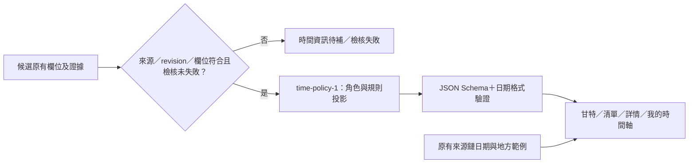

# 時間投影契約 v1：既有規則先可見

後續已獲准重萃並開另一支線：[時間重萃結果及64項呈現檢核](TEMPORAL-REEXTRACTION.md)。新增獨立時間觀察JSON、受限／延後原因、跨年度防護與附件來源版本；下文「不抓取／資料不變」描述PR43當時的P1／T1範圍，不是後續重萃現況。

2026-11-03使用者核可繼續時間契約與既有規則投影。本PR接續規劃PR42，先完成P1的相容投影與T1既有規則顯示；不代表整個路線圖、三區重排、新規則萃取或全來源時間分類均已完成。不自行合併／部署。

## 這輪改變

- `schema/time-policy.schema.json`：新增時間**顯示投影**的獨立契約。現有候選Schema及`data/`維持原樣；正式候選的`schedule.rules`遷移留到後續受控萃取批次，不先強制64筆補新必填欄位。
- `scripts/time_policy.py`：從候選既有`application_start`、`steps`、`result_date`及已知`relative_rule`轉接，每條規則保留角色、階段、原有摘要、日期精度、來源／revision／定位／欄位路徑。資料不變、沒有抓取或模型呼叫。
- `radar_metadata`新增`time_policy`，不放寬原`known.deadline`學生期限閘門。相對規則即使只有機構／補件證據，也可單獨展示，但不能取得學生日期或受理中狀態。
- 第一頁甘特列內新增無日期規則面板：已知規則有專屬標記與角色清單，沒有座標不畫假長條或today縱線。既有日期條、歷史底帶及具名單位範例保留；年度上限的條件提醒保留。
- 清單卡、點選詳情、第二頁、第三頁與文字表讀同一投影。文字表新增「時間類型／規則」欄；規則可展開，逐條有來源連結與定位。
- 保留既有單一主標題，補文字表caption／scope／可聚焦捲動區、具證據日期的`time datetime`標籤；不變更noindex、canonical或部署網域。這些只是本輪HTML語意補強，不宣稱已完成SEO／AEO。

## 契約的責任

每條規則的`source_refs`必須符合候選的source ID、revision及對應欄位。沒有引用只保留未知；失敗或衝突不顯示規則。`review_mode`本輪保持`not_stated`，不因缺日期或標題出現「隨到隨審」就推成全年受理。

事件相對規則只辨識既有相容類型與`conference_start`錨點，不新增來源ID專用公式。常態月日僅轉接既有`recurring_time`輸出的證據摘要，不從標題／零散關鍵字猜週期。不支持的相對文字保留為「時間規則已載（計算方式待整理）」，不能轉成確定日期。

本輪不新增計算器；入口導向現有會議規劃器，文案要求先選擇同一方案，再輸入日期，不自動把FAOS機構規則套為臺大學生期限。機構、學生、補件分列；假日未校正、校內收件未記錄均保留提示。新竹／臺北AI工具的年度上限另標個人條件，不由日期條推定目前受理。

## 64筆目前投影

| 基於候選本身的主要類型 | 筆數 |
|---|---:|
| 依活動日期計算 | 3 |
| 常態月日規則 | 2 |
| 僅有行政程序 | 6 |
| 年度上限＋個人條件 | 2 |
| 制度參考 | 3 |
| 僅有學生截止 | 1 |
| 未有可投影時間資訊 | 47 |

共64筆，沒有更改來源、candidate ID或pending狀態。這是候選原欄位的投影分類，還沒加入資訊鏈的地方日期／歷史底帶；加上那些日期後，前端依具名範例補相應標記。17筆有類型不等於17筆當期開放，也不宣稱其餘47筆官方未公布。原PR42的20筆／7組可畫觀察報告保持歷史原檔，不以本輪輸出覆寫。

## 測試與範圍

後端測試覆蓋64筆不變性、機構／補件不可代填學生、常態不補年份、缺證據／來源revision不符／unsafe時不揭露、不從標題或審查用語推常態、條件期限不可套所有工具，以及相對規則禁止偽造日期。前端測試驗證學生閘門關閉時機構規則仍可見，且不改原受理狀態、個人條件與地方範例。

既有Node／Python、資料檢查、配置檢查及公開／工作台建置須通過；Chrome驗證跨頁共用、國科會多角色、FAOS機構規則、千里馬常態月日、文字表、來源與規劃入口，以及手機無整頁溢出。

尚未做：重新萃取47筆缺口、辨識新的全年受理或審查模式、批次／額滿條件通用解析、三區重排／時間類型篩選、可索引實體頁與RSS／ICS。這些仍依PR42規劃逐步處理，不能為了降低未知筆數自行放寬證據。

## 使用者最新偏好

- 導覽預設不顯示，未來只放圓形「?」小按鈕，使用者主動開啟；待時間修正穩定後再做，本輪沒有新增導覽套件或彈窗。
- SEO／AEO可先改善HTML語意；目前只做本輪相關標籤與表格，不開放索引。之後預計放到mattye.dev的side project，網域、路徑及部署本輪不處理。
- 模型0、獎助源站重抓0，正式pilot10筆、64筆pending、真人台帳與新增來源排程維持原樣。PR30及PR33–36不處理，PR34棄用但保留。
