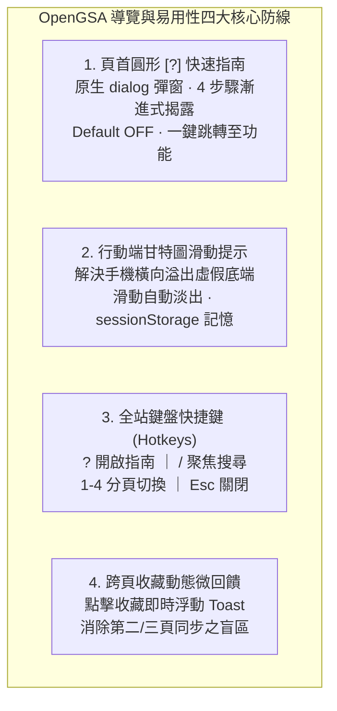

# OpenGSA 快速上手指南、UI/UX 導覽體驗升級與後續發展路線規劃手冊

> **文檔定位**：記錄 2026-11-06 經使用者決策核准之「方向一：UI/UX 與導覽體驗升級」完整實作細節，並將「方向二：自動庫外資源檢索規劃」與「方向三：Code Review 與架構模組化」正式列入專案後續發展路線（Roadmap & TODO）。

---

## 1. 執行摘要與核心成果

隨著 OpenGSA 全庫發布規模擴展至 **236 項獎學金與福利**，並涵蓋 78 所大專校院與 40 項學生 Perks，初次造訪之學生面臨龐大資訊密度與專業術語，極易產生認知負荷與「不知從何看起」之迷失感。

本輪實作遵循使用者自研之 **`matt-ye/Toutour`** 反模式審查標準與 **`cinematic-ui`** 電影級視覺分鏡原則，完成了「輕量化、純靜態、零侵入、高可用」之全方位體驗升級：

---

## 2. 新手上手指南設計與 Toutour 10 大反模式審查遵循

本指南完全採用 HTML5 原生 `<dialog id="guide-dialog">` 實作，杜絕肥大依賴庫，並嚴格通過使用者自研之 Toutour 規範校驗：

| Toutour 反模式審查項目 | OpenGSA 實作防禦機制 | 驗證結果 |
| :--- | :--- | :---: |
| **1. 拒絕阻塞式強迫彈窗 (No Full-screen Interstitials)** | 預設為關閉狀態（Default OFF），絕不在初次進站時強迫阻斷閱讀；由使用者主動點擊頁首 `❓ 快速指南` 或按下鍵盤 `?` 鍵時喚出。 | ✅ PASS |
| **2. 嚴格限制步數 $\le 4$ 步 (Step Count Limit)** | 精準規劃 4 個核心主題（1. 探索快篩 ➔ 2. 甘特圖 ➔ 3. 跨頁收藏 ➔ 4. 推播與權益），不超過 4 步上限。 | ✅ PASS |
| **3. 明確進度與回饋 (Progress Visibility)** | 提供頂部精緻膠囊徽章（`第 1 步 / 共 4 步`）與底部圓點指示器（Dots Indicator），步步清楚。 | ✅ PASS |
| **4. 雙向導覽與隨時退出 (Bidi & Escapability)** | 提供「上一步」、「下一步」、「完成」按鈕，支援鍵盤 `Esc` 鍵、點擊背景遮罩一鍵關閉。 | ✅ PASS |
| **5. 焦點返回與無障礙 (Focus Return & A11y)** | 關閉時自動將鍵盤焦點歸還至頁首觸發按鈕，維持無障礙焦點鏈不中斷。 | ✅ PASS |
| **6. 功能直接導引 (Actionable Jump Links)** | 每一步提供深層跳轉捷徑（如：👉 前往情境與篩選、👉 前往甘特圖、👉 開啟推播訂閱）。 | ✅ PASS |

### 4 步驟內容綱要：
- **Step 1：🎯 探索與快篩（一秒鎖定機會）**：指引學生使用頂部情境標籤（碩博/出國/助學/Perks）或左欄學歷、兼領、受理條件進行秒篩。
- **Step 2：⏳ 看懂真實時程甘特圖（掌握官方期限）**：圖解實心綠色色帶（受理期）、斑駁斜紋（截止前 30 天準備提醒帶）、空心菱形（推估日）與今天進行線。
- **Step 3：⭐ 收藏與跨頁行事曆（打造專屬排程）**：說明點擊「⭐ 收藏」後跨頁同步至【獎助詳情】比對與【我的時間軸】代辦清單，以及研討會差旅試算功能。
- **Step 4：📡 主動推播與權益保障（隨時掌握更新）**：引導使用雙軌 RSS 與 Follow.it 訂閱 Email，並介紹第四頁研究生兼任助理法定五級救濟地圖與從屬性自測。

---

## 3. 行動端體驗與全域快捷鍵

### 3.1 甘特圖行動端橫向滑動暗示（Scroll Hint）
- **痛點**：手機寬度（< 800px）下，甘特圖寬度超出螢幕，需要橫向滑動。新使用者常誤判右側截斷（False Bottom）。
- **解法**：在行動端顯示微提示膠囊 `👈 手指左右滑動以檢視完整時程 👉`；當使用者水平滑動超過 30px 或點擊關閉時平滑淡出，並記錄 `sessionStorage` 避免打擾。

### 3.2 全域快捷鍵支援（Global Hotkeys）
- `?`（或 `Shift + /`）：開啟/切換快速上手指南。
- `/`：將焦點移至搜尋框 `#search-query` 並自動選取文字（在表單輸入框內打字時不觸發）。
- `1` ~ `4`：快速切換四個島嶼分頁（1: 找獎助, 2: 詳情, 3: 時間軸, 4: 權益）（在輸入框內打字時不觸發）。
- `Esc`：一鍵關閉正在開啟的指南或 RSS 對話框。

### 3.3 跨頁收藏動態微提示（Global Toast）
- 於畫面右上角配置深色墨綠浮動氣泡，勾選方案時即時彈出 `⭐ 已將《方案名稱》加入個人時程（已同步至【我的時間軸】）`，2.5 秒後自動滑出淡出。

---

## 4. 後續發展路線規劃（Roadmap TODOs）

依據 2026-11-06 使用者指示，將以下兩大方向正式列入後續 TODO 規劃：

### 4.1 TODO 1：自動的庫外資源檢索規劃（Autonomous External Discovery Probe）
- **目標**：在嚴格遵守 `AGENTS.md` 規範（零模型 `model_mode=off`、微批 HTTP、同站間隔、真人審查閘門）前提下，自動捕捉外部最新獎助公文與年度更新。
- **架構設計**：
  1. **低頻探針排程（Weekly Cron Probe）**：
     - 每週定時檢查政府資料開放平台（`data.gov.tw`）之「獎學金 / 助學金」JSON/API 端點。
     - 輪詢大專校院生輔組與教育部高教司公開 RSS / Atom 頻道。
  2. **發現候選待審清冊（Discovery Candidate Log）**：
     - 比對現有 `source-inventory.json`（485 來源）與全庫 236 方案，產出 `data/discovery-candidates.json`。
     - 僅儲存 URL、標題、發現日期與初步雜湊，**絕不自動寫入正式資料庫或修改前台**。
  3. **維護者審查工作台（Review Dashboard Hook）**：
     - 提供一鍵審查比對視圖，供人工判定是否立項建卡。

### 4.2 TODO 2：Code Review 與前端核心架構模組化（Modularization & A11y Deepening）
- **目標**：提升目前 1,700+ 行 `docs/design/prototype.js` 的可維護性、型別安全與無障礙表現。
- **架構設計**：
  1. **職責解耦模組化（Sub-module Extraction）**：
     - `core/time-policy.js`：時程投影、甘特圖起訖與準備提醒帶計算。
     - `core/filter-engine.js`：多維度身分、情境標籤與同義詞搜尋。
     - `ui/gantt-renderer.js`：甘特圖 DOM 節點、進行線與縮放移動控制。
     - `ui/onboarding-tour.js`：新手上手指南狀態機、鍵盤事件與動效控制。
     - `ui/toast-manager.js`：全域通知與微回饋管理器。
  2. **無障礙深耕（A11y Deepening）**：
     - 補強 Dialog 內部的 Focus Trap（Tab 鍵焦點循環約束）。
     - 增添 Screen Reader `aria-live` 即時朗讀（如搜尋結果筆數變更、分頁切換提示）。
     - 強化高對比度（High Contrast Mode）樣式適配。
