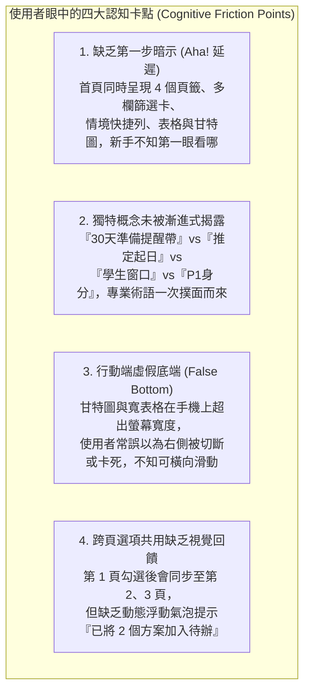
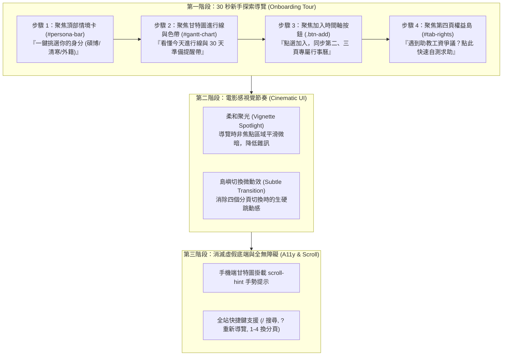

# OpenGSA 網站導覽教學、UI/UX 易用性升級與參考開源專案／Skill 深度研究報告

> **本文件定位**：針對使用者反映「目前網站使用不夠直觀，需加上教學與導覽」之痛點進行深度 UI/UX 前瞻調研。本報告整合使用者自研之 `Toutour`、`yaeo` 技能體系、`cinematic-ui` 電影級視覺敘事方法論，以及全球頂尖開源導覽庫（`Driver.js`、`Scroll-Hint`、`Floating UI` 等），擬定完整的三階段落地藍圖，供後續 Agent 進行無縫匯整與落地實作。
> 
> **本輪約束**：本輪不修改現行程式碼，專注於架構診斷、專案分析、流程圖繪製、資源準備與參考 Repo 規格化。

---

## 1. 執行摘要（Executive Summary）

OpenGSA 專案目前具備功能完整之四分頁互動原型（包含找獎助、備件行事曆、行政求助、權益與工資保障），並建立了嚴謹的資料契約、甘特圖起訖渲染與雙軌檢核機制。然而，由於資訊密度極高、專業術語集中且缺乏引導層，初次造訪學生普遍面臨「不知從何下手」之障礙。

本研究報告提出「**輕量化、非侵入式、電影感敘事**」之 UI/UX 升級戰略：
1. **導覽生成標準**：以使用者自研之 **`matt-ye/Toutour`** 作為 Onboarding 腳本之生成與反模式審查規範，避免常見的暴力阻斷式全螢幕彈窗。
2. **視覺節奏營造**：借鑑 **`akseolabs-seo/cinematic-ui`** 的導演分鏡思維，以柔和聚光（Vignette Spotlight）與視覺呼吸感消除公務表格之壓迫感。
3. **技術核心選型**：評估 **`Driver.js v1`**（純原生 TS、零依賴、~5KB）與 **`appleple/scroll-hint`**，解決手機端甘特圖橫向捲動盲區與「虛假底端（False Bottom）」問題。
4. **檢索可達性把關**：結合 **`matt-ye/yaeo`** 的 CJK 友善閾值，確保繁體中文法規與獎助資訊符合新世代 AEO/GEO/LLMO 語意標準。

---

## 2. 現狀診斷：使用者為何反映「目前網站不夠直觀」？

經過對現有使用者回饋與原型架構（`docs/design/wireframes.html`、`docs/design/prototype.js`）的深度審視，我們診斷出四大核心認知卡點（Cognitive Friction Points）：

### 2.1 四大痛點詳細剖析
1. **痛點 1：缺乏第一步暗示（Aha! Moment 延遲）**
   - **現象**：學生進入網站時，畫面同屏展示「頂部身分快速列（Persona Bar）」、「左側多維度篩選卡（Filter Card）」、「右側機會清單」與「下方甘特圖進行線」。
   - **心理障礙**：使用者缺乏明確的視覺錨點（Visual Anchor），不知道是該「先按快篩」、「先輸入關鍵字」還是「先看甘特圖」，導致思考停滯。
2. **痛點 2：專業概念缺乏「漸進式揭露（Progressive Disclosure）」**
   - **現象**：OpenGSA 為求法規精準，引入了「推定起日（inferred）」、「截止前 30 天準備提醒帶（Notice Window）」、「學生窗口 vs 機構窗口」、「P1 博士候選人」、「從屬性自測指標」等嚴謹概念。
   - **心理障礙**：若無微導覽（Micro-tour）或 Tooltip 引導，一般學生無法即時理解「為什麼有些長條是虛線提醒、有些是實心」、或「為什麼有些起日寫推定」。
3. **痛點 3：行動端（RWD）「虛假底端（False Bottom）」與「橫向滾動盲區」**
   - **現象**：甘特圖橫軸跨越數個月，寬度超過手機螢幕寬度（375px~430px）。雖然已實作 `overflow-x: auto`，但在行動端缺乏視覺陰影或動態箭頭提示。
   - **心理障礙**：學生往往誤以為表格右側內容丟失或版面壞掉，不知道手指可以橫向滑動檢視後續月份。
4. **痛點 4：跨頁共用（Cross-tab Sharing）缺乏即時動態微回饋**
   - **現象**：在第一頁勾選獎學金會自動存入記憶體並同步至第二頁（研討會）與第三頁（行事曆）。
   - **心理障礙**：勾選按鈕後缺乏類似購物車加入時的輕量氣泡（Badge Toast），學生不知道第二頁已經發生改變。

---

## 3. 使用者自研 Skill 與關鍵專案深度剖析

### 3.1 [`matt-ye/Toutour`](https://github.com/matt-ye/Toutour) —— AI 驅動之 Onboarding Tour 生成與反模式審查 Skill
- **專案定位**：專門為 AI Coding Agent（Claude Code 等）打造之自動化導覽生成器與反模式審查規範。
- **四大核心技術亮點**：
  1. **DOM 佈局與組件自動分析（Automatic Layout & Component Inspection）**：能自動爬梳網頁的層級結構，辨識最關鍵的互動入口，免去手動翻查或硬寫脆弱 CSS Selector 的困擾。
  2. **10 大 Onboarding 反模式審查（10 Anti-Pattern Audit）**：
     - 主動防禦「全螢幕阻塞式彈窗（Full-screen Interstitials）」—— 避免使用者一進站就被強迫看說明。
     - 嚴格控制「導覽步驟數 $\le 4$ 步」—— 數據證實步驟過長會導致 80% 以上使用者中途關閉。
     - 堅持「可跳過性（Skip-ability）」與「狀態記憶」—— 絕不強迫重複觀看。
  3. **Playwright 真實瀏覽器端點驗證**：能在真實瀏覽器環境中自動檢查每個導覽步驟的標的元素「是否存在、是否在 Viewport 可見、是否被 Sticky Header 遮擋」。
  4. **~13 KB 極輕量零依賴參考引擎 + `scroll-hint.js`**：
     - 具備 `startAt` 深度連結能力（如網址帶 `#tour` 即可自動啟動）。
     - 內建 `scroll-hint.js` 模組，正是解決 OpenGSA 甘特圖在行動端「虛假底端」的最佳解方！
- **對 OpenGSA 的整合價值**：**完全適配**。OpenGSA 後續導覽腳本應完全採用 Toutour 規範生成，以維持輕量純靜態與極高可用性。

### 3.2 [`matt-ye/yaeo`](https://github.com/matt-ye/yaeo) —— 語意檢索與新世代 AI 平台優化 Skill
- **專案定位**：針對 SEO / AEO（Answer Engine Optimization）/ GEO（Generative Engine Optimization）/ LLMO 的多層次代碼與內容品質審查技能。
- **核心亮點與 CJK 友善閾值**：
  - 專為繁體中文、日語等語系調適最佳文字密度與語意標籤閾值。
  - 提供具備「可引用來源（Citable Sources）」之嚴謹檢查規則。
- **對 OpenGSA 的整合價值**：
  - 易用性不僅存在於站內互動，更在於**站外檢索的精準可達性**。
  - 當學生在 Perplexity、SearchGPT 或 Google 搜尋「臺大博士生獎學金兼領規定」或「研究生兼任助理工資下限」時，透過 `yaeo` 驗證的 OpenGSA 靜態語意結構能確保 AI 引擎第一時間準確引用，免除學生翻找政府繁複公報之苦。

### 3.3 [`akseolabs-seo/cinematic-ui`](https://github.com/akseolabs-seo/cinematic-ui) & [Cinematic Skill Gallery](https://cinematicskill.com/zh-tw/gallery/) —— 電影級視覺敘事與去壓迫化
- **專案定位**：AKSEO Labs 開發之 AI Agent 設計技能，強制 AI 擺脫死板的工程樣式選擇，轉以**電影導演（Film Director）**思維構建網頁。
- **核心哲學與方法論**：
  - **分鏡與視覺故事線（Shot List & Visual Flow）**：將網頁各區塊視為電影鏡頭，有主景（Wide Shot，全覽島嶼）、中景（Medium Shot，方案卡片）與特寫（Close-up，截止日倒數與救濟窗口）。
  - **柔和暗角打光（Vignette & Focal Lighting）**：在導覽或焦點互動時，背景柔和微暗並帶微模糊（Backdrop Blur），自然引導使用者視線。
  - **色彩調色（Color Grading）**：擺脫生硬的刺眼對比，採用富有層次與呼吸感的大地色或冷暖平衡調色，消除大量公務法規條文帶來的冰冷感與壓迫感。

---

## 4. 全球頂尖開源導覽與 UI/UX 增強庫橫向評比

為了提供後續 Agent 實作時最健全的技術選型依據，我們橫向評比了 GitHub 上最成熟、高評價的輕量原生前端工具庫：

| 專案名稱與 GitHub 連結 | Stars / 授權 | 核心技術架構 | 檔案大小 | 優點 | 缺點 / 限制 |
| :--- | :---: | :--- | :---: | :--- | :--- |
| **[Driver.js](https://github.com/kamranahmedse/driver.js)** `kamranahmedse/driver.js` | **~24k+** MIT | 純原生 TypeScript 重寫 (v1) 零外部依賴 | **~5 KB** (gzipped) | • 智慧碰撞檢測與自動翻轉 • 支援無錨點中央導覽彈窗 • 暗色聚光燈遮罩平滑過渡 • 完整事件生命週期 Hooks | 無內建繁中語系檔（需自傳按鈕文字，但客製彈性高） |
| **[Shepherd.js](https://github.com/shipshapecode/shepherd)** `shipshapecode/shepherd` | ~14k AGPL | 基於 Floating UI 模組化架構 | ~15 KB (gzipped) | • WAI-ARIA 無障礙標準支援極佳 • 外觀主題化成熟度高 | • AGPL 授權限制較多 • 依賴較多外部浮動計算包 |
| **[Scroll-Hint](https://github.com/appleple/scroll-hint)** `appleple/scroll-hint` | ~1k MIT | 純原生 Vanilla JS 行動端手勢感應 | **~2 KB** (gzipped) | • **專為寬表格與甘特圖設計** • 自動偵測是否超出容器寬度 • 出現優雅的左右滑動手勢微動效 | 功能單一，僅專注於橫向滾動提示 |
| **[Floating UI](https://github.com/floating-ui/floating-ui)** `floating-ui/floating-ui` | ~31k MIT | 頂級視窗邊界定位計算庫 | ~3 KB (core) | • 業界最準確的碰撞、邊界翻轉數學邏輯 • 箭頭（Arrow）自動對齊邊界 | 僅為定位計算引擎，需自行渲染 DOM 樣式 |
| **[Hotkeys-js](https://github.com/jaywcjlove/hotkeys)** `jaywcjlove/hotkeys` | ~6.5k MIT | 輕量全域快速鍵監聽器 | **~3 KB** (gzipped) | • 支援組合鍵（如 `Ctrl+K`, `/`, `Esc`） • 解決各瀏覽器鍵盤代碼相容性 | 需防範表單輸入時誤觸快速鍵 |
| **[Canvas Confetti](https://github.com/catdad/canvas-confetti)** `catdad/canvas-confetti` | ~8k MIT | 畫布級慶祝微粒子引擎 | **~4 KB** (gzipped) | • 零 DOM 節點污染（全繪於 Canvas） • 在自測完成時提供極佳微成就感 | 需避免濫用導致視覺干擾 |

---

## 5. OpenGSA 導覽與易用性落地藍圖（三階段設計）

結合上述分析，為 OpenGSA 規劃出符合「**零代價、純靜態、零侵入、高可用**」的三階段易用性升級路徑：

### 5.1 第一階段：30 秒新手探索導覽（Toutour 驅動）
- **核心設計**：
  - 步驟數嚴格限制在 **4 步以內**，不造成閱讀負擔。
  - **Step 1**：聚焦 `#persona-bar`（情境快速列）——「第一步：點選符合您的身分，瞬間篩出相關補助」。
  - **Step 2**：聚焦甘特圖與今天線 ——「第二步：看懂申請時程。實線為正式受理期，虛線為截止前 30 天準備提醒帶」。
  - **Step 3**：聚焦表格「加入時間軸」按鈕 ——「第三步：將心儀方案加入行事曆，第二、三頁自動同步專屬排程」。
  - **Step 4**：聚焦第四分頁「權益與工資保障」——「第四步：研究生兼任助理薪資或著作權遇爭議？點此自測求助」。
- **狀態管理**：
  - 儲存於 `localStorage.getItem('opengsa_tour_completed')`。
  - 使用者關閉或完成後不再主動打擾。
  - 介面右上角與右下角常設 `? 新手導覽` 浮動按鈕，隨時供需要的學生喚醒。

### 5.2 第二階段：電影感視覺節奏與呼吸感（Cinematic UI 啟發）
- **聚光燈暗角（Vignette Backdrop）**：
  - 導覽啟動時，非標的元素覆蓋 `rgba(15, 23, 42, 0.65)` 搭配微柔焦 `backdrop-filter: blur(2px)`，將高密度的文字雜訊隱去，精確突顯說明目標。
- **島嶼切換過渡動效**：
  - 四個 Tab（探索島、行事曆島、求助島、權益島）切換時，加入 150ms 輕微淡入淡出（Fade-in）與滑動平移，消除 DOM 突兀置換的生硬感。

### 5.3 第三階段：消滅虛假底端與鍵盤無障礙（Accessibility & RWD）
- **甘特圖橫向捲動暗示（Scroll-Hint）**：
  - 在寬螢幕時隱藏；當螢幕寬度 $\le 768px$ 且甘特圖容器具備橫向溢出時，自動浮現「左右滑動」手勢指示符，手指滑動後自動淡出，徹底解決手機端被誤判為卡死的問題。
- **全站鍵盤導覽（Hotkeys）**：
  - 按鍵 `/`：直接將游標聚焦於搜尋輸入框。
  - 按鍵 `1` ~ `4`：快速在四個島嶼分頁之間切換。
  - 按鍵 `?`：開啟新手導覽或快捷鍵說明卡。
  - 按鍵 `Esc`：一鍵退出導覽或彈跳視窗。

---

## 6. 給後續接手 Agent 的匯整與實作指引（Handoff Guide）

接手本任務進行代碼實作的 Agent，可依循以下精準指引進行開發：

1. **依賴引入原則**：
   - OpenGSA 堅持純靜態 JAMstack 架構，不引入肥大的 NPM 構建鏈。
   - 導覽腳本可直接採用 `Driver.js` 單一純 JS/CSS 靜態嵌入，或直接借鑑 `Toutour` 的 13KB 原生引擎。
2. **建議落實檔案結構**：
   - 新增 `docs/design/tour.js`：封裝導覽步驟定義、`localStorage` 狀態讀寫與事件綁定。
   - 新增 `docs/design/tour.css`：定義 Cinematic UI 聚光燈遮罩、柔焦與氣泡樣式。
   - 整合於 `docs/design/wireframes.html` 與 `docs/design/prototype.js`：在頁尾引入腳本，並於導覽列補上 `? 導覽` 觸發按鈕。
3. **驗證與防呆清單**：
   - [ ] 執行 `node --test tests/prototype.test.cjs` 確保既有 38 項測試不回歸。
   - [ ] 驗證首次造訪自動跳出導覽，點擊略過後重整頁面不再跳出。
   - [ ] 點擊 `? 導覽` 能無誤重新觸發 4 步驟流程。
   - [ ] 行動裝置寬度（375px）實測甘特圖是否成功掛載滑動暗示。

---

## 7. 參考來源與官方 Repository 連結清單

### 7.1 使用者自研核心專案
1. **matt-ye / Toutour**  
   - GitHub: [https://github.com/matt-ye/Toutour](https://github.com/matt-ye/Toutour)  
   - 說明：AI 驅動 Onboarding 導覽生成器、10 大反模式審查、Playwright 驗證與 13KB 輕量引擎。
2. **matt-ye / yaeo**  
   - GitHub: [https://github.com/matt-ye/yaeo](https://github.com/matt-ye/yaeo)  
   - 說明：新世代 SEO/AEO/GEO/LLMO 四層檢索審查技能，內建 CJK 友善閾值。

### 7.2 電影級視覺敘事專案
1. **AKSEO Labs / cinematic-ui**  
   - GitHub: [https://github.com/akseolabs-seo/cinematic-ui](https://github.com/akseolabs-seo/cinematic-ui)  
   - 官網展間：[https://cinematicskill.com/zh-tw/gallery/](https://cinematicskill.com/zh-tw/gallery/)  
   - 說明：將電影導演視覺分鏡、打光層次與視覺節奏引入網頁設計的 AI Agent 技能。

### 7.3 全球頂尖開源導覽與 UI/UX 工具庫
1. **Driver.js (v1 Rewrite)**  
   - GitHub: [https://github.com/kamranahmedse/driver.js](https://github.com/kamranahmedse/driver.js)  
   - 官網：[https://driverjs.com/](https://driverjs.com/)  
   - 授權：MIT（~24k+ Stars，純原生 TS，~5KB gzipped 零依賴導覽庫）。
2. **Shepherd.js**  
   - GitHub: [https://github.com/shipshapecode/shepherd](https://github.com/shipshapecode/shepherd)  
   - 官網：[https://shepherdjs.dev/](https://shepherdjs.dev/)  
   - 授權：AGPL（~14k Stars，WAI-ARIA 完整支援之導覽庫）。
3. **Scroll-Hint**  
   - GitHub: [https://github.com/appleple/scroll-hint](https://github.com/appleple/scroll-hint)  
   - 授權：MIT（專為行動端寬表格與甘特圖設計之橫向捲動提示庫）。
4. **Floating UI**  
   - GitHub: [https://github.com/floating-ui/floating-ui](https://github.com/floating-ui/floating-ui)  
   - 官網：[https://floating-ui.com/](https://floating-ui.com/)  
   - 授權：MIT（~31k Stars，現代最頂級之彈窗與浮動定位計算引擎）。
5. **Hotkeys-js**  
   - GitHub: [https://github.com/jaywcjlove/hotkeys](https://github.com/jaywcjlove/hotkeys)  
   - 授權：MIT（~6.5k Stars，純原生極輕量快速鍵處理器）。
6. **Canvas Confetti**  
   - GitHub: [https://github.com/catdad/canvas-confetti](https://github.com/catdad/canvas-confetti)  
   - 授權：MIT（~8k Stars，畫布級輕量慶祝粒子微動效）。
