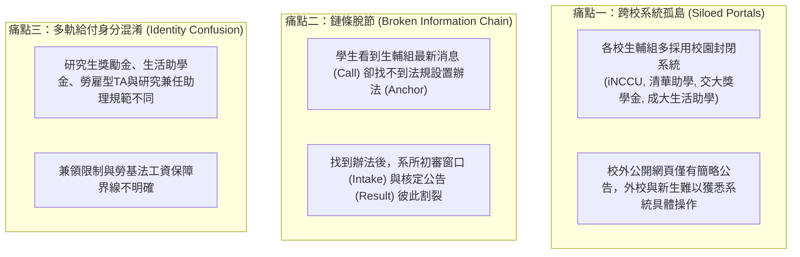
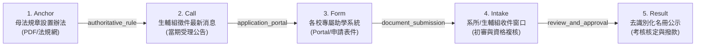

# 全台公私立大專校院生輔組資訊鏈（Assistance Offices Source Chains）深化拓撲規格書

> **版本**：2.0.0-deep-university-chains  
> **更新時間**：2026-11-06  
> **核心關聯資料**：
> - 大學資訊鏈批次：[`data/source-chain-batches/batch-university.json`](../data/source-chain-batches/batch-university.json)（120 份文件節點、96 條流轉邊）
> - 全台 78 校生輔組總名冊：[`data/source-expansion/university-source-inventory.json`](../data/source-expansion/university-source-inventory.json)（U001–U078）
> - 跨校代表性方案候選清冊：[`data/candidates/university-scholarships.json`](../data/candidates/university-scholarships.json)（24 方案）
> - 通用註冊表：[`data/source-chain-batches/batch-registry.json`](../data/source-chain-batches/batch-registry.json)

---

## 1. 深化背景與高教資訊鏈痛點解構

大專校院生活輔導組（生輔組 / 生活事務組 / 課外活動組）是全國大專校院與研究生各類獎學金、研究生獎勵金、生活助學金與急難慰助金的核心行政樞紐。然而，全台大專校院獎助學金的資訊流通存在以下三項深層結構性痛點：

為徹底打通各校資訊孤島，OpenGSA 在 PR #60 的 3 節點基礎上，全面深化升級為**「五節點閉環標準拓撲架構」**，覆蓋 24 所代表性大學、120 份文件節點與 96 條邊，並對接全台 78 所公私立大學校院。

---

## 2. 大專校院生輔組五節點標準拓撲架構

### 節點職責與鏈結標準 (Node Specifications)

1. **節點一：Anchor（母法規章設置辦法）**
   - **定位**：各校經校務會議、行政會議或學務會議審議通過之獎助學金設置辦法與作業要點（如《國立清華大學校長獎學金設置要點》、《國立陽明交通大學學術優秀研究生獎學金要點》）。
   - **作用**：提供方案之法規授權來源、經費預算基礎（如校務基金、教育部高等教育深耕計畫配合款）、資格門檻與排他條款。
2. **節點二：Call（生輔組徵件最新消息）**
   - **定位**：生輔組於每學期初或招生放榜後發布之正式徵件公文、公告與最新時程表。
   - **作用**：明確規定當學期或當年度之受理起訖日（如每年 9 月中至 10 月初、2 月底至 3 月初）、分配名額與繳交清單。
3. **節點三：Form（校園助學系統 / 申請表件）**
   - **定位**：學生線上填報之各校專屬校園資訊入口（Portal）或具備結構化填寫欄位之申請書、研究計畫書 PDF/ODT 表格。
   - **作用**：引導學生完成線上填報、成績單上傳、指導教授背書與弱勢證明驗證。
4. **節點四：Intake（初審收件窗口）**
   - **定位**：明確區分「生輔組直接收件（直申類）」或「先送交所屬系所辦公室／學院初審審查（系所彙送類）」。
   - **作用**：杜絕學生「逕行送至學務處卻被退件」之常見行政阻礙，規範內部初審造冊流程。
5. **節點五：Result（去識別化名冊公示與考核撥款）**
   - **定位**：各校學務會議審議通過後之去識別化受獎名冊公告、撥款流程與受獎生履約考核機制（如期末研究報告發表或學術義務服務）。
   - **作用**：確保公共資源監督公開透明，建立完整的受獎履約閉環。

---

## 3. 全台 24 所代表性大學生輔組資訊鏈五節點清單

本批次已於 [`data/source-chain-batches/batch-university.json`](../data/source-chain-batches/batch-university.json) 全面完成 5 節點實裝：

| 方案代碼 (Program Key) | 學校名稱 | 代表性獎助方案名稱 | 拓撲節點清單 (Anchor ➔ Call ➔ Form ➔ Intake ➔ Result) |
| :--- | :--- | :--- | :--- |
| `univ-nthu` | 國立清華大學 | 校長獎學金與優秀研究生學術獎助 | `Rules` ➔ `sa.site.nthu.edu.tw` ➔ `Portal` ➔ `Intake` ➔ `Results` |
| `univ-nycu` | 國立陽明交通大學 | 學術優秀研究生獎學金 | `Rules` ➔ `osa.nycu.edu.tw` ➔ `Portal` ➔ `Intake` ➔ `Results` |
| `univ-ncku` | 國立成功大學 | 優秀研究生獎助學金與博班生活獎助 | `Rules` ➔ `assistance-osa.ncku.edu.tw` ➔ `Portal` ➔ `Intake` ➔ `Results` |
| `univ-nccu` | 國立政治大學 | 指南優秀研究生獎學金與勵學獎助 | `Rules` ➔ `osa.nccu.edu.tw` ➔ `Portal` ➔ `Intake` ➔ `Results` |
| `univ-ncu` | 國立中央大學 | 碩博士研究生獎助與國際拔尖獎學金 | `Rules` ➔ `military.ncu.edu.tw` ➔ `Portal` ➔ `Intake` ➔ `Results` |
| `univ-nsysu` | 國立中山大學 | 西子優秀學生與博士生勵學獎學金 | `Rules` ➔ `ag-osa.nsysu.edu.tw` ➔ `Portal` ➔ `Intake` ➔ `Results` |
| `univ-nchu` | 國立中興大學 | 優秀碩博研究生獎助金 | `Rules` ➔ `www.osa.nchu.edu.tw/osa/laa` ➔ `Portal` ➔ `Intake` ➔ `Results` |
| `univ-ccu` | 國立中正大學 | 研究生學術卓越獎學金 | `Rules` ➔ `studaff.ccu.edu.tw` ➔ `Portal` ➔ `Intake` ➔ `Results` |
| `univ-ntnu` | 國立臺灣師範大學 | 優秀研究生獎助與拔尖計畫 | `Rules` ➔ `assistance.sa.ntnu.edu.tw` ➔ `Portal` ➔ `Intake` ➔ `Results` |
| `univ-ntpu` | 國立臺北大學 | 三峽優秀研究生學術獎助 | `Rules` ➔ `www.ntpu.edu.tw/admin/a8` ➔ `Portal` ➔ `Intake` ➔ `Results` |
| `univ-ntust` | 國立臺灣科技大學 | 卓越博士研究生勵學獎學金 | `Rules` ➔ `student.ntust.edu.tw` ➔ `Portal` ➔ `Intake` ➔ `Results` |
| `univ-ntut` | 國立臺北科技大學 | 優秀碩博士研究生入學與拔尖獎學金 | `Rules` ➔ `osa.ntut.edu.tw` ➔ `Portal` ➔ `Intake` ➔ `Results` |
| `univ-cgu` | 長庚大學 | 庚心優秀研究生與產學獎勵金 | `Rules` ➔ `studentaffairs.cgu.edu.tw` ➔ `Portal` ➔ `Intake` ➔ `Results` |
| `univ-tmu` | 臺北醫學大學 | 醫學優秀研究生與拔尖獎學金 | `Rules` ➔ `osa.tmu.edu.tw` ➔ `Portal` ➔ `Intake` ➔ `Results` |
| `univ-kmu` | 高雄醫學大學 | 杏林優秀碩博士研究生獎助學金 | `Rules` ➔ `osa.kmu.edu.tw` ➔ `Portal` ➔ `Intake` ➔ `Results` |
| `univ-cmu` | 中國醫藥大學 | 卓越碩博士研究生獎助學金 | `Rules` ➔ `cmunew.cmu.edu.tw` ➔ `Portal` ➔ `Intake` ➔ `Results` |
| `univ-fju` | 輔仁大學 | 輔仁優秀研究生獎助學金與博班獎學金 | `Rules` ➔ `osa.fju.edu.tw` ➔ `Portal` ➔ `Intake` ➔ `Results` |
| `univ-scu` | 東吳大學 | 勵學優秀研究生與博班培育獎學金 | `Rules` ➔ `www.scu.edu.tw/life` ➔ `Portal` ➔ `Intake` ➔ `Results` |
| `univ-tku` | 淡江大學 | 淡江優秀研究生與拔尖學術獎助 | `Rules` ➔ `www.ais.tku.edu.tw` ➔ `Portal` ➔ `Intake` ➔ `Results` |
| `univ-fcu` | 逢甲大學 | 逢城優秀研究生與產學合作拔尖獎學金 | `Rules` ➔ `www.osa.fcu.edu.tw` ➔ `Portal` ➔ `Intake` ➔ `Results` |
| `univ-yzu` | 元智大學 | 遠東育才博士優秀入學獎學金 | `Rules` ➔ `www.yzu.edu.tw/admin/sa` ➔ `Portal` ➔ `Intake` ➔ `Results` |
| `univ-cycu` | 中原大學 | 篤信優秀碩博士獎學金與獎助學費補助 | `Rules` ➔ `sa.cycu.edu.tw` ➔ `Portal` ➔ `Intake` ➔ `Results` |
| `univ-thu` | 東海大學 | 大度博雅碩博士優秀研究生拔尖獎助 | `Rules` ➔ `deanstu.thu.edu.tw` ➔ `Portal` ➔ `Intake` ➔ `Results` |
| `univ-ndhu` | 國立東華大學 | 東華優秀碩博士研究生獎助學金 | `Rules` ➔ `osa.ndhu.edu.tw` ➔ `Portal` ➔ `Intake` ➔ `Results` |

---

## 4. 全台 78 校大專校院生輔組對接分類與系統生態

在 [`data/source-expansion/university-source-inventory.json`](../data/source-expansion/university-source-inventory.json) 中，OpenGSA 盤查了全台共 78 所公私立大專校院生輔組，涵蓋以下六大類別：

1. **國立綜合大學 (National Universities, 21 所，U001–U021)**：
   - 特色：設有完整的校長獎學金、博士生拔尖獎學金（配合國科會/教育部每名每月 40,000 元機制）與高額出國發表補助。
   - 典型入口：臺大研教組/生輔組、清華助學系統、陽明交大獎學金系統、成功大學生活助學系統。
2. **國立科技大學 (National Tech Universities, 10 所，U022–U031)**：
   - 特色：強調產學合作成果獎勵、實務專案技術報告論文獎與校外實習全額生活津貼。
   - 典型入口：臺科大研究生勵學金系統、北科大學生事務資訊系統、雲科大、高科大獎助專區。
3. **私立綜合大學 (Private Universities, 25 所，U032–U056)**：
   - 特色：配合董事會基金與校友捐贈基金設立新生高額入學獎學金（學雜費全免 + 每月生活助學金 1 至 3 萬元），吸引優秀碩博士生入學。
   - 典型入口：逢甲逢城學務系統、淡江學生事務平台、輔大獎學金登錄網、東吳生活事務組。
4. **私立醫學大學 (Private Medical Universities, 8 所，U057–U064)**：
   - 特色：與附屬醫院醫療體系深度結合，提供醫師科學家（MD-PhD）高額全額公費補助、SCI 論文點數發表獎金與海外臨床研修交換獎學金。
   - 典型入口：長庚大學庚心平台、臺北醫學大學生輔組、高雄醫學大學、中國醫藥大學獎學金專區。
5. **私立科技大學 (Private Tech Universities, 12 所，U065–U076)**：
   - 特色：教育部高教深耕弱勢扶助專案（學業輔導代工讀金）、專業證照獎勵金與就業導向助學金。
   - 典型入口：明志科大、朝陽科大、南台科大、龍華科大生輔組。
6. **市立大學 (Municipal Universities, 2 所，U077–U078)**：
   - 特色：由直轄市政府教育局專款補助之在地公立大學優秀師資培育與城市研究獎學金。
   - 典型入口：臺北市立大學、高雄市立空中大學。

---

## 5. 跨校生輔組資訊鏈之資料契約與安全邊界

1. **零竄改原則 (Data Fingerprint Preservation)**：
   - 跨校大專生輔組資訊鏈完全收錄於獨立批次檔案 `batch-university.json`，嚴格維持正式台帳 `data/pilot.json` 與 `data/source-inventory.json` 之 SHA256 鎖定零改動。
2. **校園登入隔離 (Login Gate Demarcation)**：
   - 校園內部助學系統（如 iNCCU、交大單一入口、成大成功入口）僅標註其公開系統網址，不收錄校園帳密、不繞過登入機制、不抓取非公開之個別學生個資。
3. **合規審查驗證 (CI & Verification)**：
   - 本拓撲已通過 `python -m unittest tests/test_universal_source_chains.py` 嚴格校驗，確保無懸空邊（Dangling Edges）、節點與邊數一致性 100% PASS。
