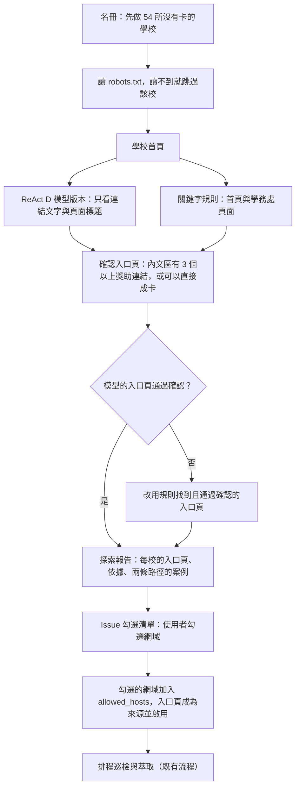

# 第 2 階段設計：大專校院獎助入口探索

最後更新：2026-11-10。使用者已確認第 7 節的決定；第 3–5 節已照實作改寫（`scripts/discover_universities.py`）。

## 1. 目標

找出全台大專校院的獎助入口頁（獎學金、助學金、急難救助、弱勢助學），讓排程巡檢自動產生卡片。

先從還沒有任何卡的學校開始。新網域由使用者核可後才加入巡檢。

## 2. 現況（2026-11-10 實算）

- `docs/audits/university-roster-verification-2026-11-07.json` 有 78 校名冊（#83 修過一輪）：

  | 名冊網址狀態 | 校數 |
  |---|---|
  | 指到學校官網 | 25 |
  | 指到入口頁 | 21 |
  | 指到相關方案頁 | 15 |
  | 未驗證 | 10 |
  | 指到行政單位 | 7 |

- 78 校中，**54 校目前沒有任何卡片**，例如臺師大、臺北大學、臺科大、北科大、東海、東吳、淡江、逢甲、北醫、中國醫。24 校已有卡，多半來自研究批次。
- RSS 路線已確認不可行：2026-11-07 實測 78 校只有 1 校宣告 feed，而且沒有獎助內容（`docs/archive/AUTONOMOUS-DISCOVERY-PLAN.md`）。
- 全台大專校院超過 78 所。名冊的擴充來源要先查證（見第 7 節）。

## 3. 流程



### 3.1 找入口頁（規則版本）

1. 讀 robots.txt。被禁止的路徑不抓，不繞過；robots 回 HTML 或讀不到的學校整校跳過（跟每日巡檢同一套規則）。
2. 看首頁的連結，以及首頁上「學務處、學生事務、生活輔導」連結（最多 2 個）的頁面連結。學務處常在 `osa.`、`sa.` 等子網域，同一所學校網域下的子網域都可以抓。
3. 關鍵字：獎學金、獎助、助學、急難、弱勢、學雜費減免、工讀；排除：名單、榜單、得獎、獲獎、成果、新聞稿、頒獎、申請表。
4. sitemap.xml 還沒做：首頁加學務處已經涵蓋實測的學校，有需要再加。

### 3.2 確認入口頁

- 每個候選入口頁抓一次。下列其一成立才算入口頁：
  - **索引頁**：內文區（導覽、頁首、頁尾以外）有 3 個以上獎助類連結。只數內文區，是因為選單每頁都一樣，數進去的話整個網站每頁都像索引頁。
  - **可以直接成卡**：交給現有的 `prepare_response` 和 `not_card_reason`，沒有不成卡的原因。
- **單篇公告不算**：標題像公告（【…】開頭、學年度、學期、申請事宜、轉知、自送等），或網址是 rpage 系統的單篇文章（`/p/404-…`），即使旁邊列了 3 個以上獎助連結也不算。第一次排程（#130）有兩則單篇公告被誤判成入口頁，因此加上這條。
- 結果記成入口頁網址與依據（例如「索引頁（8 個獎助連結）」），每校最多 3 個入口頁。

### 3.3 ReAct D（模型版本優先，失敗時改用規則）

- **每校都先跑**：模型每一步看到目前頁面的標題和編號連結（獎助與學務處連結排前面，最多 60 個），回答「打開第 n 個」「入口頁是第 n 個」或「找不到」。不送內文。
- **上限**：每校最多 6 步；每輪模型呼叫最多 150 次（`--max-model-calls`）。模型的回覆以內容雜湊快取在 `work/discovery/model-cache/`，續跑不重複呼叫。
- **只送目前頁面**：每一步只送目前頁面的連結，之前走過的頁面只留一行摘要，token 不會隨步數累積。
- **錯誤處理**：模型回 HTTP 錯誤時，把狀態碼和錯誤訊息記進報告。遇到 429（限速），這一輪後面的學校都不再呼叫模型、直接用規則，不重試。第一次排程有 7 校的模型呼叫失敗，但當時沒記狀態碼，所以加上這條。
- **只用免費模型**：預設 Groq（`data/model-providers.json`）。沒有金鑰就只跑規則。
- **驗證**：同 3.2，模型指的入口頁一樣要通過確認才算數；沒通過、模型找不到或呼叫失敗，就用規則的結果。
- **記錄**：每校一筆案例，模型的每一步、兩條路徑各找到幾個入口頁都記下，供之後比較與整理規則、skill，見 `docs/AGENTIC-EXTRACTION-ARCHITECTURE.md`。

## 4. 執行方式

- **workflow**：`university-discovery.yml`，每週六 10:37（臺北）一次，避開每天的掃描與週日的型號清單，也可以手動執行。
- **請求額度另外算**：每輪 100 次（含 robots），不吃每日巡檢的額度。同站間隔至少 3 秒，403／429 就暫停該站。
- **可續跑**：進度存在 Actions 快取，每輪從上次停的學校接著做。實測每校約 8–10 次請求，每輪約 10 校，54 校約要 5–6 輪。
- **權限**：探索 job 只讀；更新 Issue 的 job 只有 `issues: write`，不能寫 repo、不抓網頁。Issue 裡的連結文字先去掉提及與 Markdown 語法。

## 5. 核可與加入巡檢

- 探索結果寫在「大專校院獎助入口探索」Issue，每校一行：網域、入口頁、依據，前面有勾選框。每週更新時保留已勾選的項目。
- 使用者勾選後，由 agent 照下列步驟開 PR，使用者合併後生效：

  ```bash
  gh issue view <編號> --json body --jq .body > work/discovery/issue-body.md
  python scripts/discover_universities.py --approved work/discovery/issue-body.md   # 寫出 approved-targets.json
  python scripts/run_hand_replacement.py --targets work/discovery/approved-targets.json --output work/discovery/intake
  python scripts/run_hand_replacement.py --targets work/discovery/approved-targets.json --output work/discovery/intake --propose
  ```

  之後照一般資料 PR 的流程（`open_data_pr.py`）開 PR。另外要手動補兩件事，同一個 PR 一起改：
  - **網域加進 `allowed_hosts`**：`open_data_pr.py` 會把提案帶進來的新網域拿掉（公開提交的網域要人工另外加），所以勾選學校的網域由 agent 補進白名單。
  - **入口頁登記到 `data/entry-pages.json`**：之後每週一重跑這些入口頁找新方案（見 5.1）。

  第一批（#130 勾選的 7 校，#134）：13 個入口頁產生 8 張卡，使用者只收 2 張；其餘 6 張寫進駁回台帳並停用來源，分別是往年公告、列表頁標題、學校行政規定。
- 沒勾選的網域不加入、不巡檢。

### 5.1 入口頁每週巡檢

每日掃描只重抓來源頁本身、不跟連結，入口頁上新出現的方案不會被發現。所以 `scan-sources` workflow 在週一那輪多一個 `entry-watch` job：

- 重跑 `data/entry-pages.json` 裡的入口頁（`scripts/watch_entry_pages.py`）。入口頁上已經是來源的連結不再跟（`skip_known_children`），只對新連結跑提交流程。
- 結果和同一輪排程掃描的提案合併成一份，由 `data-pr` job 開成週一那份資料 PR。入口頁提案是在掃描結果之上產生的，檔案以它為準；只有掃描改到的檔案從掃描提案補進來。
- 只讀、不碰權杖；每輪最多 300 次請求，同站間隔 3 秒，不呼叫模型。
- 已知限制：入口頁本身如果是駁回過的卡的來源，頁面改版時會再產生一張新卡，要再駁回一次。

## 6. 品質

- 新網站產生的卡，第一批先抽查，確認過的頁面加進評測集（`data/eval/page-expectations.json`）。
- 每週看新網站的 `not_card_reason` 統計，找出最常卡在哪一關，再決定補哪條規則。

## 7. 已確認的決定（2026-11-10）

1. **範圍**：先只做名冊中沒有卡片的 54 校。名冊擴充到全台大專校院之前，要先查證教育部名錄的資料集。
2. **ReAct D 先試模型版本**：每校先由模型版本找入口頁，找不到或模型呼叫失敗時，改用關鍵字規則。兩條路徑的結果都記成案例，第一輪做完後比較兩者的找到率與正確率，再決定之後以哪條為主。模型只看連結文字與頁面標題，入口頁一樣要通過 `not_card_reason` 的判斷才算數。
3. **額度**：探索每輪 100 次請求，另外計算。
4. **核可**：使用者在 Issue 勾選網域後，由 agent 開 PR 把網域加入 `allowed_hosts`、入口頁設為來源，使用者合併後生效。
5. **生輔組**：舊紀錄的「生輔組維持人工查核」取消，生輔組頁面和其他獎助頁面一樣處理。
