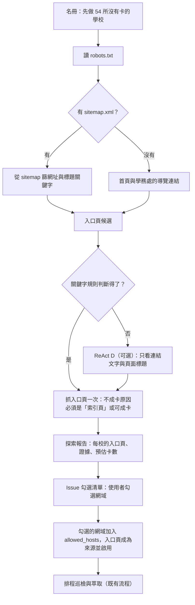

# 第 2 階段設計：大專校院獎助入口探索

最後更新：2026-11-10。使用者已確認第 7 節的決定，開始實作。

## 1. 目標

找出全台大專校院的獎助入口頁（獎學金、助學金、急難救助、弱勢助學），讓排程巡檢自動產生卡片。

先從還沒有任何卡的學校開始。新網域由使用者核可後才加入巡檢。

## 2. 現況（2026-11-10 實算）

- `docs/audits/university-roster-verification-2026-11-07.json` 有 78 校名冊（#83 修過一輪）：

  | 名冊網址狀態 | 校數 |
  |---|---|
  | 指到學校官網 | 25 |
  | 指到入口頁 | 21 |
  | 指到相關方案頁 | 15 |
  | 未驗證 | 10 |
  | 指到行政單位 | 7 |

- 78 校中，**54 校目前沒有任何卡片**，例如臺師大、臺北大學、臺科大、北科大、東海、東吳、淡江、逢甲、北醫、中國醫。24 校已有卡，多半來自研究批次。
- RSS 路線已確認不可行：2026-11-07 實測 78 校只有 1 校宣告 feed，而且沒有獎助內容（`docs/AUTONOMOUS-DISCOVERY-PLAN.md`）。
- 全台大專校院超過 78 所。名冊的擴充來源要先查證（見第 7 節）。

## 3. 流程

### 3.1 找入口頁

1. 讀 robots.txt。被禁止的路徑不抓，不繞過。
2. 有 sitemap.xml，就從裡面挑網址或標題含關鍵字的項目。
3. 沒有 sitemap，就看首頁導覽，以及學務處（`osa.`、`sa.`、`stu.`、`student.` 等子網域）的導覽連結。
4. 關鍵字：獎學金、獎助、助學、急難、弱勢、學雜費減免、工讀；排除：名單、榜單、得獎、成果、新聞稿。

### 3.2 確認入口頁

- 每個候選入口頁抓一次，交給現有的 `prepare_response` 和 `not_card_reason` 判斷。
- 判定成「索引頁」（列出多個方案）或可以直接成卡的，才算入口頁。
- 結果記成入口頁網址、判斷依據（例如哪段導覽路徑、哪些關鍵字），以及預估卡數，也就是索引頁上獎助類連結的數目。

### 3.3 ReAct D（模型版本優先，失敗時改用規則）

- **觸發**：關鍵字找不到入口、或候選太多分不出來的學校。
- **工具**：讀 robots、讀 sitemap、列出某頁的連結（只回連結文字與網址）、讀某頁的標題與小標題。不讀內文。
- **上限**：每校最多 8 次抓取，每週最多 20 校。
- **驗證**：同 3.2，入口頁一樣要過 `not_card_reason` 的判斷才算數。
- **記錄**：每校一筆案例，供之後整理規則與 skill，見 `docs/AGENTIC-EXTRACTION-ARCHITECTURE.md`。

## 4. 執行方式

- **新 workflow**：`university-discovery.yml`，每週一次（暫定週日，避開掃描與型號清單），也可以手動執行。
- **請求額度另外算**：每輪 100 次，不吃每日巡檢的 50 次。同站間隔至少 3 秒，403／429 就暫停該站。
- **可續跑**：進度存在 Actions 快取，每輪從上次停的學校接著做，大約 2–3 輪做完 54 校。
- **權限**：探索 job 只讀；開 Issue 的 job 只有 `issues: write`，不能寫 repo。

## 5. 核可與加入巡檢

- 探索報告整理成一張 Issue，每校一行：網域、入口頁、依據、預估卡數，前面有勾選框。
- 使用者勾選後，由另一支 workflow 或手動指令，把勾選的網域加進 `allowed_hosts`，入口頁成為來源並啟用，再開 PR 給使用者合併。
- 沒勾選的網域不加入、不巡檢。

## 6. 品質

- 新網站產生的卡，第一批先抽查，確認過的頁面加進評測集（`data/eval/page-expectations.json`）。
- 每週看新網站的 `not_card_reason` 統計，找出最常卡在哪一關，再決定補哪條規則。

## 7. 已確認的決定（2026-11-10）

1. **範圍**：先只做名冊中沒有卡片的 54 校。名冊擴充到全台大專校院之前，要先查證教育部名錄的資料集。
2. **ReAct D 先試模型版本**：每校先由模型版本找入口頁，找不到或模型呼叫失敗時，改用關鍵字規則。兩條路徑的結果都記成案例，第一輪做完後比較兩者的找到率與正確率，再決定之後以哪條為主。模型只看連結文字與頁面標題，入口頁一樣要通過 `not_card_reason` 的判斷才算數。
3. **額度**：探索每輪 100 次請求，另外計算。
4. **核可**：使用者在 Issue 勾選網域後，由 agent 開 PR 把網域加入 `allowed_hosts`、入口頁設為來源，使用者合併後生效。
5. **生輔組**：舊紀錄的「生輔組維持人工查核」取消，生輔組頁面和其他獎助頁面一樣處理。
