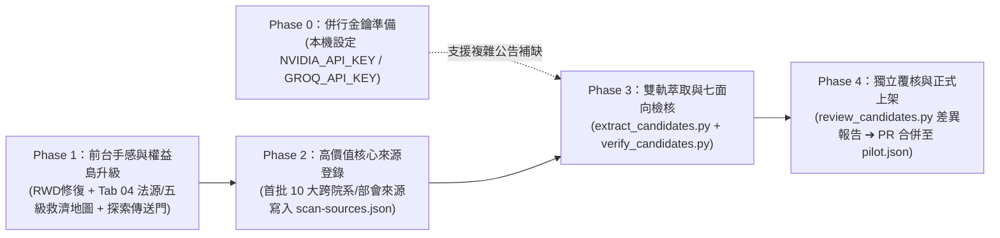
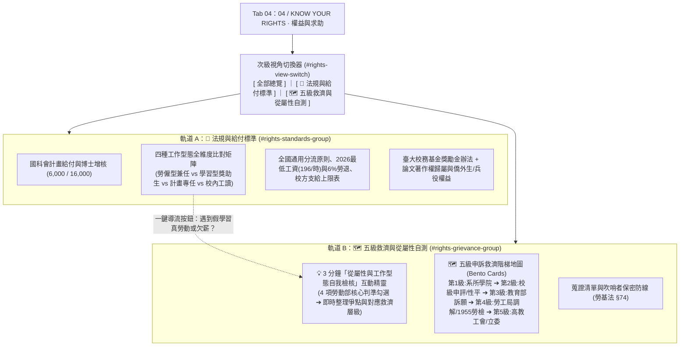

# OpenGSA 資源整合路線圖、UI/UX 響應式審核與「政策島」互動設計落地指南

> 文件性質：前台體驗升級與資源整合規劃紀錄（2026-10-30 核定開工版）。
> 本文件完整收錄四大核心規劃與審核成果：
> 1. **全域資源整合進網站之四階段路線圖與 API Key 優先序評估**
> 2. **目前網站狀態深度 UI/UX、響應式（RWD）、螢幕旋轉與觸控手感審核報告**
> 3. **完整法源庫與五級申訴救濟地圖之資訊架構整合規劃（Tab 04 雙軌次級導航設計）**
> 4. **近期台灣公民科技「政策島 / XX島」風潮研究與 OpenGSA 輕量化借鑑落地清單**

---

## 壹、資源整合進網站的順序與 API Key 優先序評估

### 1.1 API Key 的真實工程定位
- **結論**：申請免費 API Key（如 NVIDIA NIM、Groq、SambaNova）屬於**「零成本、3 分鐘可完成的併行準備工作（Phase 0）」**，但**不是阻塞資源整合上線的第一道瓶頸**。
- **原因剖析**：
  1. **雙軌與離線架構已就緒**：[`scripts/extract_candidates.py`](../scripts/extract_candidates.py) 已實作 `MockModelAdapter` 離線測試與 9 大免費提供商預設端點自動解析（NVIDIA NIM、Groq、SambaNova、Cerebras、OpenRouter、SiliconFlow、Mistral、GitHub Models、Google Gemini）。
  2. **確定性規則優先（Rule-first）**：針對結構化程度高的公告（學雜費減免、國科會增核函釋、校級獎學金辦法、TA 薪資標準），確定性規則解析可在毫秒內完成 85% 以上欄位的精準抽取，零延遲、零成本且無模型幻覺風險。
  3. **LLM 雙軌的精準發力點**：當面對跨院系所口語化長文、複雜多層嵌套細則時，啟用本機 API Key 執行 `--model-mode=extract`（補缺）與 `--model-mode=audit`（交叉盤查），能將覆蓋率推升至 95% 以上。

### 1.2 四階段資源整合落地路線圖（Integration Roadmap）

| 階段 | 執行重點 | 涉及模組與檔案 | 驗收門檻 |
| :--- | :--- | :--- | :--- |
| **Phase 0** | 領取並設定免費大額度 API Key（NVIDIA NIM `build.nvidia.com` / Groq） | 本機環境變數 `NVIDIA_API_KEY` | `create_model_adapter_from_env()` 自動識別端點通過 |
| **Phase 1** | 前台 UI/UX 響應式手感修復、Tab 04 權益島雙軌化、Tab 01 情境傳送門 | `docs/design/wireframes.html`、`docs/design/prototype.js` | 全數 Node 原型測試與 `build_site.py` 靜態預覽建置通過 |
| **Phase 2** | 登錄首批高收益來源（國科會博士增核、中研院培育、OIA 雙聯、圓夢基金等） | `data/scan-sources.json` | 遵守 robots.txt、3 秒間隔與 `hash_only` 轉載邊界 |
| **Phase 3** | 執行確定性規則＋LLM 雙軌萃取與七面向獨立檢核 | `scripts/extract_candidates.py`、`scripts/verify_candidates.py` | 逐欄具備 `field_evidence` 與 `source_block_sha256`，零捏造 |
| **Phase 4** | 產出候選差異表，經非原編輯者獨立覆核後更新正式預覽資料 | `scripts/review_candidates.py`、`data/pilot.json` | `python scripts/check_data.py` 與 52+ 項單元測試全數通過 |

---

## 貳、目前網站狀態深度 UI/UX、RWD 與觸控手感審核報告

針對 [`docs/design/wireframes.html`](design/wireframes.html) 與 [`docs/design/prototype.js`](design/prototype.js) 進行全載具檢視，盤點出以下關鍵手感痛點與修復規格：

### 2.1 跨裝置情境審核發現

| 裝置 / 情境 | 實測痛點與問題現象 | 根因定位（CSS / JS） | 嚴重度 |
| :--- | :--- | :--- | :---: |
| **iOS 手機直向** (375px–430px) | 點擊搜尋框或篩選下拉選單時，iPhone 畫面自動強制放大跳動，破壞版面邊界 | `.filter select` (13px)、`.searchbar input` (14px) 字級小於 iOS WebKit 16px 門檻 | **P0** |
| **手機橫向旋轉** (Landscape, 如 667×375) | 頂部導覽列吃掉超過 30% 垂直畫面，4 個分頁被迫折成 2 列，下方幾乎看不到內容 | `@media(max-width:800px)` 強制 `.nav-links { max-width: 245px }`，且橫向未隱藏頂部審閱條 | **P0** |
| **甘特圖節點點擊** (全行動裝置) | 點擊甘特圖菱形或色帶後，畫面毫無動靜，產生「點擊無反應」假死感 | `inspect(item)` 更新之 `#schedule-inspect` 位於甘特圖下方數百 px 視窗外，未自動帶入視野 | **P1** |
| **單手大拇指觸控** (WCAG 2.2 Target Size) | 分頁按鈕、時間軸快移鈕、甘特圖節點熱區過小（24~32px），單手操作極易誤觸 | 未達 Apple HIG / Material Design 44×44px 建議觸控熱區；缺少偽元素擴展層 | **P1** |
| **跨分頁來回切換** (Tab 01 $\leftrightarrow$ Tab 02) | 在第一頁滑到第 8 筆點「看詳情」，返回第一頁時被強制捲回最頂端，探索進度遺失 | `activatePanel()` 內無條件執行 `window.scrollTo(0,0)`，未記憶各分頁滾動位置 | **P2** |
| **觸控按壓與水平捲動** (操作回饋感) | 手指按下按鈕無縮放或變色回饋；甘特圖左側固定欄與右側捲動區缺乏陰影層次 | 僅有 `:hover` 無 `:active` 狀態；`.gantt-label` 僅有 1px 邊線，缺少漸層陰影與彈性捲動 | **P2** |

### 2.2 落地優化工程規格
1. **iOS 16px 防縮放鎖定**：於 `@media (max-width: 800px)` 將所有 `select`、`input` 字級統一提升至 `16px`。
2. **橫向螢幕（Landscape）自適應解鎖**：
   - 新增 `@media (max-width: 800px) and (min-width: 501px)` 解除 `.nav-links` 的 `max-width: 245px` 限制，維持單列排布。
   - 新增 `@media (max-height: 500px)` 矮視窗最佳化：自動收合 `.review-strip`、縮減導覽列垂直內距（padding），釋放 30% 以上垂直閱讀空間。
3. **觸控熱區擴充與 `:active` 微回饋**：
   - `.gantt-marker::after` 建立 `44×44px` 隱形觸控感應區；提升頁籤與分段按鈕最小高度。
   - 全站可點擊控制項加入 `:active:not(:disabled) { transform: scale(0.97); opacity: 0.88; }` 物理按壓手感。
4. **甘特圖視野與檢視聯動**：
   - `.gantt-label` 加入右側視覺落差陰影（`box-shadow: 3px 0 6px -2px rgba(32,63,55,.12)`）；直向窄螢幕（`<=500px`）將 `--label-width` 由 `165px` 精簡為 `138px`。
   - `inspect(item)` 觸發時，若摘要卡不在可視範圍內，自動平滑捲動（`scrollIntoView`）並加上視覺高亮提示。
5. **分頁滾動位置記憶（Scroll Restoration）**：
   - 建立 `scrollPositions` 狀態表，記錄使用者在各分頁的捲動高度，從詳情頁返回搜尋頁時精準還原瀏覽位置。

---

## 參、法源庫與五級申訴救濟地圖整合架構（歸哪一頁？是否新增 Tab？）

### 3.1 頂層導覽決策：維持 4 個頂層 Tab，不新增第 5 個 Tab
- **人因工學限制**：在 375px 手機直向螢幕中，4 個頂層頁籤（「找獎助」、「獎助詳情」、「我的時間軸」、「權益與求助」）每項寬度約 82px，剛好容納 4 個中文字。若新增第 5 個 Tab，單項寬度將跌破 65px，導致字體縮小、換行錯位與高誤觸率。
- **語意與任務閉環**：Tab 04 原定位即為 **「04 / KNOW YOUR RIGHTS · 權益與求助」**。
  - **「知曉權益（Know Your Rights）」** ＝ 完整法源體系、國科會增核、勞僱型 vs 學習型四維度比對矩陣、論文著作權、僑外生與兵役規範。
  - **「尋求救濟（Seek Remedies）」** ＝ 3 分鐘從屬性自我檢核、系院校部會至工會立委之五級申訴救濟地圖、30 日時效與吹哨者保護。
  - 將兩者整合於 Tab 04 並透過**次級分段切換器（Segmented Control）**分流，能讓學生在「發現給付或契約異常」的瞬間，一鍵切換至「五級救濟地圖」，形成最直覺的保護閉環。

### 3.2 Tab 04「研究生權益島」內部雙軌次級架構

---

## 肆、近期「政策島 / XX島」風潮研究與 OpenGSA 借鑑落地清單

### 4.1 台灣「政策島 / XX島」與公民科技專題現象剖析
2026 年 10 月台灣公共傳播圈掀起以《**HEART 政策島**》（借鑑桌遊《卡坦島》之正六角形微縮浮空島嶼、跨局處協作線）為代表之互動網頁浪潮，並衍生出《**恐怖島｜事件地圖**》等公民監督二創；結合 **g0v 零時政府**、**READr**、**沃草 Watchout** 與 **法律白話文運動** 的數位敘事經驗，其成功關鍵在於：
1. **視角翻轉（從官僚分類到生活情境）**：不再要求使用者先背誦公文號，而是以「我的處境與目標」作為入口。
2. **Bento Grid 便當盒卡片與視覺錨點**：將冰冷法條拆解為帶有明確標籤、關鍵數字與狀態色彩（安心綠、警示琥珀、資訊藍）的模組化方塊。
3. **互動自測精靈（Quiz / Wizard）**：透過 3~4 個簡單勾選，即時回饋個人化分析結果，賦予使用者掌控感（Agency）。
4. **可追溯的證據鏈（Evidence Anchors）**：每一張趣味卡片背後皆綁定真實法規條號與官方連結，兼顧易讀性與公信力。

### 4.2 OpenGSA 採納之設計與純靜態技術方案

為嚴格遵守 OpenGSA **「純靜態 HTML/CSS/Vanilla JS、零外部重型框架、無追蹤、零個資外送」** 之架構戒律，我們採用以下輕量技術實現「島嶼化」體驗：

| 借鑑特色 | OpenGSA 具體落地元件 | 技術實作方式（零外部依賴） |
| :--- | :--- | :--- |
| **微縮六角島嶼視覺** (Hexagonal Island Motif) | 探索島情境卡與五級救濟階梯之**六角形向量徽章（Hex Badge）** | 使用內聯 SVG `<polygon>` 與 CSS 漸層／懸浮微動畫（僅 ~1KB，免載入 600KB Three.js） |
| **情境分流傳送門** (Persona Wizard Tiles) | Tab 01 搜尋列上方新增 **「探索島快速情境傳送門」**（博士研究、碩博生活、出國會議、成果獎項） | 點擊一鍵套用對應之 `category` 與 `degree` 篩選組合，並同步更新甘特圖與清單 |
| **便當盒矩陣卡片** (Bento Grid Layout) | Tab 04 **「四種工作型態比對矩陣」**與**「五級申訴救濟階梯卡」** | CSS Grid `auto-fit` 搭配語意化色彩標籤（`.axis.open` / `.axis.warn` / `.axis.info`） |
| **互動自測定位器** (Self-Check Wizard) | Tab 04 **「3 分鐘從屬性與權益爭點自測」**（4 道實務情境勾選題） | 純前端記憶體計算（`evaluateSubordination`），即時提示爭點與建議救濟階梯，重整即清除 |
| **雙重視角並存** (Dual-View Ergonomics) | 保留「專家精確篩選／完整法規條列」與「情境快篩／救濟地圖」一鍵切換 | 原生 `.segmented` 按鈕控制 `aria-pressed` 與區塊顯隱，鍵盤與螢幕報讀器 100% 相容 |

---

## 伍、合規與驗證防線（Guardrails）

1. **不冒充正式法律裁決或資格核定**：自測精靈與情境傳送門明確標示「僅協助整理公開法規爭點，不構成正式法律認定或資格核准」。
2. **100% 離線與隱私保護**：所有情境點擊、從屬性自測勾選、研討會規劃與滾動記憶僅留存於瀏覽器當前頁籤記憶體（Memory-only），不寫入 Cookie、不發送任何外部請求。
3. **自動化測試覆蓋**：新增之情境快篩邏輯（`applyPersona`）與從屬性爭點整理邏輯（`evaluateSubordination`）均納入 `tests/prototype.test.cjs` 進行單元測試驗證。
