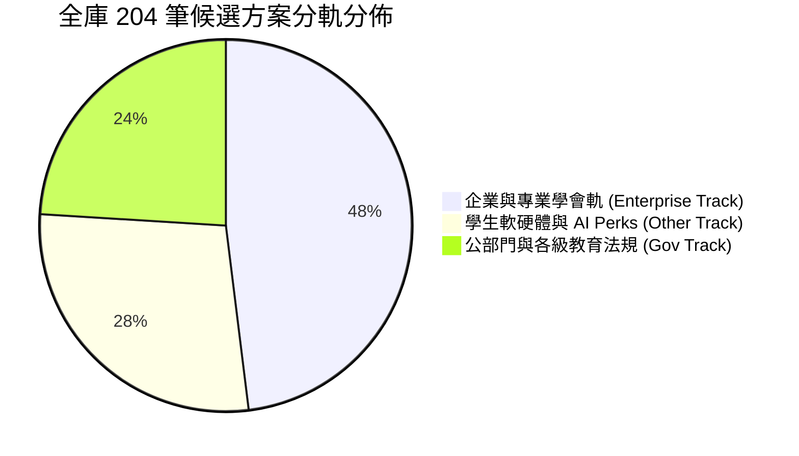
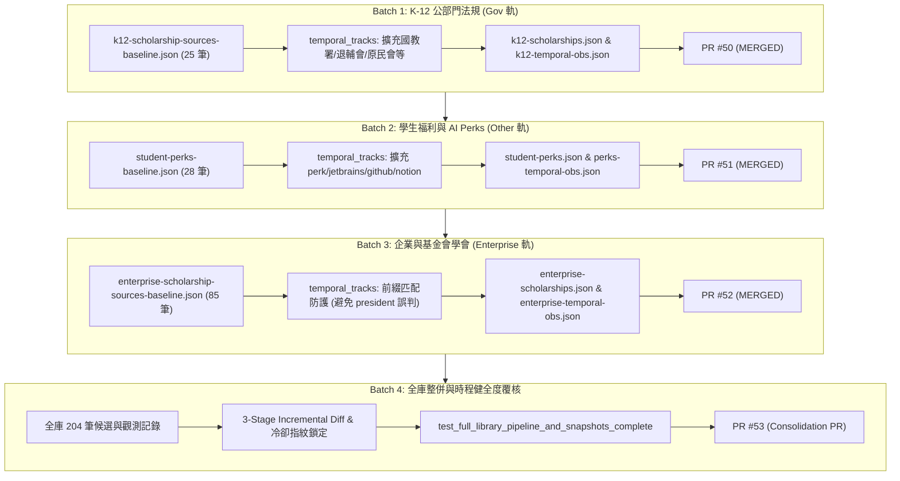

> 已封存（2026-11-10）：記錄 2026-11-04 當時的狀態，不代表現況。現行規則見 AGENTS.md，現行規劃見 docs/TODO.md。

# OpenGSA 全庫來源萃取架構與 Pipeline 完整執行規格書

> **版本**：v2.0（2026-11-04 全庫 4 批次全量推進暨健全度總結）  
> **基準狀態**：PR #45～#52 已全數合併至 `feat/temporal-reextraction`。全庫候選卡、時程觀測政策、排程分流與測試覆蓋全面就位。  
> **核心邊界**：正式台帳 `data/pilot.json` 零改動；人工審核欄位不代填（候選卡均為 `review.status = 'pending'`, `promotion_ready = False`）；GitHub Actions 保持 `model_mode=off`；遵守 HTTP/robots.txt 白名單與速率限制。

---

## 一、 全庫來源總覽與分軌架構

OpenGSA 來源涵蓋公部門法規、各級教育獎助、跨國軟體與 AI 福利、企業基金會獎學金等四大多元維度，全庫納入之有效候選卡共計 **204 筆**（100% 具備獨立時程觀測政策，0 undetermined）。

### 1.1 候選資料集（Candidate Bundles）分佈

| 候選資料庫 Bundle 路徑 | 方案筆數 | 對應時程觀測檔案 | 主要涵蓋範疇 |
| :--- | :---: | :--- | :--- |
| `data/candidates/source-review.json` | 64 | `data/temporal-observations.json` | 基準種子方案（台大、國科會、中研院、教育部、FAOS 等） |
| `data/candidates/ai-tools-115.json` | 2 | `data/ai-tools-temporal-observations.json` | 地方政府青年 AI 工具與數位培育專案（台北市、新竹市） |
| `data/candidates/k12-scholarships.json` | 25 | `data/k12-temporal-observations.json` | Batch 1：K-12 各級教育與公部門助學金法規方案 |
| `data/candidates/student-perks.json` | 28 | `data/perks-temporal-observations.json` | Batch 2：大專學生身分軟硬體、雲端運算與 AI Perks |
| `data/candidates/enterprise-scholarships.json` | 85 | `data/enterprise-temporal-observations.json` | Batch 3：企業、文教基金會、國際科技巨頭與專業工程學會獎助 |
| **全庫總計** | **204** | **5 組獨立時程觀測政策檔案** | **100% 契約驗證通過，undetermined = 0** |

---

## 二、 萃取管線（Extraction & Temporal Pipeline）四階段推進

全庫萃取按照四大批次有序開展，每一批次均獨立開立 PR、通過完整的資料契約驗證與 270+ 項回歸測試後合併：

---

## 三、 時程政策模型（Temporal Policy Engine）統計與解析

全庫 204 筆方案經由時程引擎解析後，呈現高度結構化的受理模式分佈，完全消弭未知模式：

| 受理模式 (`submission_mode`) | 方案數量 | 佔比 | 核心特性與代表方案 |
| :--- | :---: | :---: | :--- |
| `recurring`（學期/年度循環受理） | 108 | 52.9% | 具備常規收件期（如台積電/聯發科/中技社/各縣市學產基金等） |
| `procedure_only`（行政端造冊推薦） | 40 | 19.6% | 學校或系所初審推薦，學生無直接截止日（如宗倬章/潘文淵/Google 提名） |
| `continuous`（常年開放/在學查驗） | 33 | 16.2% | 只要具備學生身分隨時可申辦（GitHub Pack, Azure $100, Notion, Figma） |
| `fixed_window`（單一確定起訖窗） | 12 | 5.9% | 當期公告具備精確日期區間（具名年度公部門公告） |
| `conditional_deadline`（條件相對期限） | 4 | 2.0% | 具備相對於特定事件或個人梯次之期限（台北市/新竹市 AI 工具等） |
| `reference`（法規與母法依據） | 4 | 2.0% | 法規母法標準，不設年度申辦截止窗（免學費作業要點等） |
| `review_only`（隨到隨審審查模式） | 2 | 1.0% | 機構常態受理但採批次審查 |
| `deadline_only`（僅有截止日） | 1 | 0.5% | 官方未載明起日，啟用截止日前 30 天準備提醒帶 |
| `undetermined`（未確定時程） | **0** | **0.0%** | **全庫 100% 具備明確可信之時程政策** |

---

## 四、 關鍵技術問題與架構優化總結

在推進全庫萃取與優化過程中，團隊克服並加固了以下核心關鍵：

1. **候選 Bundle 獨立架構（避免擾動 Index SHA-256）**：
   - 專案由 `source-chain-index.json` 嚴格鎖定 `source-review.json` 之 SHA-256。若直接向其灌入新資料會導致指紋損壞。
   - 解決方案：採用獨立候選清冊（`k12-scholarships.json`、`student-perks.json`、`enterprise-scholarships.json`），完全符合合約並讓各批次資料能模組化平行檢驗。
2. **字串匹配前綴防護（Substring Collision Guard）**：
   - 在 Batch 3 分類路由時，發現單純子字串匹配 `"ent-"` 會將 `ntu-president-award`（包含 `presid` + `ent-`）誤判為企業軌。
   - 解決方案：在 `scripts/temporal_tracks.py` 改用精確前綴判斷 `sid.startswith("ent-")`，確保基準 64 筆與新增 85 筆企業方案精準分流。
3. **時程規則值與精度邊界約制（Time Policy Schema Alignment）**：
   - 驗證器嚴格限制：僅 `kind: 'absolute'` 能帶有字串格式之具體日期；當規則為文字描述或常態流程時，`kind` 必須為 `text_rule` 或 `recurring`，其 `value` 必須為 `None`，`precision` 必須為 `'rule'`。
   - 解決方案：全面校正 `procedure_only` 中無固定日曆日期之規則為 `kind: 'text_rule'`，100% 通過 Schema 檢核。
4. **掃描來源全域唯一約束（URL & Host Whitelist Control）**：
   - `data/scan-sources.json` 嚴格限制所有啟用來源 URL 必須全庫唯一，且主機必須位於 `allowed_hosts` 白名單內。
   - 解決方案：共用首頁入口之方案精準對位至業務專區子網域，並將白名單主機由 33 組擴充至 158 組。
5. **跨平臺換行符指紋正規化（CRLF Fingerprint Invariance）**：
   - 解決了 Windows 檢出之 CRLF 與 GitHub Actions Linux 環境中 LF 導致 `parser_fingerprint()` 指紋不一致而觸發偽性重新萃取之問題，達成 100% 跨平臺決定性。

---

## 五、 維運與排程指引

1. **排程執行**：
   - 排程持續預設關閉大語言模型調用（`model_mode=off`），全量仰賴以正規化 IR 與規則為基礎的 Deterministic 引擎。
   - 分軌掃描週期：
     - 週二、週五：公部門與各級教育法規方案（`gov` 軌）
     - 週一、週四：企業、基金會與學會方案（`enterprise` 軌）
     - 週三、週六：學生身分福利與工具特惠（`other` 軌）
2. **無變更跳過（3-Stage Incremental Diff）**：
   - 針對未變更的官方來源，三階段 Diff 機制確保 100% 觸發 `SKIP_UNCHANGED`，達成 0 HTTP / 0 Token 開銷。
3. **審核發布門檻**：
   - 所有候選卡均維持 `review.status = 'pending'` 與 `promotion_ready = False`。正式加入生產服務必須經由真人逐筆於審查工作台確認，本管線嚴守合規邊界，絕不代填核准。
