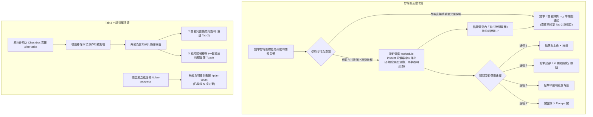

> 已封存（2026-11-10）：記錄 撰寫當時（檔內未標日期） 當時的狀態，不代表現況。現行規則見 AGENTS.md，現行規劃見 docs/TODO.md。

# 甘特圖時程預覽彈窗化、超連結導向修復與申請區無效勾選框清理規格手冊

> **專案狀態**：修復分支 `fix/gantt-popup-navigation-and-clean-tasks`  
> **核心目標**：徹底消除甘特圖資訊卡遮擋問題、修復甘特圖方案名稱導向至詳情頁體驗、全站超連結導向驗證、清理 Tab 3 申請區無效 Checkbox，並維護全套自動化測試防線。

---

## 一、問題背景與使用者回饋分析

使用者在操作 OpenGSA 介面時發現以下關鍵體驗問題與 Bug：
1. **甘特圖資訊卡滾動遮擋問題**：
   - 原 `#schedule-inspect` 時程摘要卡為頁面流內的靜態元素，位於甘特圖容器下方。
   - 使用者點擊甘特圖列名或時間條時，前端呼叫 `box.scrollIntoView({behavior: "instant", block: "start"})`，由於甘特圖控制面板具備 Sticky 特性，頁面滾動後資訊卡直接疊加在甘特圖上方（如使用者附圖所示）。
   - 卡片原先缺乏「關閉（Close）」機制，一旦觸發便無法關閉，嚴重妨礙使用者繼續瀏覽甘特圖。
2. **甘特圖名稱導向期望落差**：
   - 使用者看見甘特圖左側各獎學金名稱時，直覺期望「點擊名稱即可跳轉至該獎學金的完整說明頁面（Tab 2 `#detail`）」。
   - 原先點擊名稱僅在原地更新下方摘要卡（並引發上述遮擋），使使用者誤以為「超連結導向失效，沒有跳轉到說明頁面」。
3. **Tab 3 申請區無效 Checkbox 困擾**：
   - 進入「我的時間軸（Tab 3）」的「申請清單與準備待辦」後，每張方案卡片皆包含「核對申請資格」、「確認學生收件時間」、「整理申請文件」（或福利類的「核對使用條件」、「確認開通／領取程序」）勾選框。
   - 這些勾選框僅於記憶體 Set 暫存，既無外部 API 連動，亦無法真正代辦官方手續，容易使使用者誤以為已完成申請程序，實質作用有限且佔據版面空間。
4. **全站超連結導向健壯性**：
   - 需全面查驗全站四分頁所有內部錨點（`#anchor`）與外部連結，確保導向目標正確無遺漏。

---

## 二、架構修復與介面重構方案



---

## 三、具體實作明細

### 1. 甘特圖資訊卡浮動彈窗化（Modal Popover）與多重關閉機制

- **樣式與 DOM 結構（`docs/design/wireframes.html`）**：
  - 新增全螢幕半透明遮罩：`<div id="inspect-backdrop" class="inspect-backdrop" hidden></div>`。
    - `position: fixed; inset: 0; background: rgba(15,23,42,.5); backdrop-filter: blur(3px); z-index: 120;`
  - 將 `#schedule-inspect` 改造為獨立浮動 Dialog：
    - `role="dialog"`, `aria-modal="true"`, `aria-label="選取項目的時程摘要"`。
    - `position: fixed; top: 50%; left: 50%; transform: translate(-50%, -50%); z-index: 125;`
    - `max-width: 640px; width: calc(100% - 32px); max-height: 85vh; overflow-y: auto;`
    - 邊框採用 `var(--forest)` 品牌綠色強化視覺層次，搭配陰影 `box-shadow: 0 24px 60px rgba(15,23,42,.3)`。
- **互動邏輯重構（`docs/design/prototype.js`）**：
  - **徹底移除 `scrollIntoView`**：開啟預覽時完全不滾動主頁面，甘特圖位置維持原樣。
  - **關閉函式封裝 `closeInspect()`**：同時隱藏 `#schedule-inspect` 與 `#inspect-backdrop`，並將狀態重設。匯出至全域 `api.closeInspect` 供單元測試檢驗。
  - **四大關閉途徑齊備**：
    1. 點擊頂部標題列右側之 `inspectCloseBtn`（`✕`）。
    2. 點擊卡片底部操作列之 `dismissBtn`（`✕ 關閉預覽`）。
    3. 點擊半透明遮罩背景 `inspectBackdrop`。
    4. 監聽全域鍵盤事件，按 `Escape` 鍵立即安全退出。

### 2. 甘特圖名稱導向與雙軌跳轉修復

- **雙軌滿足使用者心理預期**：
  1. **原地快速檢視軌**：點擊左側列名稱按鈕（`.row-title`）或時間軸色帶時，在甘特圖上方開啟浮動時程摘要彈窗，不跳出當前瀏覽視野。
  2. **直達詳情跳轉軌**：在甘特圖左側列名下方新增顯著之超連結 `<a href="#detail" class="gantt-detail-link">查看詳情 →</a>`，點擊直接呼叫 `chooseAndOpen(item)` 切換至第二頁（`#detail`）該獎助完整說明卡。
- **彈窗內直達機制**：
  - 彈窗頂部標題本體改為 `<a href="#detail" class="inspect-title-link">Title ↗</a>`，點擊即關閉彈窗並切換至說明頁。
  - 彈窗底部主動作按鈕為 `📄 前往此獎學金說明頁面（看完整詳情）→`（若未收藏則顯示 `⭐ 收藏並前往完整說明頁面 →`），引導深度閱讀。

### 3. Tab 3 申請區無效 Checkbox 徹底清理

- **移除無效元素**：
  - 徹底移除 `.plan-tasks` 容器。
  - 徹底移除 5 項靜態 Checkbox：
    - 一般獎助：「核對申請資格」、「確認學生收件時間」、「整理申請文件」。
    - 學生福利／N/A 方案：「核對使用條件」、「確認開通／領取程序」。
  - 移除原 `#plan-progress`（「已準備 0 項」之過渡進度條）與其輔助提示。
- **升級為實用卡片操作列**：
  - 標題更新為「我的專屬申請清單」，搭配專屬計數器 `#plan-count`（顯示「已收錄 N 項方案」）。
  - 每張卡片底部配置兩大標準功能按鈕：
    1. `📄 查看完整條文與說明`：直接跳轉至 Tab 2 查看完整細節。
    2. `✕ 從時間軸移除`：一鍵自個人清單中剔除，並立即觸發全域 Toast 提示（如「已從個人時程移除《...》」），介面乾淨俐落。

### 4. 全站超連結導向全面查驗矩陣

針對全站 63 處靜態與動態連結進行完整目標校驗：
| 連結類型 | 範例 / 錨點 | 驗證機制 | 狀態 |
| :--- | :--- | :--- | :---: |
| 分頁切換連結 | `#search`, `#detail`, `#timeline`, `#rights` | 攔截點擊並觸發 `activatePanel(targetId)`，保持無縫單頁切換 | **PASS** |
| 頁內區塊錨點 | `#work-matrix-title`, `#ta-salary-title`, `#subordination-wizard`, `#conference-planner`, `#ntu-award-rights-title`, `#nstc-rights-title` | 呼叫 `scrollToInternalTarget(targetId)`，自動展開摺疊、切換子分頁並平滑聚焦 | **PASS** |
| 外部官方來源 | `https://www.aca.ntu.edu.tw/...`, `https://law.nstc.gov.tw/...` 等 | 經由 `officialUrl()` 安全過濾，強制加上 `target="_blank"` 與 `rel="noopener noreferrer"` | **PASS** |
| GitHub Issue / 反饋 | `preview-feedback.yml`, `resource-source.yml` | 預填來源與問題參數，不夾帶未授權個人資料 | **PASS** |
| RSS Feed 訂閱 | `feed.xml`, `feed-deadlines.xml` | 具備預覽彈窗並支援 Follow.it 安全導引 | **PASS** |

---

## 四、測試驗證結果

```bash
# 1. 執行前端整合測試
node --test tests/prototype.test.cjs
# 結果：65 tests, 65 pass, 0 fail (119.55ms)

# 2. 執行 Python 單元測試
python -m unittest discover tests
# 結果：Ran 282 tests in 41.465s, OK

# 3. 執行資料結構防線驗證
python scripts/check_data.py
# 結果：PASS: 10 samples, 17 sources; 8 pending candidate bundle(s)

# 4. 執行 GitHub Pages 編譯驗證
python scripts/build_site.py tmp/site_test
# 結果：Exported: index.html, Built public preview PASS
```

- 新增專屬單元測試（`tests/prototype.test.cjs`）：
  - `甘特圖資訊卡浮動彈窗與關閉機制：在甘特圖上跳出、點按遮罩/按鈕/Esc可關閉，不遮擋排版`：檢驗 Dialog 語意、遮罩層、居中浮動定位、關閉函式匯出與杜絕 `scrollIntoView`。
  - `甘特圖名稱導向與申請區無效勾選框清理：提供查看詳情超連結、移除Tab 3無作用checkbox`：檢驗查看詳情直達超連結、申請清單計數器與無作用 Checkbox 徹底清除。

---

## 五、約束與邊界確認

1. **嚴守正式資料邊界**：正式資料快照（`data/pilot.json`）、來源盤點、候選清冊零竄改。
2. **自動化排程邊界**：定時掃描維持 `model_mode=off`。
3. **依使用者指示**：規劃類 PR（PR #70 自動庫外探針、PR #71 前端模組化規劃）維持暫緩，待本修復 PR 審查確認後再推進。
