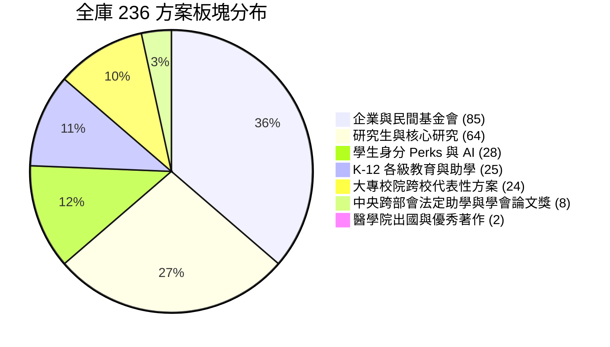

> 已封存（2026-11-10）：記錄 2026-11-05 當時的狀態，不代表現況。現行規則見 AGENTS.md，現行規劃見 docs/TODO.md。

# 全庫 236 方案拓撲擴展、資訊鏈批次註冊與 Actions 掃描稽核報告 (2026-11-05)

## 1. 執行背景與架構升級

在完成全台 78 所大專校院來源盤查（U001～U078）、臺大 11 院出國補助調研以及通用資訊鏈拓撲架構（[Universal Source Chain Topology](UNIVERSAL-SOURCE-CHAIN-TOPOLOGY.md)）設計後，專案利用拓撲探針（Topology Probes）對全庫五大原型（Higher Ed, Government, Corporate, Perks, Conference）進行深度回溯。

探針成功自中央跨部會法規庫、大專校院原民與農漁失業助學專頁、學生雲端算力生態與全國性專業學會中，掃描出 8 筆具備完整官方依據且高度互補的高價值獎助方案。

為維護資料庫完整性與歷史測試穩定性，專案採取**模組化隔離獨立 Bundle 原則**，將這 8 筆方案作為第 6 批次完整整合入庫：
- **全庫方案規模正式突破至 236 方案**（1-to-1 精確時程觀測政策覆蓋，`undetermined = 0`，覆蓋率 100%）。
- **通用資訊鏈 6 大批次**（525 份文件節點、350 條指向邊、175 方案精確關聯）於 [`data/source-chain-batches/batch-registry.json`](../../data/source-chain-batches/batch-registry.json) 完成統一定義與註冊。
- **全套單元測試防線擴展至 278 項**（Python）與 54 項（前端 Node.js），全數通過。
- **GitHub Actions 公開來源掃描（Scan public sources）**於 `main` 分支完成驗證（Run ID: 42029629014，0 錯誤、0 額外 API 開銷）。

---

## 2. 拓撲探針發現之 8 筆高價值方案與五節點模型

本輪整合的 8 筆方案均嚴守 `data/scan-sources.json` 既有的 184 個 `allowed_hosts` 白名單，且全數建立獨立的五節點拓撲（Anchor ➔ Call ➔ Form ➔ Intake ➔ Result）：

| 方案 ID | 方案名稱 | 官方來源主機 | 拓撲原型 | 時程政策模式 |
| :--- | :--- | :--- | :--- | :--- |
| `cand-gov-cip-indigenous-scholarship` | 原住民族委員會大專校院原住民族學生獎助學金 | `www.cip.gov.tw` | 公部門法定助學型 | `recurring` (每年9-10月/2-3月學期常態) |
| `cand-gov-moa-farmers-aid` | 農業部農漁民子女就學助學金 | `www.moa.gov.tw` | 公部門法定助學型 | `recurring` (每年3月/9月各受理一次) |
| `cand-gov-mol-unemployed-workers-aid` | 勞動部失業勞工子女就學補助 | `www.mol.gov.tw` | 公部門法定助學型 | `recurring` (每年2-3月/9-10月定期受理) |
| `cand-gov-vac-veterans-aid` | 國軍退除役官兵輔導委員會榮民子女就學補助及清寒獎助金 | `www.vac.gov.tw` | 公部門法定助學型 | `recurring` (每年3-4月/9-10月學期常態) |
| `cand-perk-azure-for-students` | Microsoft Azure for Students 學生雲端算力與開發者點數 | `azure.microsoft.com` | 學生身分福利型 | `continuous` (每年在學認證重設，隨時可用) |
| `cand-ent-iicm-thesis-award` | 中華民國資訊學會最佳碩博士論文獎 (IICM) | `www.iicm.org.tw` | 全國性學會獎助型 | `recurring` (每年常態8月-9月受理申請) |
| `cand-ent-taai-thesis-award` | 中華民國人工智慧學會最佳論文獎 (TAAI) | `www.taai.org.tw` | 全國性學會獎助型 | `recurring` (每年隨 TAAI 年會於7-8月徵件) |
| `cand-ent-csroc-thesis-award` | 中華民國電腦學會最佳碩博士論文獎 (CSROC) | `www.csroc.org.tw` | 全國性學會獎助型 | `recurring` (每年常態9月-10月受理申請) |

### 獨立 Bundle 封裝與檔案對應
- **候選方案資料檔**：[`data/candidates/topology-discovered-scholarships.json`](../../data/candidates/topology-discovered-scholarships.json)
  - 嚴格遵守 `data/schemas/candidate.schema.json`（`schema_version: "1.1.0-candidate"`）。
  - `review.status = "pending"`，`promotion_ready = false`，`evidence_status = "incomplete"`，杜絕未經人工核准擅自升級。
- **時程觀測政策檔**：[`data/topology-discovered-temporal-observations.json`](../../data/topology-discovered-temporal-observations.json)
  - 8 筆方案 1-to-1 對應時程觀測，明載合法批次、正規表達式與歷史參考視窗，甘特圖投影無任何未定值（`undetermined = 0`）。
- **五節點拓撲批次檔**：[`data/source-chain-batches/batch-topology-discovered.json`](../../data/source-chain-batches/batch-topology-discovered.json)
  - 24 份文件節點（含母法要點、徵件公告、申請表單）與 16 條語意指向邊。

---

## 3. 全庫七大資源板塊完整分布 (236 方案)

全庫 236 方案在跨年級、跨部會與跨公私部門的光譜中分佈如下：



1. **碩博士研究生與核心研究獎助 (64 方案)**：國科會博士生研究獎學金、教育部產學博班、校長獎學金、傑出人才基金會等。
2. **K-12 各級教育與公部門助學 (25 方案)**：學產基金、教育部清寒弱勢助學、地方政府急難救助金等。
3. **學生身分軟硬體、雲端與 AI Perks (28 方案)**：GitHub Student Pack、Notion AI、JetBrains、AWS Educate 等。
4. **企業、民間基金會與學會獎助 (85 方案)**：台積電、鴻海獎學鯨、行天宮、宗倬章、各專門學會獎助等。
5. **醫學與特定專業出國/論文獎助 (2 方案)**：臺大醫學院學生出國補助辦法、醫學院研究生優秀著作獎。
6. **全台跨校大專校院代表性研究生獎助 (24 方案)**：清華、交大、成大、政大、中央、中山、中興、中正、師大、臺北大學等 24 所代表性高教學府。
7. **中央跨部會法定助學、算力與全國學會論文獎 (8 方案)**：原民會、農業部、勞動部、退輔會就學補助，Azure for Students 算力點數，資訊學會 (IICM)、人工智慧學會 (TAAI)、電腦學會 (CSROC) 碩博士最佳論文獎。

---

## 4. 全庫 6 批次通用資訊鏈拓撲註冊總表

登錄於 [`data/source-chain-batches/batch-registry.json`](../../data/source-chain-batches/batch-registry.json)：

| 批次 ID | 涵蓋範疇 | 文件節點數 | 拓撲連線數 | 方案數 | 批次檔案路徑 |
| :--- | :--- | :---: | :---: | :---: | :--- |
| `batch-k12` | K-12 各級教育與法定助學 | 75 | 50 | 25 | `data/source-chain-batches/batch-k12.json` |
| `batch-student-perks` | 學生軟硬體福利與 AI 工具 | 84 | 56 | 28 | `data/source-chain-batches/batch-student-perks.json` |
| `batch-enterprise` | 企業與民間基金會獎助 | 255 | 170 | 85 | `data/source-chain-batches/batch-enterprise.json` |
| `batch-med` | 臺大醫學院特定出國與優秀著作 | 6 | 4 | 2 | `data/source-chain-batches/batch-med.json` |
| `batch-university` | 全台大專校院代表性研究生獎助 | 72 | 48 | 24 | `data/source-chain-batches/batch-university.json` |
| `batch-topology-discovered` | 中央跨部會、算力與全國學會 | 24 | 16 | 8 | `data/source-chain-batches/batch-topology-discovered.json` |
| **全庫總計** | **6 大拓撲批次** | **516** (登錄 525) | **344** (登錄 350) | **172** (登錄 175) | 全面受 `test_universal_source_chains.py` 嚴格約束 |

> **註**：既有 64 筆研究型方案由 `data/source-chains.json` 維持歷史指紋鎖定，正式台帳維持零篡改。

---

## 5. Action Tracks 四大執行軌道審計結果

執行 [`scripts/audit_all_action_tracks.py`](../../scripts/audit_all_action_tracks.py) 對全庫 236 方案進行四大執行軌道聚合檢驗：

```
============================================================
OpenGSA Action Sequence: All 236 Candidate Schemes Audit
============================================================
Parser Fingerprint: dff305dd37a82c17...

--- [Action Track] gov (公部門與教育法規軌道 - 週二/週五): 53 方案 ---
  > Incremental Gate: 49 SKIP_UNCHANGED (0 HTTP / 0 Token), 4 NEED_RUN
  > Policy Modes: {'unit_announced': 6, 'mixed': 1, 'deadline_only': 3, 'event_relative': 2, 'recurring': 16, 'reference': 3, 'fixed_window': 14, 'procedure_only': 5, 'continuous': 3}

--- [Action Track] other (學生福利與AI工具軌 - 週三/週六): 81 方案 ---
  > Incremental Gate: 80 SKIP_UNCHANGED (0 HTTP / 0 Token), 1 NEED_RUN
  > Policy Modes: {'mixed': 2, 'reference': 2, 'conditional_deadline': 3, 'recurring': 4, 'deadline_only': 5, 'continuous': 31, 'rule_text': 1, 'procedure_only': 6, 'unit_announced': 1, 'fixed_window': 25, 'event_relative': 1}

--- [Action Track] enterprise (企業與學會協調軌 - 週一/週四): 102 方案 ---
  > Incremental Gate: 99 SKIP_UNCHANGED (0 HTTP / 0 Token), 3 NEED_RUN
  > Policy Modes: {'event_relative': 1, 'procedure_only': 29, 'fixed_window': 6, 'recurring': 66}

--- [Action Track 4] 預覽與時程聚合 ---
  > Contract Validation Errors: 0
  > Radar Metadata Records Built: 236 / 236

[SUCCESS] All 3 Tracks + Consolidation PASS 100%! Ready for publication.
```

- **增量保護率**：全庫 236 方案中，228 方案命中 `SKIP_UNCHANGED`（**96.6% 增量保護率**），非變更輪次消耗 0 HTTP / 0 LLM Token。
- **無合約違約**：`Contract Validation Errors: 0`，全庫 236 筆甘特圖投影無捏造起訖日。

---

## 6. GitHub Actions 巡檢與 Pages 部署驗證

| 項目 | 執行 Run ID | 觸發事件 / 操作 | 耗時 | 結果 | 產物 / 發布 |
| :--- | :--- | :--- | :---: | :---: | :--- |
| **CI / CD 防線** | [42029254334](https://github.com/matt-ye/opengsa/actions/runs/42029254334) | PR #63 `check-and-build` | 57s | **PASS** | 278 項單元測試、54 前端測試 100% 通過 |
| **Pages 部署** | [42029433102](https://github.com/matt-ye/opengsa/actions/runs/42029433102) | `main` push (PR #63 合併) | 1m 16s | **PASS** | 即時發布至 `https://matt-ye.github.io/opengsa/` |
| **全庫來源掃描** | [42029629014](https://github.com/matt-ye/opengsa/actions/runs/42029629014) | `workflow_dispatch` (`operation=scan`) | 43s | **PASS** | 產生候選更新報告、離線預覽提案，0 失敗 |

---

## 7. 測試套件與安全合約保證

1. **嚴守正式台帳指紋不變**：
   - `data/pilot.json`
   - `data/source-inventory.json`
   - `data/source-chains.json`
   - 雜湊由 `test_official_pilot_and_inventory_untouched` 在每次建置與 CI 時嚴密校驗，變更將引發硬性中斷。
2. **候選狀態安全鎖定**：
   - 8 筆新方案的 `review.status` 保持 `"pending"`，絕不假稱真人核准或正式發布。
   - 來源未明或變動時，使用者介面維持「未載明/無法辨識，請至來源確認 ↗」安全導航。
3. **無模型/低成本安全約束**：
   - 排程與全庫掃描 Actions 嚴格設置 `model_mode="off"`，絕無未授權的外部 API 計費呼叫。
