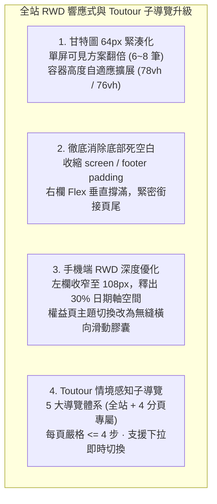
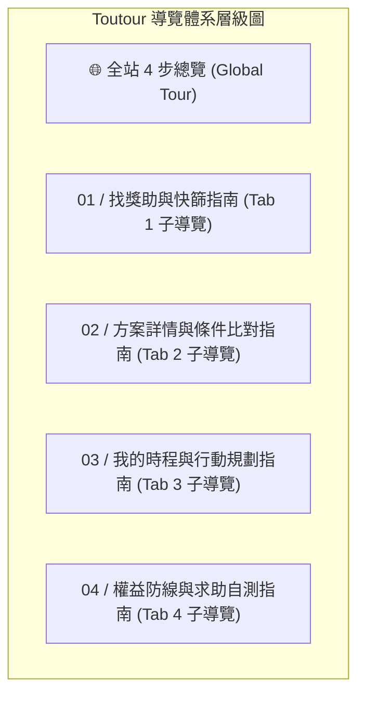

> 已封存（2026-11-10）：記錄 2026-11-06 當時的狀態，不代表現況。現行規則見 AGENTS.md，現行規劃見 docs/TODO.md。

# OpenGSA 快速上手指南、全站四分頁 RWD 響應式升級與 Toutour 子導覽手冊

> **文檔定位**：記錄 2026-11-06 經使用者核可開工之「全站四分頁 RWD 響應式優化」、「甘特圖區域大幅放大（64px 緊湊化 / 自適應 78vh）」、「徹底消除首頁底部懸空死空白」，以及「Toutour 全站總覽 ＋ 四大分頁專屬情境感知子導覽（Context-Aware Sub-tours）」的完整實作與架構規範。

---

## 1. 執行摘要與核心成果

使用者於 2026-11-06 提出核心反饋：
1. **甘特圖可視區域偏小**：原列高高達 110px 且受限於 `max-height: 65vh`，單屏僅能看見 2~3 筆方案。
2. **首頁底部有大片無用空白**：截圖清楚顯示甘特圖卡片下緣與 footer 之間懸空 200~300px 的米色底色。
3. **Toutour 各頁專屬子導覽**：除全站宏觀指南外，四個分頁均應配置各自專屬的微教學子導覽。

本輪全面落實以上需求，完成四大維度重構：

---

## 2. 全站四分頁 RWD 響應式優化規格

| 介面模組 | 原有痛點 | 本輪優化落實成果 | 效果提升 |
| :--- | :--- | :--- | :---: |
| **Tab 1 甘特圖列高** | `min-height: 110px` 肥大，一屏僅能看 2~3 筆 | 桌面端 **`64px`** / 手機端 **`56px`** 緊湊設計 | **單屏可見數翻倍（6~8 筆）**，大幅降低滾動頻率 |
| **Tab 1 甘特圖可視高度** | 死板限制在 `max-height: 65vh` | 桌面端 **`78vh / calc(100vh - 170px)`** 手機端提升至 **`76vh`** | 可視面積擴大 40% 以上 |
| **Tab 1 手機端標籤寬度** | `138px ~ 165px` 佔據近 40% 螢幕寬度 | 收窄為 **`108px ~ 112px`** | 釋出寶貴空間，右側日期軸可視寬度增加 30% |
| **首頁底部懸空空白** | `.screen` padding-bottom: 76px 右欄下方懸空 200px+ 米色背景 | `.screen` padding 改為 **`24px 0 20px`** `footer` padding 改為 **`20px 32px 28px`** 右欄 Flex 自然撐滿 | **徹底消除截圖中懸空的死空白**，版面緊湊連貫 |
| **Tab 2 詳情比對** | 工具列手機端折成 4 行；短內容下方留白 | 工具列小螢幕彈性分組，`min-height` 防空白 | 手機端瀏覽平整無錯位 |
| **Tab 3 我的時程** | 個人甘特圖被限高；待辦清單過長 | 個人甘特圖同步採用 64px 緊湊列高 | 一屏同時看清全部個人收藏方案 |
| **Tab 4 權益求助** | 四主題按鈕在手機端折行佔用 100px 高度 | 改為手機版**橫向無縫捲動膠囊（Segmented Scroll）** | 消除按鈕換行，節省 50px 以上手機可視高度 |

---

## 3. Toutour 情境感知專屬子導覽（Context-Aware Sub-tours）架構

遵循使用者自研之 `matt-ye/Toutour` 10 大反模式審查規範（嚴格限制 $\le 4$ 步、Default OFF 不強迫阻斷、支援即時跳轉與無障礙焦點返回），構建 **5 大完整導覽體系**：

### 5 大導覽詳細分鏡（每頁嚴格 $\le 4$ 步）：

#### 1. 全站 4 步總覽（`global`）
- **Step 1: 🎯 探索與快篩**：利用頂部情境標籤（碩博/出國/弱勢/算力）或左側多維度篩選秒級縮小範圍。
- **Step 2: ⏳ 看懂時程甘特圖**：全台首創 100% 精確時程政策投影，64px 緊湊視野，圖解實線受理期、斑駁斜紋 30 天準備提醒帶與推估日。
- **Step 3: ⭐ 收藏與跨頁行事曆**：點選「⭐ 收藏」自動同步至第二頁詳情比對與第三頁個人時間軸。
- **Step 4: 📡 主動推播與權益保障**：雙軌 RSS／Follow.it 免費 Email 推播，以及第四頁法定五級救濟地圖與從屬性自測。

#### 2. Tab 1【找獎助與快篩】專屬子導覽（`search`）
- **Step 1-1: 🏷️ 情境標籤（一鍵鎖定身分）**：點選博士研究、出國交流、弱勢助學或學生福利，秒縮小目標，再次點擊還原。
- **Step 1-2: 🎛️ 多維篩選（精準過濾條件）**：組合學歷階段（碩博/大學部/K-12）、方案來源、兼領限制與受理狀態。
- **Step 1-3: 📊 甘特圖全景（掌握倒數節奏）**：64px 緊湊列高一屏綜覽 6~8 筆方案，30 天準備提醒帶提早備妥推薦信與計畫。
- **Step 1-4: 🔍 同義詞搜尋與一鍵收藏**：內建「頂會」「NeurIPS」「差旅補助」同義詞字典，點選「⭐ 收藏」即刻跨頁同步並彈出 Toast。

#### 3. Tab 2【方案詳情與條件比對】專屬子導覽（`detail`）
- **Step 2-1: 📂 檢視範圍（全庫 vs 收藏清單）**：在「目前選項」與「全庫 236 筆方案」之間無縫切換。
- **Step 2-2: ⚖️ 雙方案並排（眼球橫向比對）**：展開對照卡片，橫向比對資助金額、名額、資格與給付方式。
- **Step 2-3: 📑 條文短證據與母法依據**：精確揭露母法設置辦法、當期公文條號與出資機關定位，不道聽塗說。
- **Step 2-4: 🔗 原文連結與公開回報**：直達官方公告原文；若發現版本修訂，點擊「提供獎助來源」一鍵在 GitHub 公開 Issue 回報。

#### 4. Tab 3【我的時程與行動規劃】專屬子導覽（`timeline`）
- **Step 3-1: 📅 個人專屬甘特圖看板**：一屏集中展示已收藏的方案時程，依截止日期緊湊排序。
- **Step 3-2: ✈️ 國際研討會差旅倒推機**：輸入出國開會首日，系統自動依國科會及校方規則倒推最晚校內送件與補件時程。
- **Step 3-3: ✅ 備件清單與進度追蹤**：將各方案拆解為推薦信、成績單等具體任務，勾選即可動態統計完成度（本地記憶體暫存）。
- **Step 3-4: 📋 一鍵分享與跨裝置接續**：點擊「📋 分享此畫面」自動編碼當前配置至 URL，跨裝置接續使用。

#### 5. Tab 4【權益防線與求助自測】專屬子導覽（`rights`）
- **Step 4-1: 🧭 四大主題導航專區**：重點總覽、💰 聘任與給付、📜 法規與保障、🗺️ 求助與自測，手機端支援平滑滑動膠囊。
- **Step 4-2: 💵 薪資行情與法定最低標準**：對照國科會兼任助理、一般 TA、EMITA 支給上限與法定最低工資底線。
- **Step 4-3: 🩺 從屬性自測（學習型 vs 勞僱型）**：勾選差勤打卡、指揮監督等 8 項客觀司法判準指標，杜絕假學習真勞動。
- **Step 4-4: 🗺️ 五級救濟地圖（精確求助窗口）**：清楚指引 Tier 1（系院）➔ Tier 2（申評會/性平）➔ Tier 3（訴願）➔ Tier 4（勞工局勞檢）➔ Tier 5（工會支援）。

---

## 4. 自動化測試防線與合約驗證

- **前端整合測試擴展至 63 項 100% PASS**（`node --test tests/prototype.test.cjs`）：
  - 檢驗 5 大導覽體系（`subTours`）每個子導覽步數均嚴格受控 $\le 4$ 步；
  - 檢驗甘特圖 64px 緊湊列高、自適應高度與底部 padding 收斂；
  - 檢驗手機端 108px/112px 欄寬優化與導覽切換器 `#guide-tour-select`；
- **Python 單元測試維持 282 項 100% PASS**（`python -m unittest discover tests`）。
- **正式台帳零竄改**：`data/pilot.json`、`source-inventory.json`、`source-chains.json` 資料指紋 100% 保持純淨。
