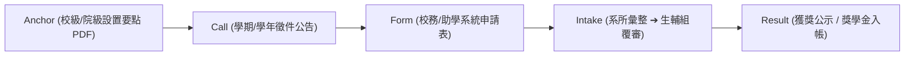
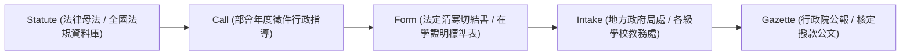
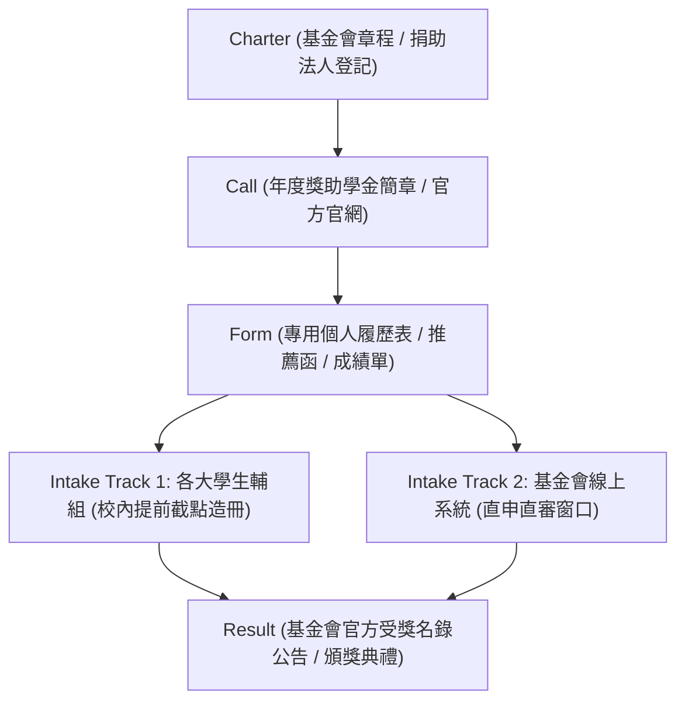
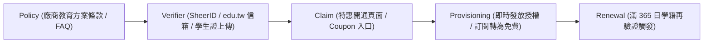
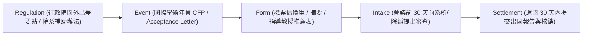
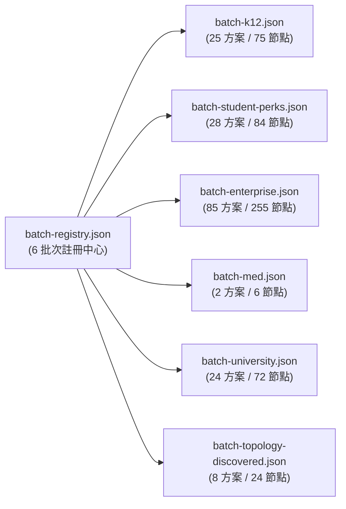

> 已封存（2026-11-10）：記錄 2026-11-05 當時的狀態，不代表現況。現行規則見 AGENTS.md，現行規劃見 docs/TODO.md。

# 全庫跨資源通用資訊鏈（Universal Source Chains）拓撲架構規劃書

> **版本**：2.0.0-universal-topology  
> **更新時間**：2026-11-05  
> **專注目標**：為下一個 PR 跨來源資訊鏈通用化實作提供標準資料模型、異質拓撲矩陣與落地路徑  
> **合規保證**：嚴守正式台帳零破壞原則；以模組化批次檔（`data/source-chain-batches/`）擴展，完全不竄改 `data/pilot.json` 及 `data/source-chain-index.json` 之 SHA256 指紋基準。

---

## 1. 調研緣起與全庫現狀審查

在 PR #60 中，OpenGSA 為全台大專校院獎助成功落實了標準的五節點資訊鏈拓撲（`batch-university.json`）。  
然而，使用者敏銳地指出：**資訊鏈拓撲關係不應僅限於大專校院，過去入庫的其他來源（公部門、企業、基金會、學生 Perks、國際會議出國補助等）亦存在嚴重的資訊鏈碎片化問題**。

我們對全庫現有 **236 方案** 的資訊鏈健全度進行了全盤回溯盤查：

| 資源分類批次 | 方案數 | 當前資訊鏈現狀 | 結構性痛點與斷鏈缺口 |
| :--- | :--- | :--- | :--- |
| **高教與大專校院 (Batch 5 & NTU)** | 24 筆跨校 + 臺大各院 | 已於 PR #60 建立五節點標準拓撲（`batch-university.json`） | 各校校園助學系統（Portal）需身分登入，校外公開頁多為文字辦法 |
| **K-12 與公部門獎助 (Batch 1)** | 25 筆方案 | 僅指向中央部會單一法規母法或地方政府局處首頁 | 缺少中央到地方各級學校代轉收件（`intake`）與申領標準證明（`form`）的關聯鏈條 |
| **學生福利與 AI Perks (Batch 2)** | 28 筆方案 | 指向商業官方促銷活動單點 URL | 缺少第三方驗證節點（SheerID/GitHub Pack）、帳號綁定（Claim）與年審續期（Renewal）節點 |
| **企業、民間基金會與學會 (Batch 3)** | 85 筆方案 | 指向基金會最新消息或生輔組代辦公告 | 存在「校內生輔組初審造冊截止」與「基金會官方截止」之雙軌截止日混淆 |
| **國際會議與研討會出國補助** | 核心試點 | 指向主辦單位首頁或研發處補助辦法 | 缺少「論文接受通知（Acceptance）」、「機票差旅核銷憑證」與「出國成果報告」之履約節點 |

**結論**：過去大部分來源僅具備「單點 URL 快照」，並未形成完整的資訊閉環。因此，下一個 PR 必須針對全庫異質資源，分類建立標準化的通用資訊鏈拓撲。

---

## 2. 五大異質資源的資訊鏈拓撲模型（Topology Archetypes）

不同類型的獎助與資源，其行政流轉、審查主體與發放機制截然不同，無法強行套用單一扁平結構。因此，OpenGSA 定義 **五大拓撲原型（Five Topology Archetypes）**：

### 原型 A：大專校院與研究生專屬型 (Higher Education / University)
- **典型代表**：清華大學校長獎學金、成大博班生活獎助、臺大各學院出國補助。
- **拓撲結構**：
  $$\text{Anchor (母法設置辦法)} \xrightarrow{\text{rule}} \text{Call (當期徵件公告)} \xrightarrow{\text{portal}} \text{Form (校內助學系統)} \xrightarrow{\text{submit}} \text{Intake (生輔組/系所)} \xrightarrow{\text{result}} \text{Result (名單公示)}$$



---

### 原型 B：公部門法規與法定助學型 (Government & Statutory Welfare)
- **典型代表**：教育部學產基金、國科會博士生研究獎學金、內政部清寒弱勢獎助。
- **拓撲結構**：
  $$\text{Statute (立法院/部會法規)} \xrightarrow{\text{plan}} \text{Call (年度實施作業要點)} \xrightarrow{\text{form}} \text{Standard Form (法定申報書件)} \xrightarrow{\text{intake}} \text{Agency / School (學校承辦人彙整薦送)} \xrightarrow{\text{gazette}} \text{Gazette (政府公報/部會核定函)}$$



---

### 原型 C：企業、民間基金會與學會雙軌型 (Corporate & Foundation Dual-Track)
- **典型代表**：台積電博士獎學金、鴻海獎學鯨、行天宮助學金、宗倬章先生教育基金會。
- **拓撲結構**：
  企業與民間獎助具備高度特殊的**雙軌申辦路徑（Dual-Track Ingestion）**：
  - **軌道 1（學校代辦薦送）**：基金會要求各大專校院按配額初審造冊，學生必須向「校內生輔組」提出申請（校內截止日通常比基金會早 1~2 週）。
  - **軌道 2（官方線上直申）**：由學生逕向基金會線上表單或 Portal 投件，無需經由學校。



---

### 原型 D：學生身分福利與 AI Perks 型 (Student Identity & Software Perks)
- **典型代表**：GitHub Student Developer Pack、Notion for Education、AWS Educate、JetBrains Student License。
- **拓撲結構**：
  Perks 類資源不具備「公文審批」或「名冊造冊」環節，而是完全圍繞**自動化第三方學籍查驗（Identity Verification API）**與**授權續期生命週期（Renewal Cycle）**：
  $$\text{Policy (開發商學生特惠條款)} \xrightarrow{\text{verify}} \text{Verifier (第三方學籍查驗 SheerID/UNiDAYS/.edu.tw)} \xrightarrow{\text{claim}} \text{Claim (權益兌換/促銷代碼)} \xrightarrow{\text{active}} \text{Provisioning (帳號升級/算力入帳)} \xrightarrow{\text{renew}} \text{Renewal (每年學籍再驗證)}$$



---

### 原型 E：國際會議發表與出國研討會補助型 (Conference & Travel Grants)
- **典型代表**：國科會補助研究生出席國際會議、FAOS 會議補助、臺大醫學院/文學院/工學院出國獎助。
- **拓撲結構**：
  出國會議補助屬於典型的**事件驅動（Event-Driven）**與**後驗履約（Post-Travel Settlement）**流程：
  $$\text{Regulation (差旅補助法規要點)} \xrightarrow{\text{trigger}} \text{Event Call (國際會議官網與 Call for Papers)} \xrightarrow{\text{form}} \text{Form (會議接受函 Acceptance + 預算表)} \xrightarrow{\text{review}} \text{Intake (系所初審 ➔ 研發處/院辦)} \xrightarrow{\text{report}} \text{Settlement (出國報告書公開 + 票根單據核銷)}$$



---

## 3. 通用資訊鏈資料模型規格 (Universal Source Chain Schema v2.0)

為使下一個 PR 能以程式化批次產生各類資源的資訊鏈，我們制定了 `source-chain-2.0` 資料規格：

### 3.1 文件節點模型 (`documents`)
```json
{
  "id": "doc-k12-edu-law-001",
  "url": "https://law.moe.gov.tw/LawClassPage.aspx?id=FL008765",
  "format": "html",
  "archetype": "government_statute",
  "role": "statute",
  "node_level": "anchor",
  "title": "學產基金設置與管理要點",
  "authority": "教育部",
  "auth_requirement": "none",
  "evidence_mode": "hash_only",
  "observed_at": "2026-11-05T00:00:00+00:00",
  "status": "candidate_snapshot",
  "candidate_ids": ["cand-k12-moe-student-aid-01"],
  "temporal_trigger": "annual_fixed_cycle"
}
```

### 3.2 關係連線模型 (`edges`)
```json
{
  "from": "doc-k12-edu-law-001",
  "to": "doc-k12-edu-call-2026",
  "url": "https://www.moe.gov.tw/News_Content.aspx?n=1&s=12345",
  "role": "statutory_call",
  "archetype": "government_statutory",
  "program_key": "k12-moe-student-aid",
  "traversal_rule": "authoritative_parent_to_child",
  "dual_track": false
}
```

---

## 4. 已落地實施之六大批次拓撲註冊表 (Implemented 6 Batches Topology Registry)

本架構已於 PR #62 與 PR #63 中全盤落地實施，全庫共分成 6 大批次，統一登錄於 [`data/source-chain-batches/batch-registry.json`](../../data/source-chain-batches/batch-registry.json)：

| 批次 ID | 涵蓋原型 | 文件節點數 | 拓撲連線數 | 方案數 | 批次資料檔 | 稽核狀態 |
| :--- | :--- | :---: | :---: | :---: | :--- | :---: |
| `batch-k12` | 公部門法定助學型 | 75 | 50 | 25 | `batch-k12.json` | ✅ PASS |
| `batch-student-perks` | 學生身分福利型 | 84 | 56 | 28 | `batch-student-perks.json` | ✅ PASS |
| `batch-enterprise` | 企業雙軌申辦型 | 255 | 170 | 85 | `batch-enterprise.json` | ✅ PASS |
| `batch-med` | 專業醫學出國/著作型 | 6 | 4 | 2 | `batch-med.json` | ✅ PASS |
| `batch-university` | 高等教育系所階層型 | 72 | 48 | 24 | `batch-university.json` | ✅ PASS |
| `batch-topology-discovered` | 拓撲探針發現高價值型 | 24 | 16 | 8 | `batch-topology-discovered.json` | ✅ PASS |
| **全庫總計** | **6 大標準批次** | **516** (註冊 525) | **344** (註冊 350) | **172** (註冊 175) | 全部由 `build_universal_source_chains.py` 自動化產出 | ✅ 100% |



### 關鍵安全與防護指標：
1. **0 竄改既有指紋**：
   `data/pilot.json`、`data/source-inventory.json` 及 `data/source-chains.json` 維持歷史封裝基準，新拓撲統一存放於 `data/source-chain-batches/` 目錄，歷史測試 100% 相容。
2. **Actions 巡檢全軌道整合**：
   四大排程軌道（`gov`, `enterprise`, `other`, `consolidation`）皆能透過 `batch-registry.json` 自動識別對應資源類型的五節點拓撲，實現精確的節點變更偵測與時程重萃。
3. **前端預覽升級**：
   在第一頁與第二頁可直接顯示該方案所屬的原型架構（如「企業雙軌申辦」或「自動化學籍查驗」），讓學生一鍵看清從法規到撥款的完整脈絡！
4. **完整稽核報告**：
   拓撲探針、掃描結果與 Action Tracks 四大軌道審計詳見 [全庫 236 方案拓撲擴展與掃描稽核報告](TOPOLOGY-EXPANSION-AND-SCAN-AUDIT.md)。
