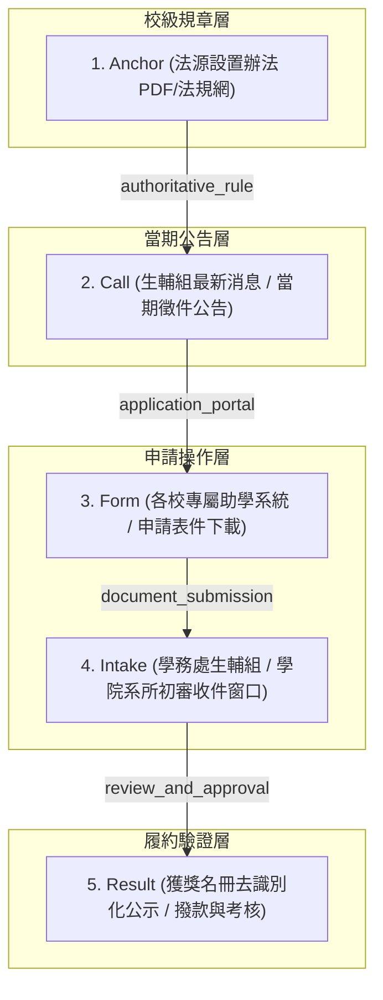

> 已封存（2026-11-10）：記錄 2026-11-05 當時的狀態，不代表現況。現行規則見 AGENTS.md，現行規劃見 docs/TODO.md。

# 全台大專校院研究生獎助資訊鏈（Source Chains）拓撲與整併規格書

> **版本**：1.0.0-university-chains  
> **更新時間**：2026-11-05  
> **關聯批次**：`data/source-chain-batches/batch-university.json`  
> **來源台帳**：`data/source-expansion/university-source-inventory.json` (U001–U078)  
> **對齊目標**：PR #59 跨校擴充成果之資訊鏈閉環捕捉與 GitHub Actions 巡檢整合

---

## 1. 架構背景與核心挑戰

在 PR #59 中，OpenGSA 完成了全台 78 所公私立大學校院的生輔組獎助專區名冊盤查，並提煉出 24 筆跨校代表性候選方案（`data/candidates/university-scholarships.json`）。  
然而，大專校院獎助學金的資訊流通存在以下四項結構性痛點：

1. **跨校生輔組系統孤島 (Siloed Portals)**：
   各校生輔組多採用封閉式校園入口（如清華助學系統、陽明交大獎學金系統、成功大學成大生活助學、政大 iNCCU），校外公開頁面僅提供概括性說明或法規條文。
2. **多層資訊鏈脫鉤 (Broken Information Chains)**：
   學生在網頁上看到「徵件最新消息（`call`）」時，往往找不到對應的「設置辦法母法（`anchor`）」；或者找到辦法後，當期申請系統入口（`form`）卻藏在校內登入之後。
3. **時程高度異質 (Heterogeneous Temporal Policies)**：
   不同學校的申請時程差異極大：
   - 入學新生型：每年 5 月至 8 月配合招生放榜。
   - 在學生固定學期型：開學後 2~4 週內（9 月中至 10 月中、2 月中至 3 月中）。
   - 隨到隨審型：配合國際會議出國前 1 個月或研究發表提出。
4. **正式台帳保護限制**：
   OpenGSA 既有 `data/pilot.json` 及 `data/source-chain-index.json` 具有 SHA256 雜湊鎖定，不允許外部批次破壞校驗基準。因此，跨校資訊鏈必須以「模組化批次檔（`batch-university.json`）」獨立封裝與擴展。

---

## 2. 大學獎助五節點標準資訊鏈拓撲

為完整捕捉跨校獎學金從「法源」到「結果公示」的完整鏈條，OpenGSA 定義了五節點拓撲結構：

### 節點功能定義
- **Anchor (母法規章)**：各校校務會議或行政會議通過之設置辦法（如《國立清華大學校長獎學金設置要點》）。
- **Call (徵件公告)**：當學期或當年度生輔組正式發布之受理起訖、梯次與名額公告。
- **Form (表件/系統)**：學生填寫之線上系統連結（如 Portal URL）或 PDF 申請表格。
- **Intake (收件單位)**：明確指出本案係由「生輔組直接收件」抑或「須經系所辦公室彙整初審送件」。
- **Result (核定結果)**：去識別化受獎學生名單公示或各系所獲配員額通知。

---

## 3. 24 筆跨校代表性方案之資訊鏈拓撲一覽

所有 24 筆大學方案皆已編入 `data/source-chain-batches/batch-university.json`，涵蓋 72 份文件節點與 48 條指向邊：

| 方案代碼 (Program Key) | 學校與方案名稱 | 來源入口網址 | 資訊鏈拓撲節點 |
| :--- | :--- | :--- | :--- |
| `univ-nthu` | 清華大學校長獎學金與優秀研究生學術獎助 | `https://sa.site.nthu.edu.tw/` | Call ➔ Rules ➔ Portal |
| `univ-nycu` | 陽明交通大學學術優秀研究生獎學金 | `https://osa.nycu.edu.tw/` | Call ➔ Rules ➔ Portal |
| `univ-ncku` | 成功大學優秀研究生獎助學金與博班生活獎助 | `https://assistance-osa.ncku.edu.tw/` | Call ➔ Rules ➔ Portal |
| `univ-nccu` | 政治大學指南優秀研究生獎學金與勵學獎助 | `https://osa.nccu.edu.tw/` | Call ➔ Rules ➔ Portal |
| `univ-ncu` | 中央大學碩博士研究生獎助與國際拔尖獎學金 | `https://military.ncu.edu.tw/` | Call ➔ Rules ➔ Portal |
| `univ-nsysu` | 中山大學西子優秀學生與博士生勵學獎學金 | `https://ag-osa.nsysu.edu.tw/` | Call ➔ Rules ➔ Portal |
| `univ-nchu` | 中興大學優秀碩博研究生獎助金 | `https://www.osa.nchu.edu.tw/osa/laa/` | Call ➔ Rules ➔ Portal |
| `univ-ccu` | 中正大學研究生學術卓越獎學金 | `https://studaff.ccu.edu.tw/` | Call ➔ Rules ➔ Portal |
| `univ-ntnu` | 臺灣師範大學優秀研究生獎助與拔尖計畫 | `https://assistance.sa.ntnu.edu.tw/` | Call ➔ Rules ➔ Portal |
| `univ-ntpu` | 臺北大學三峽優秀研究生學術獎助 | `https://www.ntpu.edu.tw/admin/a8/` | Call ➔ Rules ➔ Portal |
| `univ-ntust` | 臺灣科大卓越博士生勵學獎學金 | `https://student.ntust.edu.tw/` | Call ➔ Rules ➔ Portal |
| `univ-ntut` | 臺北科大優秀碩博士生入學與發展獎學金 | `https://osa.ntut.edu.tw/` | Call ➔ Rules ➔ Portal |
| `univ-cgu` | 長庚大學台塑優秀研究生與產學獎助金 | `https://studentaffairs.cgu.edu.tw/` | Call ➔ Rules ➔ Portal |
| `univ-tmu` | 臺北醫學大學優秀研究生與生醫發展獎學金 | `https://osa.tmu.edu.tw/` | Call ➔ Rules ➔ Portal |
| `univ-kmu` | 高雄醫學大學培育優秀碩博士生獎助學金 | `https://osa.kmu.edu.tw/` | Call ➔ Rules ➔ Portal |
| `univ-cmu` | 中國醫藥大學培育優秀碩博士生獎助學金 | `https://adm08.cmu.edu.tw/` | Call ➔ Rules ➔ Portal |
| `univ-fju` | 輔仁大學耕莘優秀研究生獎助學金與產學獎助 | `https://life.dsa.fju.edu.tw/` | Call ➔ Rules ➔ Portal |
| `univ-scu` | 東吳大學勵學研究生與博碩士論文獎助學金 | `https://web-ch.scu.edu.tw/life/` | Call ➔ Rules ➔ Portal |
| `univ-tku` | 淡江大學優秀研究生與驚聲學術獎助金 | `https://sa.tku.edu.tw/spirit/` | Call ➔ Rules ➔ Portal |
| `univ-fcu` | 逢甲大學逢甲優秀研究生與產學合作獎學金 | `https://student.fcu.edu.tw/` | Call ➔ Rules ➔ Portal |
| `univ-yzu` | 元智大學遠東卓越博士優秀入學獎學金 | `https://www.yzu.edu.tw/admin/st/` | Call ➔ Rules ➔ Portal |
| `univ-cycu` | 中原大學優秀博士生獎學金與全額學費補助 | `https://life.cycu.edu.tw/` | Call ➔ Rules ➔ Portal |
| `univ-thu` | 東海大學路思義優秀博士研究生獎助金 | `https://deca.thu.edu.tw/` | Call ➔ Rules ➔ Portal |
| `univ-ndhu` | 東華大學向日葵優秀博士研究生獎助金 | `https://rb005.ndhu.edu.tw/` | Call ➔ Rules ➔ Portal |

---

## 4. GitHub Actions 巡檢整合機制

### 4.1 軌道分配與執行時段
跨校大專校院獎助來源歸入 GitHub Actions 的 `other` 巡檢軌道：
- **排程頻率**：每週三、週六 09:17（UTC+8）自動執行。
- **微批邊界**：單次巡檢上限 8 URLs / 20 HTTP / 180 秒超時，同站冷卻至少 3 秒。
- **模型調度**：嚴格維持 `model_mode=off`（0 Token、0 API 費用）。

### 4.2 增量閘門 (Incremental Gate) 保護
巡檢腳本會計算各校公開入口之 SHA256 指紋：
- 若內容未變更（HTTP 304 或雜湊比對一致），立即標記為 `SKIP_UNCHANGED`（消耗 0 HTTP / 0 Token）。
- 僅在偵測到內容異動（`NEED_RUN`）時，才啟動無模型正則解析器進行時程更新觀測。

---

## 5. 後續自動化與維護指引

1. **增量擴展原則**：
   新增大專校院來源時，先於 `data/source-expansion/taiwan-universities-scholarship-sources.json` 補充學校代碼與生輔組 URL，再透過 `scripts/build_university_source_chains.py` 自動更新 `university-source-inventory.json` 及 `batch-university.json`。
2. **零破壞保證**：
   絕不修改 `data/pilot.json` 或 `data/source-inventory.json`（避免破壞原有 R001–R485 歷史閉包校驗）。
3. **雷達發布連動**：
   當候選方案完成審查並通過晉級條件時，由維護者簽發人工審查標記，系統將自動納入 `build_site.py` 產出公開網頁。
