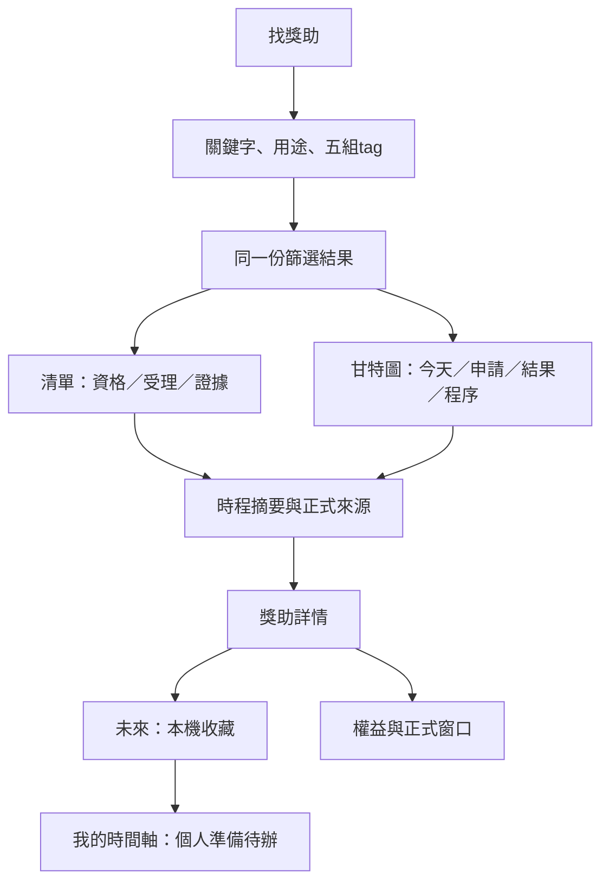
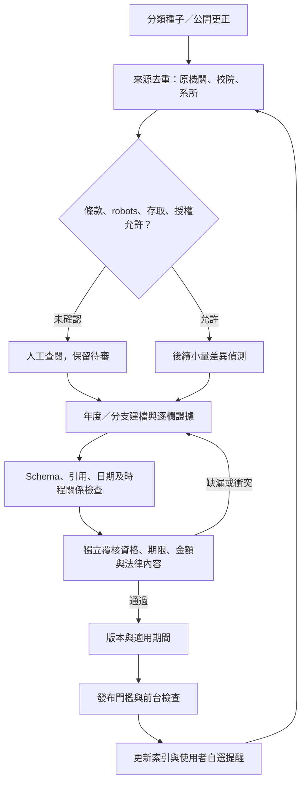

# 四分頁互動線框與維護流程

設計審閱稿0.2，尚非正式產品。[wireframes.html](wireframes.html) 與同目錄 prototype.js 可在瀏覽器開啟；四個功能使用頁內tabs，一次只顯示一頁。使用者已核可本輪分頁、篩選與甘特圖原型，完整資格核定、收藏儲存、ICS、通知與部署仍未實作。

## 可操作內容

- 四個頁籤：找獎助、獎助詳情、我的時間軸、權益與求助。支援左右方向鍵、Home／End、ARIA選取狀態及雜湊深連結。
- 找獎助提供關鍵字、用途與五組tag；甘特圖、清單與日期表共用篩選和筆數。切換頁籤及檢視保留本次條件。
- 色帶表示申請起訖，虛線表示等待結果，菱形表示結果日；預定結果為空心虛線菱形，校內／機關節點另用方形與不同列。
- 今天線採Asia/Taipei裝置日期，跨日或返回頁面時更新。可前後移30天、回到今天，或切換涵蓋所有已知日期。
- 近90天檢視固定為今天前21天至後69天，共91個日期格；篩選不改尺度。自選涵蓋所有日期時才隨結果調整。
- 手機圖表局部水平捲動、名稱欄固定；開啟甘特圖或回到今天時，將今天線帶入可視區。
- 點項目、色帶或節點看摘要；另提供與篩選同步的文字日期表及零結果清除入口。

篩選只整理選項，不代表個人符合資格。「保留標籤待確認項目」預設開啟，unknown不會被改成allowed或unlimited。

## 合成與真實資料分流

預設6筆SYNTH合成排程的名稱、身分標籤與日期全部虛構，用於展示過去、受理中、未開始、等待結果及缺日期。日期相對裝置的臺北今天產生，不代表任何官方機會。

切換「10筆來源草稿」，由嵌入的 [pilot.json](../../data/pilot.json) 快照產生畫面；測試核對快照與原檔相同。來源類型在原型中是人工分類，完整資助／配合款角色仍須看正式資料，不把單一標籤當成全部經費來源。

真實草稿尚無結構化起日與結果日，因此不從敘述推算期間或公布日，只標示steps已有的學生期限及其他程序。11/9學院送件不回填為學生截止。搜尋摘要不因被畫在圖上而升級已覆核；所有真實資料仍是draft，受理狀態以資料快照為準。

詳情與我的時間軸仍是既有靜態案例頁，尚未連成完整收藏流程。探索甘特圖呈現所有篩選結果；個人時間軸未來呈現收藏與自己的準備工作。

## 頁面分工

| 頁面 | 核心資訊 | 缺漏處理 |
|---|---|---|
| 找獎助 | 五組tag、年度、三軸狀態、申請／公布時程 | 缺起日只畫已知節點，無日期不畫期間 |
| 獎助詳情 | 資格缺漏、各層程序、來源與版本 | 機關期限不替代學生期限 |
| 我的時間軸 | 未來共用時程資料，加上本機收藏及個人待辦 | 自訂日期標明；未確認期限獨立區 |
| 權益與求助 | 工資／獎助／成果獎、版本及正式窗口 | 關係未明仍可查窗口；不產生法律裁決或申訴倒數 |

## 使用者流程



提醒只能使用已確認且適用的日期，不用推估結果日或校級送件日冒充學生截止。

## 維護流程



本輪不啟用自動爬取或提醒。重大異動先降為待確認；法規保留舊版與適用事件。公文延遲研究保留缺失值，不將觀察直接變成責任歸因。

## 檢查與單檔匯出

原生HTML／CSS／JavaScript，沒有新增網站框架或套件。Node內建測試覆蓋篩選、未知值、今天時區、日期缺漏、時程關係、手機定位與快照一致性。

```powershell
node --test tests/prototype.test.cjs
python scripts/export_wireframes.py outputs/OpenGSA-wireframes-v0.2.html
```

匯出把JavaScript和資料嵌入單一HTML，離線不需服務、不傳送個資。來源HTML與JS維持分檔；不覆寫來源檔。

本輪9項原型測試通過；前輪另有10項資料契約測試。瀏覽器檢查分頁與鍵盤、即時篩選、切換保留條件、零結果、資料分流及320 CSS px重排。這不是完整資格引擎或產品驗收。

## 無障礙與下一步

以WCAG 2.2 AA為產品目標，目前有語意化頁籤、原生篩選、鍵盤操作、可見焦點、文字狀態、節點名稱及文字日期表。未完成完整讀屏、對比或觸控測試，不宣稱AA驗收。

- [x] 四頁改為獨立頁籤。
- [x] 找獎助加入與filter同步的甘特圖、今天線及申請／結果關係。
- [ ] 確認圖例、資訊密度及資料契約的新時程欄位。
- [ ] 指派來源維護者及獨立覆核。

正式產品仍依 [目前計畫](../PLAN.md)；新時程欄位見 [資料契約](../DATA-CONTRACT.md#甘特圖所需的契約補充提案)。
