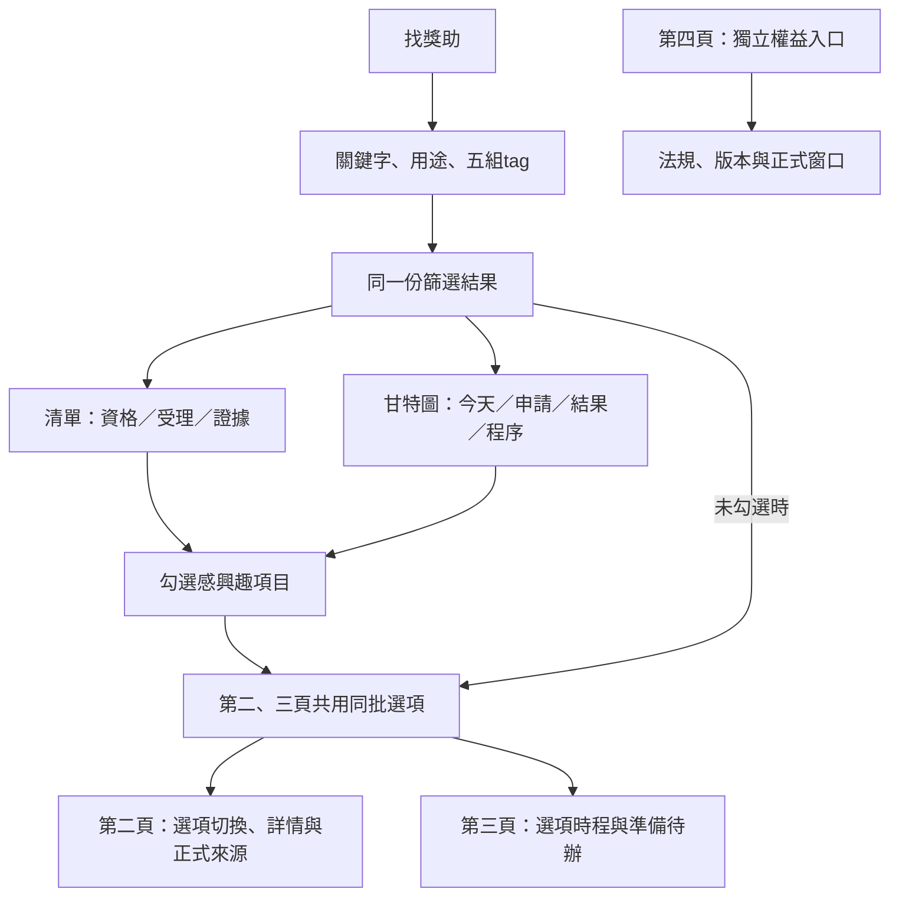
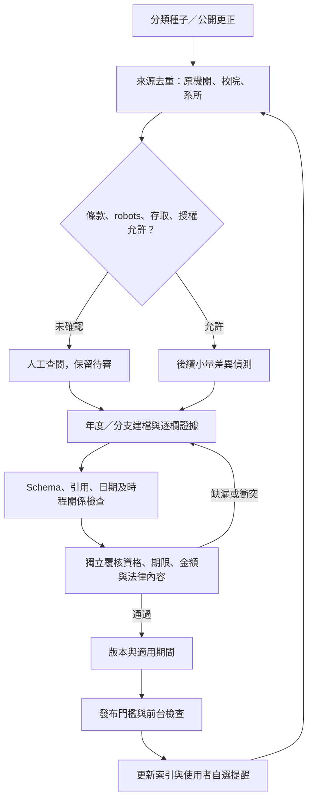

# 四分頁互動線框與維護流程

MVP介面基礎審閱稿0.8，已發布[公開預覽](https://matt-ye.github.io/opengsa/)，尚非已覆核的正式服務。[wireframes.html](wireframes.html) 與同目錄prototype.js可在瀏覽器開啟；使用者已接受v0.6為MVP基礎。v0.8將研討會規劃加入甘特圖及共用選項，完整資格核定、跨次瀏覽儲存、ICS與通知仍未實作。

## 可操作內容

- 四個頁籤：找獎助、獎助詳情、我的時間軸、權益與求助。支援左右方向鍵、Home／End、ARIA選取狀態及雜湊深連結。
- 找獎助提供關鍵字、用途與五組tag；甘特圖、清單與日期表共用篩選和筆數。切換頁籤及檢視保留本次條件。
- 桌面篩選卡固定於實測導覽列下方；矮視窗時卡片內可捲動，提供鍵盤焦點。800px以下恢復正常排版，避免固定卡佔滿手機畫面。
- 第一頁研討會卡可選國科會、醫學院、FAOS或自填院系方案；輸入名稱、會議日、通知日及0–90天緩衝，按加入／更新後同步第一頁甘特圖、清單、日期表及第二、三頁。支援同場多補助、同方案更新及逐筆移除；跨資料模式保留個人規劃，其他合成與來源選取仍隔離。新增醫學院及FAOS制度入口可從來源清單檢索。規則及證據見[研討會來源](../CONFERENCE-SOURCES.md)。
- 個人虛線色帶為準備建議、空心節點為試算／自填，不能冒充官方起日／期限／結果。未知校內日期不從機構日期補猜；未核例假日與月底換算時保持待核。本次記憶體資料不進正式表、URL、儲存或模型，重整即清除。
- 第一頁的清單與甘特圖可逐項勾選或勾選目前結果。第二、三頁共用勾選項目；尚未勾選時使用目前篩選結果。調整篩選不刪除勾選；清除勾選後回到目前篩選結果。
- 第二頁列出這批選項的切換選單，呈現各項條件、程序、來源與待查問題；第三頁呈現同一批選項的甘特圖、申請清單與三項準備待辦。
- 勾選與待辦僅本次瀏覽有效，重新整理會重設；合成與真實資料的選取和待辦各自隔離。勾選進度不變更來源覆核或個人資格狀態。
- 第四頁獨立維護，不隨篩選、勾選或時間軸重繪內容；法規、正式窗口或來源連結變更時覆核修訂，仍保留查核日與適用版本。
- 第四頁以國科會約用注意事項呈現適用身分與給付要求，再列勞動法規底線、臺大及實踐大學補充；上限不當成最低保障。來源初查與待覆核事項見[權益依據](../RIGHTS-SOURCES.md)。
- 博士生另列增核10,000元、領有增核者最低每月總額16,000元及適用核定／期間，不能只列一般6,000元。提供原函、FAQ、官方沿革、世新轉知及勞動法源；12,000元通用下限尚未查得，保留待查。
- 第四頁另補全國從屬性綜合判斷與臺大校務基金獎勵金辦法；避免「有固定報酬就一律適用勞基法」。臺大摘要跟隨生輔組目前連到的109年版，保留舊106年版差異，學校經費不直接套國科會給付要求。
- 2026-10-30 依 [資源整合路線圖、UI/UX 響應式審核與「政策島」互動設計落地指南](../UX-AUDIT-AND-ISLAND-DESIGN.md) 補強：第一頁新增「探索島情境快速篩選（博士研究、生活與學費、國際會議出國、境外移地研究、學術成果與榮譽、助教與兼任聘任六大傳送門）」；第四頁維持頂層四頁籤結構，於頁內新增「全部總覽／📜 法規與給付標準／🗺️ 五級救濟與從屬性自測」次級視角切換、三層法源位階金字塔、助教與兼任助理五大管道與 4,000～50,000 元薪資級距總表、四種校園工作型態全維度比對矩陣、本次記憶體「3分鐘從屬性與工作型態爭點自測」及「五級申訴救濟階梯地圖」，並完成文案去官僚化瘦身、iOS 16px 自動縮放防護、手機橫向導覽列解鎖、觸控熱區擴充與跨頁捲動位置記憶。
- 色帶表示申請起訖，虛線表示等待結果，菱形表示結果日；預定結果為空心虛線菱形，校內／機關節點另用方形與不同列。
- 今天線採Asia/Taipei裝置日期，跨日或返回頁面時更新。可前後移30天、回到今天，或切換涵蓋所有已知日期。
- 近90天檢視固定為今天前21天至後69天，共91個日期格；篩選不改尺度。自選涵蓋所有日期時才隨結果調整。
- 手機圖表局部水平捲動、名稱欄固定；開啟甘特圖或回到今天時，將今天線帶入可視區。
- 點項目、色帶或節點看摘要；另提供與篩選同步的文字日期表及零結果清除入口。

篩選只整理選項，不代表個人符合資格。「保留標籤待確認項目」預設開啟，unknown不會被改成allowed或unlimited。

## 合成與真實資料分流

預設6筆SYNTH合成排程的名稱、身分標籤與日期全部虛構，用於展示過去、受理中、未開始、等待結果及缺日期。日期相對裝置的臺北今天產生，不代表任何官方機會。

切換「10筆來源草稿」，由嵌入的 [pilot.json](../../data/pilot.json) 快照產生畫面；測試核對快照與原檔相同。來源類型在原型中是人工分類，完整資助／配合款角色仍須看正式資料，不把單一標籤當成全部經費來源。

真實草稿尚無結構化起日與結果日，因此不從敘述推算期間或公布日，只標示steps已有的學生期限及其他程序。11/9學院送件不回填為學生截止。搜尋摘要不因被畫在圖上而升級已覆核；所有真實資料仍是draft，受理狀態以資料快照為準。

詳情與我的時間軸均依第一頁共用選項產生，不再固定顯示單一歷史案例。探索甘特圖呈現目前篩選結果；個人時間軸優先呈現勾選項目。若已勾選項目不在目前篩選結果中，第二、三頁會明示，避免默默刪除。

## 頁面分工

| 頁面 | 核心資訊 | 缺漏處理 |
|---|---|---|
| 找獎助 | 五組tag、年度、三軸狀態、申請／公布時程 | 缺起日只畫已知節點，無日期不畫期間 |
| 獎助詳情 | 第一頁選項清單、資格缺漏、各層程序、來源與版本 | 無選項顯示返回入口；機關期限不替代學生期限 |
| 我的時間軸 | 同批選項的甘特圖、申請清單及本次準備待辦 | 缺日期仍列出待辦；個人進度不代表資料覆核 |
| 權益與求助 | 獨立的工資／獎助／成果獎、版本及正式窗口 | 不隨個人選項重算；依正式依據變更維護 |

## 使用者流程



提醒只能使用已確認且適用的日期，不用推估結果日或校級送件日冒充學生截止。

## 維護流程



本輪不啟用自動爬取或提醒。重大異動先降為待確認；法規保留舊版與適用事件。公文延遲研究保留缺失值，不將觀察直接變成責任歸因。

## 檢查與單檔匯出

原生HTML／CSS／JavaScript，沒有新增網站框架或套件。Node內建測試覆蓋篩選、未知值、今天時區、日期缺漏、時程關係、手機定位與快照一致性。

```powershell
node --test tests/prototype.test.cjs
python scripts/export_wireframes.py outputs/OpenGSA-wireframes-v0.8.html
```

匯出把JavaScript和資料嵌入單一HTML，離線不需服務、不傳送個資。來源HTML與JS維持分檔；不覆寫來源檔。

30項原型測試通過，另有54項Python資料契約、掃描、雙軌萃取檢核及發布邊界測試。既有瀏覽器檢查包含分頁、篩選、共用勾選、改篩選保留選項、詳情切換、跨頁待辦保留、資料模式隔離、第四頁內容不變、零結果及320 CSS px重排。v0.8另核對同場多方案、重按不重複、篩選隱藏提示、清除篩選、未知院系日期、移除、跨模式、詳情／時間軸及重整清除。這不是完整資格引擎或產品驗收。

v0.7另在1059×764檢查長頁捲動：導覽列下緣約89px，固定卡上緣101px；1059×600時卡片內能捲到清除條件。320×760時卡片恢復static，開啟研討會試算也無整頁橫向溢出。以合成會議2027/7/20、接受通知6/25確認分列6/1彙送、5/31 17:00送出、6/22補送及晚接受函提示；改用途篩選保留輸入，清除按鈕還原空值，未見瀏覽器JavaScript錯誤。

## 無障礙與下一步

以WCAG 2.2 AA為產品目標，目前有語意化頁籤、原生篩選、鍵盤操作、可見焦點、文字狀態、節點名稱及文字日期表。未完成完整讀屏、對比或觸控測試，不宣稱AA驗收。

- [x] 四頁改為獨立頁籤。
- [x] 找獎助加入與filter同步的甘特圖、今天線及申請／結果關係。
- [x] 第一至三頁共用選項與本次準備待辦；第四頁獨立維護。
- [ ] 確認圖例、資訊密度及資料契約的新時程欄位。
- [ ] 指派來源維護者及獨立覆核。

正式產品仍依 [目前計畫](../PLAN.md)；新時程欄位見 [資料契約](../DATA-CONTRACT.md#甘特圖所需的契約補充提案)。
