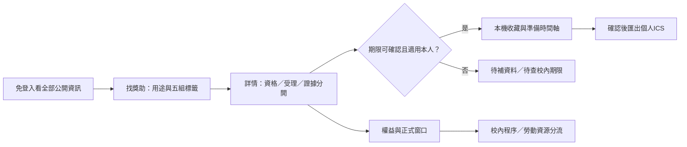
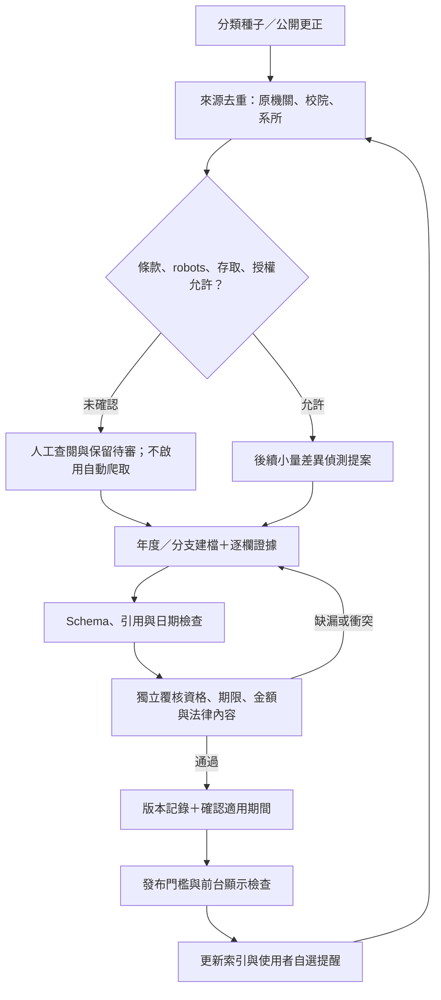

# 四頁線框與維護流程

狀態：設計審閱稿，尚非產品。以 [wireframes.html](wireframes.html) 在瀏覽器開啟，可用四個頁面錨點切換閱讀。只有文件導覽與原生展開；搜尋、篩選、收藏、提醒、匯出按鈕均為示意或停用，不執行資料處理、不儲存個人條件、不發送資料。

線框中的 P1 是合成情境，獎助例子連回10筆草稿的公開依據。日期快照固定2026-10-28；範例資料與線框是手工審閱文件，未與 JSON 自動同步；調整契約後再建立產品單一資料來源。

## 頁面與必須看見的資訊

| 畫面 | 主要任務 | 固定呈現 | 空值／錯誤狀態 |
|---|---|---|---|
| 01 找獎助 | 選用途、校院、五組 tag，查看結果 | 三軸狀態、年度、申請角色、最早適用學生期限 | 無相符結果仍可清除條件；未知不偷偷排除；未補個資仍可瀏覽 |
| 02 獎助詳情 | 看懂資格、程序、證據與待辦 | 逐項缺漏、所有層級期限、來源／版本、收藏位置 | 來源失效保留歷史標示；機關期限不能代替學生期限 |
| 03 我的時間軸 | 安排準備與追蹤 | 日期表與簡單視覺時間軸、未確認期限獨立區 | 缺日期不畫成今天；當日日期精度不足不顯示秒級倒數 |
| 04 權益與求助 | 查關係、給付依據、法規及分流 | 工資／獎助／成果獎分開、正式窗口、版本與隱私提醒 | 無法判定關係時可直接查窗口；不生成違法判定或申訴倒數 |

## 使用者流程

以上是規劃行為；本輪線框沒有實作儲存、篩選、ICS或通知。提醒以使用者選擇為前提，來源更新後重新比對；未核期限不產生肯定截止提醒。不得把推估日期冒充主辦公告。

## 資料維護流程

當期重大資料異動先降為待確認；重大期限更正需顯著標記。法規舊版不覆寫成新版，維持適用事件與時間。公文延遲僅研究公開可觀察／自願提供的時間，缺失值不補0，不把觀察變成責任歸因。

## 無障礙與手機

以 WCAG 2.2 AA 為產品驗收目標。本線框使用語意化標題、導覽、跳至內容、鍵盤焦點、可見文字狀態與文字時間表，不以顏色唯一表義。手機採單欄，篩選可原生展開，卡片換行；時間軸同時有清單，不要求拖曳。

本輪只作視覺與結構檢查，不宣稱完成 WCAG 認證或讀屏實測。產品階段補鍵盤全流程、讀屏名稱、400%縮放／320 CSS px重排、對比、觸控及自動檢查。

## 待確認與下一里程碑

- [ ] 同意四頁內容順序與三軸狀態。
- [ ] 同意五組 tag 與「不知道」顯示方式。
- [ ] 同意校內／機關期限分開，時間軸保留待確認區。
- [ ] 同意權益入口以正式依據、適用事實及分流為主，不承諾統一教授最低獎助。
- [ ] 確認 [資料契約](../DATA-CONTRACT.md)；指派來源維護與獨立覆核。

確認後才開始階段 B：核對當時穩定版工具、建靜態頁面、JSON單一來源、搜尋與五組標籤、詳情、本機設定／收藏、可解釋比對及ICS。依 [目前計畫](../PLAN.md) 收集20筆已覆核年度機會並滿足全國與開放數量門檻，否則維持候選版。
